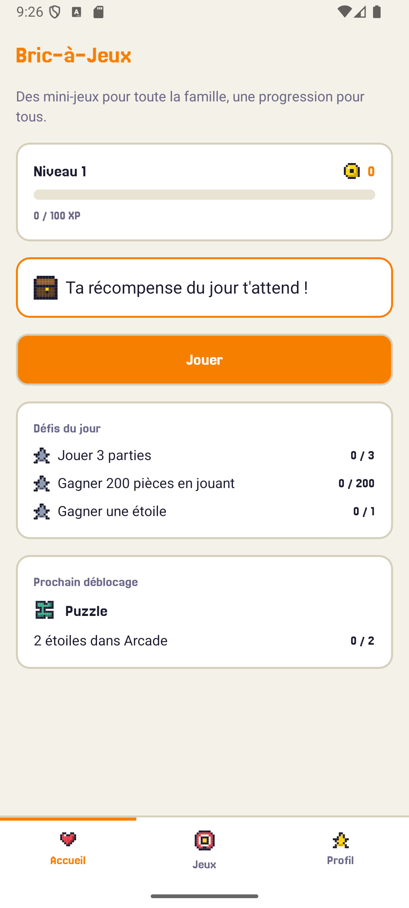
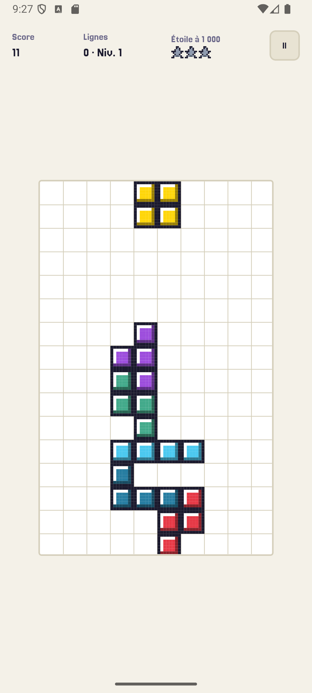
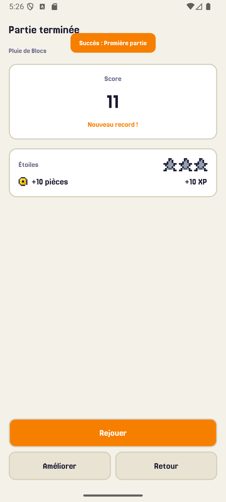

# Bric-à-Jeux

A family collection of one-finger mini-games in pixel art, tied together by one shared progression: stars, XP,
coins, upgrades, a daily reward and daily challenges. Made with React Native (Expo) for Android. The game speaks
French and English (it follows the phone's language; you can change it in the settings). English name:
**Game Grab-Bag**.

## Screenshots

<!-- factory:screenshots:start -->
<p>
  
  
  
</p>
<!-- factory:screenshots:end -->

## Play

Download the APK attached to the latest release (if any) or build it yourself (below), then install it on an
Android phone (allow installation from unknown sources).

35 mini-games in nine worlds (Arcade, Puzzle, Stratégie, Cartes, Bulles, Adresse, Exploration, Mémoire, Défis), all
played with one finger: falling blocks, match-3, bubble shooter, fruit fusion, pipes, mazes, card games, tower
defence, territory battles, memory and logic games... A world opens with stars and your level, and inside a world
each game opens with the stars earned there.

Every round earns stars (3 score thresholds per game), coins and XP. Coins buy upgrades for the games you like; a
daily reward calendar (miss a day and it starts again), three daily challenges and a game of the day (coins ×2 on
its rounds) reward coming back. The tenth world, Construction, is coming in a later version.

## Privacy

- No account, no ads, no purchases, no personal data. Your progress stays on your phone.
- The game can send anonymous usage statistics and crash reports (Firebase Analytics and Crashlytics)
  **only if you accept** on first launch; you can change your choice at any time in *Paramètres*. The events are
  listed in [docs/KPIS.md](docs/KPIS.md): rounds played, scores, unlocks, upgrades bought, rewards collected,
  settings changed. No identifier, no free text.
- This version is built without a Firebase project: nothing is sent at all, even after acceptance.

## Build from source

Requirements: Node.js 20+, JDK 17, Android SDK.

```bash
npm install
npm test
```

Firebase configuration is not part of this repository. To build with telemetry, create your own Firebase project
and place its `google-services.json` in `firebase/` (see [firebase/README.md](firebase/README.md)). Without it,
the game builds and runs with telemetry disabled.

Release signing reads `FACTORY_STORE_FILE`, `FACTORY_STORE_PASSWORD`, `FACTORY_KEY_ALIAS` and
`FACTORY_KEY_PASSWORD` from your user-level `~/.gradle/gradle.properties`; without them the release build is
signed with the debug key.

Sound effects are generated by `node scripts/generate-sounds.mjs`; the launcher icon and the splash image by `node scripts/generate-icons.mjs` (from the game sprites); the pixel font is Jersey 20 (OFL), see
[assets/LICENSES.md](assets/LICENSES.md).

## Project docs

- [Product requirements](docs/PRD.md)
- [Architecture decisions](docs/adr/)
- [Build plan](docs/PLAN.md)
- [KPIs and telemetry](docs/KPIS.md)
- [Device checks and test links](docs/DEVICE-CHECKS.md)
- [Verification evidence](docs/evidence/)
