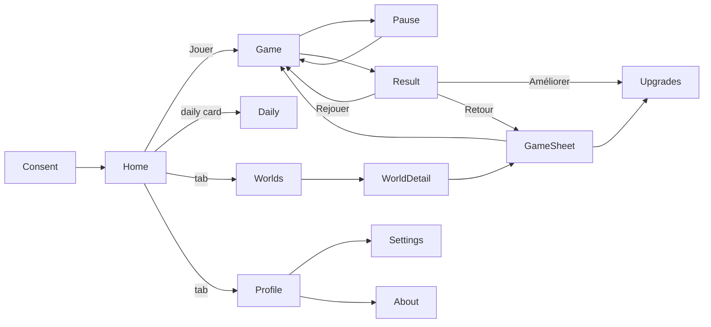

# PRD: Bric-à-Jeux

Status: approved
Project slug: mini-worlds
Final app name: Bric-à-Jeux
Android package: io.github.nhilaire.miniworlds
Version target: 0.1.0
Last updated: 2026-11-12 (amended after the first phone test of v0.1.0: blocks scoring and stars, tutorial fall, ghost piece, pixel font)

> Written in English. Player-facing text is quoted in the "Player copy" section, in every language of the game
> (`factory-app.json` "languages"; French is the reference).
> Status becomes `approved` only after the user explicitly approves this document.

## Summary

Bric-à-Jeux is a family collection of one-finger mini-games in pixel art, tied together by one shared progression.
v0.1.0 ships three mini-games in three different worlds (a falling-blocks arcade game, a turn-based match-3, a
bubble shooter) and the full meta-game core: stars of mastery, XP and global level, coins, per-game upgrades, a
7-day reward calendar, three daily challenges and achievements. Every round lasts 30 seconds to 3 minutes and feeds
the same profile, so playing any game brings the next unlock closer. No ads, no purchases, no account, no backend.
Pitch: « Des mini-jeux pour toute la famille, une progression pour tous. »

## Target players

- Families, parents included: casual players from about 7 years old (reading short sentences) to adults.
- Played on the couch, in transport or in a waiting room; the phone is held in one hand or passed around; a round
  is launched in a few seconds and lasts 30 s to 3 min.
- Accessibility: portrait, every control reachable with the thumb, large buttons, colour is never the only cue
  (each piece type has its own sprite shape), text rendered by the UI in a pixel font with a readable size.
- Tone: tu, light and encouraging.

## Core loop

1. The player opens the app, collects the daily reward if available, sees the three daily challenges.
2. Taps « Jouer » (last played game) or picks a game on the world map.
3. Plays a short round; the score, combos and stars feed the shared profile.
4. The result screen shows score, new best, stars, coins, XP and challenges completed; « Rejouer », « Améliorer »
   or « Retour ».
5. Spends coins on an upgrade of a favourite game, or chases the next star to unlock the next world.

What makes one more round tempting: a star threshold within reach, an upgrade almost affordable, a daily challenge
at 2/3, a world about to unlock. The player always sees the next goal.

## Use cases

| ID | As a player I want to... | So that... |
|---|---|---|
| UC-01 | choose whether to share anonymous statistics at first launch | my privacy is respected |
| UC-02 | start a round in two taps from Home | I can play during a short break |
| UC-03 | learn each mini-game during its first round, with short help bubbles | I never read a rulebook |
| UC-04 | play Pluie de Blocs, Potager Fou and Bulles en Folie with one finger in portrait | the games fit one hand |
| UC-05 | earn stars, coins and XP in every round | each game pushes the same progression |
| UC-06 | see the ten worlds and exactly what unlocks the next one | I never feel blocked arbitrarily |
| UC-07 | buy upgrades for the games I like, with coins earned anywhere | my favourite game gets better |
| UC-08 | collect a reward every day and complete three daily challenges | coming back every day is rewarded |
| UC-09 | unlock achievements shown on my profile | my milestones are visible |
| UC-10 | see my best score and stars per game and my global stats | I can measure my progress |
| UC-11 | pause a round, resume it, or leave it | an interruption does not cost me the round |
| UC-12 | turn sound, vibrations and statistics on or off, pick a theme and a language | the game fits the moment and my choices |
| UC-13 | read why the game exists and who made it | I know the game's story |
| UC-14 | reset my progression | another family member can start from scratch |

## Screens

Three bottom tabs: Accueil (Home), Jeux (Games), Profil (Profile). A game is at most two taps from Home.

- **Consent** (first launch only): explains the anonymous statistics; « Accepter » and « Refuser » equally visible.
- **Home** (tab): level badge and XP bar (« Niveau 4 · 120 / 400 XP »), coin balance, daily reward card when a
  reward is available (opens Daily reward), big « Jouer » button (opens the last played game, or Pluie de Blocs
  if none), the three daily challenges with progress (« 2 / 3 »), « Prochain déblocage » card (world name and
  progress of each condition), « Derniers jeux » row (up to 3 game chips, tap opens the game sheet).
- **Worlds** (tab « Jeux »): vertical list of the 10 world cards: pixel icon, name, state (open / locked /
  coming soon), stars « 2 / 3 » (available stars = 3 × games present), games « 1 / 5 ». A locked world shows
  its condition(s) with progress; a coming-soon world shows « Bientôt » and its indicative condition. Tap on an
  open world opens World detail; tap on a locked or coming-soon world shows the conditions in a sheet.
- **World detail**: name and colour of the world, five slots: the game (icon, name, best score, stars, upgrade
  badge if one is affordable) and four « Bientôt » slots. Tap on the game opens the Game sheet.
- **Game sheet**: large pixel illustration, name, one-line description, « Jouer », best score, stars with their
  thresholds (« 500 · 1500 · 3000 »), « Améliorations » (with the count of affordable upgrades), « Revoir le
  tutoriel » (re-enables the guided round). Android back returns to World detail.
- **Upgrades**: the three upgrades of the game as cards: name, effect, current level « 1 / 3 », next effect,
  cost, « Acheter » (disabled when unaffordable or maxed, « Max » when maxed). Purchase is immediate; the coin
  balance is shown at the top.
- **Game** (one layout per mini-game, see Rules): HUD with score, the game-specific counter (lines, moves left,
  shots before next row), the next star threshold, « Pause » button; the board takes most of the screen.
  Guided first round: help bubbles (see Rules / Tutorial). Android back opens Pause.
- **Pause** (overlay): « Reprendre », « Recommencer », « Quitter » (quitting ends the round with the current
  score, which counts like any round).
- **Result**: animation (score counts up, stars light up one by one, coins and XP fly to their counters), score,
  « Nouveau record ! » when applicable, stars earned (new ones highlighted), coins and XP earned, level-up
  banner when applicable, challenges completed in this round, « Rejouer », « Améliorer », « Retour ».
- **Daily reward**: calendar of 7 days with today's reward highlighted and past days checked, one button
  « Récupérer » (then « Récupéré » and the next day's reward shown). Reached from the Home card.
- **Profile** (tab): avatar (pixel), level and XP, stats (rounds played, games discovered, stars « 4 / 9 »,
  coins earned in total, days played), achievements grid (locked ones greyed with their condition), buttons
  « Paramètres » and « À propos ».
- **Settings**: Son, Vibrations, Thème (Automatique / Clair / Sombre), Langue (Automatique / Français / English),
  Statistiques anonymes (with help text), « Réinitialiser la progression » (confirmation dialog), « Retour ».
- **About** (« À propos »): the story of the game (`about.story`), « Un mot de l'auteur », « Tes données »,
  version; « Retour ».

## Rules and scoring

### Randomness and determinism

All randomness (piece bags, board generation, bubble colours, challenge draw) goes through one seeded
pseudo-random generator. The seed is random in normal play. Opening the app through the deep link
`miniworlds://seed/<integer>` fixes the seed for the session (used by Maestro flows; it has no effect on the
save file). The variant `miniworlds://seed/<integer>/unlocked` also opens every world of this version in memory
for the session and suppresses every write to the save (Maestro flows of Potager Fou and Bulles en Folie).

### Worlds and unlocks

| # | World (fr / en) | v0.1.0 content | Unlock condition |
|---|---|---|---|
| 1 | Arcade / Arcade | Pluie de Blocs | open from the start |
| 2 | Puzzle / Puzzle | Potager Fou | 2 stars in world 1 |
| 3 | Stratégie / Strategy | coming soon | 6 stars in total (indicative) |
| 4 | Cartes / Cards | coming soon | level 8 (indicative) |
| 5 | Bulles / Bubbles | Bulles en Folie | 4 stars in total AND level 3 |
| 6 | Adresse / Skill | coming soon | 9 stars in total (indicative) |
| 7 | Construction / Building | coming soon | level 12 (indicative) |
| 8 | Exploration / Exploration | coming soon | level 15 (indicative) |
| 9 | Mémoire / Memory | coming soon | level 18 (indicative) |
| 10 | Défis / Challenges | coming soon | level 25 (indicative) |

A world is unlocked the moment its conditions are met (checked after every round and level-up); the unlock is
announced on the Result screen (« Monde débloqué : Puzzle ! ») and the world card changes state. Coming-soon
worlds never unlock in v0.1.0 even when their indicative condition is met: their card keeps « Bientôt » and the
condition is shown as « à venir ». Unlocks are permanent.

### Stars

Each game has three score thresholds. A star is earned when the round score reaches the threshold; stars are kept
forever (a lower score later never removes one). 9 stars exist in v0.1.0.

| Game | 1 star | 2 stars | 3 stars |
|---|---|---|---|
| Pluie de Blocs | 1 000 | 2 500 | 5 000 |
| Potager Fou | 1 500 | 3 000 | 5 000 |
| Bulles en Folie | 800 | 2 000 | 4 000 |

### XP and global level

- XP per round = 10 + floor(score / 50), capped at 100; plus 25 XP per new star earned in that round.
- Level starts at 1. XP needed to go from level L to L+1 = 100 × L (1→2: 100, 2→3: 200, 3→4: 300...).
  XP in excess carries over; several levels can be gained in one round. Level cap: 50 (XP still accumulates).
- Level-up reward: 50 × new level coins, granted immediately and shown on the Result screen, or on the Daily
  reward screen when the level-up comes from the day-7 XP (same for a world unlock triggered there).

### Coins

- Coins per round = 10 + floor(score / 25), multiplied by the game's « Bonus pièces » upgrade (1 + 0.10 × level),
  rounded down; plus 50 coins per new star earned in that round.
- Other sources: level-up rewards, daily rewards, daily challenges, achievements. Coins are only spent on
  upgrades (v0.1.0). The balance never goes negative; purchases are refused when unaffordable.
- Lifetime coins earned (never decreased) is kept for stats and achievements.

### Upgrades

Each game has three upgrades with three levels each. Cost of level 1 / 2 / 3: 100 / 250 / 500 coins (same for every
upgrade). Buying is immediate; the effect applies from the next round.

| Game | Upgrade (fr) | Effect per level |
|---|---|---|
| Pluie de Blocs | Aperçu | shows the next 1 / 2 / 3 pieces (0 without the upgrade) |
| Pluie de Blocs | Départ en douceur | initial fall interval 800 ms + 80 ms per level |
| Pluie de Blocs | Bonus pièces | coins per round +10 % per level |
| Potager Fou | Coup en plus | +1 move per level (20 → 23) |
| Potager Fou | Récolte en cascade | cascade multiplier +0.5 per level (see scoring) |
| Potager Fou | Bonus pièces | coins per round +10 % per level |
| Bulles en Folie | Visée | aim guide shows 0 / 1 / 2 / 3 wall bounces |
| Bulles en Folie | Prochaine bulle | shows the next 1 / 2 / 3 bubbles (0 without the upgrade) |
| Bulles en Folie | Bonus pièces | coins per round +10 % per level |

### Daily reward

- Calendar of 7 days: 100, 150, 200, 250, 300, 400, 600 coins; day 7 also grants 100 XP.
- A day is identified by the device's local date (YYYY-MM-DD). The reward can be collected at most once per local
  date. The save keeps `lastCollectedDate` (none at first) and `calendarDay` (0 at first, then 1-7): without
  `lastCollectedDate`, the first collection is day 1.
- Collecting on the day after `lastCollectedDate` advances `calendarDay` by one (8 wraps to 1). A gap of exactly
  one missed day keeps `calendarDay` (the player collects the same day again). A gap of two or more missed days
  resets `calendarDay` to 1. A device date earlier than `lastCollectedDate` counts as already collected.
- The Home card appears when the reward is collectable; the reward is added when « Récupérer » is tapped (never
  silently).

### Daily challenges

- Three challenges per local date: « Jouer 3 parties » is always the first; the two others are drawn without
  replacement from the rest of the pool below with the seeded generator (seed = hash of the date, or the session
  seed when the app was opened through the seed deep link), among challenges whose game (if any) is unlocked
  (« Jouer à 2 jeux différents » needs at least 2 unlocked games). The draw is recomputed when the date changes;
  progress of the previous date is discarded.
- Progress is counted from rounds ended on that date (including rounds quit from Pause). Each completed
  challenge grants its reward once; completing all three grants 100 bonus coins.

| ID | Challenge (fr) | Target | Reward |
|---|---|---|---|
| rounds3 | Jouer 3 parties | 3 rounds | 50 coins |
| games2 | Jouer à 2 jeux différents | 2 distinct games | 50 coins |
| star1 | Gagner une étoile | 1 new star | 75 coins |
| combos5 | Faire 5 combos | 5 combos (see per-game definition) | 75 coins |
| coins200 | Gagner 200 pièces en jouant | 200 coins from rounds | 50 XP |
| score_blocks | Marquer 1000 points à Pluie de Blocs | one round ≥ 1000 | 75 coins |
| score_garden | Marquer 1500 points à Potager Fou | one round ≥ 1500 | 75 coins |
| score_bubbles | Marquer 800 points à Bulles en Folie | one round ≥ 800 | 75 coins |

### Achievements

| ID | Name (fr) | Condition | Reward |
|---|---|---|---|
| first_round | Première partie | 1 round ended | 25 coins |
| rounds10 | Dix parties | 10 rounds | 50 coins |
| rounds100 | Cent parties | 100 rounds | 200 coins |
| first_star | Première étoile | 1 star | 50 coins |
| all_stars | Ciel étoilé | 9 stars | 500 coins |
| explorer | Explorateur | 3 games played at least once | 100 coins |
| first_upgrade | Bricoleur | 1 upgrade bought | 50 coins |
| maxed_upgrade | Expert | 1 upgrade at level 3 | 150 coins |
| level5 | Niveau 5 | level 5 | 100 coins |
| level10 | Niveau 10 | level 10 | 250 coins |
| week | Semaine complète | day 7 of the calendar collected | 200 coins |
| rich | Trésor | 5 000 coins earned in total | 150 coins |

Achievements are checked after every round, purchase and collection; each unlocks once and is announced with a
toast (« Succès : Première étoile ») and listed on the Profile.

### Common mini-game contract

Every mini-game implements the same interface: `init(seed, upgrades)`, `start()`, `pause()`, `resume()`,
`input(event)`, `tick(dt)` (real-time games), `state()` for rendering, and emits `combo` and `end(score)`.
The core engine, not the game, converts the score into stars, coins, XP, challenge progress and achievements.
A round quit from Pause ends with the current score. « Recommencer » ends the current round like « Quitter »
(settled, outcome quit) and starts a new one. Backgrounding the app pauses a running round and shows the Pause
overlay on return.

Short rounds: a round that lasted less than 20 s (paused time excluded) is not settled: no coins, no XP, no star,
no best score, it does not count as a round for stats, challenges and achievements. The Result screen shows the
score and « Partie trop courte : pas de récompense ». This prevents farming the fixed part of the rewards by
quitting at once.

### Pluie de Blocs (world Arcade)

- Board 10 columns × 16 rows; 7 tetrominoes (I, O, T, S, Z, J, L) drawn with a 7-bag; spawn centred at the top.
- Controls: horizontal drag moves the piece one cell per 1/10 of the board width; tap rotates clockwise (wall
  kicks: try 1 cell left then right; otherwise the rotation is refused); swipe down hard-drops.
- Gravity: the piece falls one row every interval; interval (ms) = max(150, 800 + 80 × slowStartLevel − 50 ×
  floor(lines / 10)). The « level » shown is floor(lines / 10) + 1.
- Lock: a piece that cannot fall locks after 300 ms; completed rows disappear; rows above shift down.
- Scoring: 1 / 2 / 3 / 4 lines at once = 100 / 300 / 500 / 800 points; hard drop = 1 point per row dropped
  (1 point, not more: the stars must reward lines, not drops).
  Back-to-back: clearing lines with two consecutive locked pieces adds 50 × (chain length − 1).
- Combo (for challenges): a clear of 2 or more lines at once, or a back-to-back clear.
- End: a new piece overlaps existing blocks at spawn. Expected round: 1-3 min.
- Ghost piece: the landing position of the current piece is outlined for the first 5 locked pieces of each
  round, then hidden (the player has seen how the piece lands; the shadow would clutter the board afterwards).
- Tutorial bubbles (guided first round, fall slowed to one row every 2 s while a bubble is shown, normal
  interval from the moment the last bubble is dismissed): « Glisse pour déplacer » (dismissed
  by a horizontal drag), « Touche pour tourner » (by a tap), « Glisse vers le bas pour lâcher » (by a swipe down).

### Potager Fou (world Puzzle)

- Board 7 columns × 8 rows; 5 vegetable types (carotte, tomate, aubergine, maïs, brocoli), each with its own
  colour and sprite shape. From the 11th move, the refill also draws a 6th type (oignon).
- Initial board: generated without any existing line of 3 and with at least one valid move. When no valid move
  exists after cascades, the board is shuffled automatically: the result has no line of 3 and at least one valid
  move, scores nothing and consumes no move.
- Controls: swipe on a piece towards a neighbour swaps them. A swap that creates no line of 3 bounces back and
  does not consume a move. A valid swap consumes one move.
- Moves: 20 (+ « Coup en plus »). The HUD shows moves left.
- Matching: lines of 3+ identical pieces (horizontal or vertical) are removed; pieces above fall; new pieces
  refill from the top; cascades repeat until no line exists.
- Scoring: line of 3 = 100, of 4 = 200, of 5+ = 400 (an L or T shape counts its lines separately). Cascade
  multiplier: lines removed in the k-th cascade step (k = 1 for the direct result of the swap) are multiplied by
  1 + (k − 1) × m, with m = 1 (+0.5 per « Récolte en cascade » level).
- Combo (for challenges): a cascade step with k ≥ 2.
- End: no move left (after the last cascade). Expected round: 1-2 min.
- Tutorial bubble: « Glisse un légume vers son voisin pour aligner 3 identiques » (dismissed by a valid swap).

### Bulles en Folie (world Bubbles)

- Grid of 9 columns, rows offset by half a bubble (hexagonal packing), 12 rows visible; the launcher is below
  row 12. Start: 5 rows filled. 5 colours (rouge, jaune, vert, bleu, violet), each with its own face sprite.
- Controls: touch and drag anywhere to aim (the guide line shows the direction, and bounces per « Visée »
  level); release to shoot. Drag released below an angle of 10° from the horizontal does not shoot.
- The bubble flies in a straight line at constant speed, bounces on the side walls, and snaps to the nearest
  free cell adjacent to the first bubble (or the top row) it touches.
- Pop: a group of 3+ same-colour bubbles including the new one is removed; bubbles no longer connected to the
  top row then drop.
- Scoring: 10 points per popped bubble, 20 per dropped bubble. The next colour is drawn among colours still on
  the board.
- Pressure: a new row is pushed from the top every 6 shots; every 5 shots after 20 shots; every 4 after 40.
  The HUD shows shots left before the next row.
- Combo (for challenges): a shot that pops 5+ bubbles or drops at least one bubble.
- End: any bubble occupies row 12 (by snap or by a row push). An empty board grants 500 bonus points, is
  refilled with 5 rows and the round continues; the shot counter is not reset. Expected round: 1-3 min.
- Tutorial bubbles: « Garde le doigt appuyé pour viser » (dismissed after a drag of 0.5 s), « Relâche pour
  tirer » (by a release that shoots).

### Tutorial (guided first round)

The first round of each game shows its help bubbles in order; each disappears when its action is performed. The
flag `tutorialDone[game]` is saved when the last bubble is dismissed; « Revoir le tutoriel » on the Game sheet
clears it. Real-time games pause their timers while a bubble is shown.

### Persistence

- One local save (AsyncStorage, key `save`), JSON with `schemaVersion: 1`, written after every change
  (debounced 300 ms) and read at start. Content: profile (xp, level, coins, lifetimeCoins, roundsPlayed,
  daysPlayed, lastPlayedDate, lastPlayedGame), per-game data keyed by game id (bestScore, stars, rounds,
  upgrades levels, tutorialDone), unlockedWorlds, daily reward state, daily challenges state (date, ids,
  progress, completed), achievements unlocked, settings (sound, vibrations, theme, language, consent).
- Unknown game ids and unknown fields are preserved, not dropped; a missing field takes its default. A save with
  a higher schemaVersion than the app knows is kept untouched: the app starts with defaults in memory and
  suppresses every write for that session (read-only session).
- « Réinitialiser la progression » clears everything except settings and consent.

## Look, sound and feel

- Pixel art drawn in code: each sprite is a small grid (8×8 to 16×16) of palette indices in TypeScript, rendered
  with crisp scaling; UI chrome uses rounded pixel frames. Limited palette, colour-blind safe (every game piece has
  a distinct shape). Free pixel font (Pixelify Sans, OFL, Regular and Bold; softer than Press Start 2P, which the first phone test found
  too harsh) for titles and HUD, a readable pixel or
  system font for body text. No external image file, no copyrighted material; game and world names are original.
- Theme: follows the phone (light / dark) with a choice in Settings; each world has a dominant colour.
- Animations: short and juicy (≤ 400 ms): piece lock flash, line clear, cascades, bubble pop and drop, result
  count-up, stars lighting one by one, coins flying to the counter, level-up banner, world unlock reveal.
- Sound effects only (no music): move/rotate, line clear, match, cascade, pop, drop, star, coin, level-up,
  reward, button. Haptics: light tick on key events (line clear, match, pop, star, reward). Both toggles in
  Settings. Portrait only.

## Telemetry events

Only events listed here may be sent (after consent). Params: numbers, booleans or short enums. No identifiers.
`game` ∈ {blocks, garden, bubbles}; `world` ∈ {arcade, puzzle, bubbles}; `outcome` ∈ {ended, quit, short}.

| Event | When | Params | Feeds KPI |
|---|---|---|---|
| round_start | a round starts | game | Rounds per session, Rounds per game |
| round_end | a round ends (end or quit) | game, score, duration_s, stars_new, outcome | Score distribution, Rounds per game |
| tutorial_complete | last help bubble dismissed | game | Tutorial completion |
| level_up | the level increases | level | Level funnel |
| world_unlock | a world unlocks | world | World unlock rate |
| upgrade_buy | an upgrade is bought | game, upgrade (enum), level | Upgrade purchases, Replay after upgrade |
| daily_reward_collect | the daily reward is collected | day | Daily reward rate |
| daily_challenge_complete | a challenge completes | challenge (enum) | Challenge completion |
| achievement_unlock | an achievement unlocks | achievement (enum) | Achievement progress |
| settings_change | a setting changes | setting (enum), value (enum) | Settings usage |

## KPIs

Business and technical indicators followed in Firebase (free Spark plan). Details and console paths in `docs/KPIS.md`.

| KPI | Type | Target | Source |
|---|---|---|---|
| D1 retention | business | ≥ 35 % | Analytics > Retention |
| D7 retention | business | ≥ 15 % | Analytics > Retention |
| Rounds per session | business | ≥ 3 | `round_start` count / `session_start` count |
| Rounds per game | business | no game < 20 % of rounds | `round_start` by `game` |
| World unlock rate | business | ≥ 60 % of users unlock Puzzle, ≥ 30 % Bubbles | `world_unlock` by `world` / users |
| Daily reward rate | business | ≥ 50 % of DAU collect | `daily_reward_collect` / DAU |
| Replay after upgrade | business | ≥ 70 % of `upgrade_buy` followed by `round_start` in the session | Funnel exploration upgrade_buy → round_start |
| Challenge completion | business | ≥ 1 `daily_challenge_complete` per DAU | `daily_challenge_complete` / DAU |
| Upgrade purchases | business | ≥ 2 `upgrade_buy` per user in the first week | `upgrade_buy` by `game` / users |
| Tutorial completion | business | ≥ 90 % of users with `round_start` on a game send `tutorial_complete` for it | funnel round_start → tutorial_complete by `game` |
| Level funnel | business | ≥ 50 % of users reach level 3, ≥ 20 % level 10 | `level_up` by `level` / users |
| Score distribution | business | tracked (median per game, used to rebalance star thresholds) | `round_end` metric `score` by `game` |
| Achievement progress | business | tracked (users with ≥ 3 achievements) | `achievement_unlock` / users |
| Settings usage | business | tracked (share of users changing language or theme) | `settings_change` by `setting` |
| Consent rate | business | tracked (approximation: users with events vs installs; refusals send nothing) | Analytics users vs Play installs |
| Crash-free users | technical | ≥ 99 % | Crashlytics |
| Cold start | technical | < 3 s | evidence report (`verify.mjs`) |

## Non-functional requirements

- Performance: smooth on a mid-range Android phone (no visible jank during play, real-time games at the display
  refresh rate), cold start < 3 s.
- APK size (arm64): target < 40 MB (< 55 MB if the stack ADR picks a GL/Skia renderer).
- Works fully offline. No account. No ads. No in-app purchases.
- Android: minSdk from the stack defaults; portrait only.
- Privacy: opt-in telemetry, no personal data, AD_ID permission removed.
- Game logic (the three games and the core engine) is pure TypeScript without React, unit-testable and
  deterministic under a seed.

## Acceptance criteria

Each criterion is testable and tagged with its proof: `[unit]` Jest, `[e2e]` Maestro flow, `[device]` check on the
phone, `[manual]` human judgement (keep these rare).

Languages and consent

- AC-01 [e2e] Given a first launch on a French phone, when the app opens, then the consent screen is shown in
  French with « Accepter » and « Refuser » equally visible; tapping « Refuser » shows Home and the consent
  screen never comes back.
- AC-02 [unit] Given a phone in English / in French / in an unsupported language (e.g. de), then the UI language
  resolves to en / fr / en.
- AC-03 [e2e] Given Settings, when the player picks « English », then the whole UI switches at once (tabs,
  « Settings », « Sound ») and the choice survives a restart; « Automatique » follows the phone again.
- AC-04 [device] Given the release APK, when `aapt dump badging` is read, then the application label is
  « Bric-à-Jeux » for `fr` and « Game Grab-Bag » for `en` and by default (the default resource carries the
  fallback language, English, so a phone in an unsupported language shows the same language under the icon as in
  the game).
- AC-05 [unit] Given the dictionaries `fr.ts` and `en.ts`, then they have exactly the same keys and shapes and
  no value is empty; every mini-game, world, upgrade, challenge and achievement has a name in both.

Core engine

- AC-06 [unit] Given a round score s and n new stars, when the round is settled, then XP = min(100, 10 +
  floor(s / 50)) + 25 n and coins = floor((10 + floor(s / 25)) × (1 + 0.1 × bonusLevel)) + 50 n (examples:
  s = 3000, n = 1, bonus 0 → 95 XP and 180 coins; s = 0, n = 0 → 10 XP, 10 coins); given a round shorter than
  20 s, when it ends, then it grants nothing and is not counted.
- AC-07 [unit] Given level L and XP, when XP reaches 100 × L, then the level becomes L+1, the excess carries
  over, the level-up grants 50 × (L+1) coins, and one round can gain several levels (e.g. 350 XP at level 1 →
  level 3 with 50 XP left and 100 + 150 coins); the level never exceeds 50.
- AC-08 [unit] Given the star thresholds, when a round scores exactly a threshold, then the star is earned; a
  later lower score keeps every star; stars earned twice are not counted twice.
- AC-09 [unit] Given the unlock rules, then world 1 is open at start; world 2 unlocks exactly when world 1 has 2
  stars; world 5 unlocks exactly when total stars ≥ 4 and level ≥ 3 (not before, e.g. 4 stars at level 2); worlds
  3, 4, 6-10 never unlock in v0.1.0; unlocks are permanent.
- AC-10 [unit] Given 300 coins, when the player buys an upgrade at level 0, then its level is 1 and 200 coins
  remain; buying level 2 (250) is then refused as unaffordable; levels above 3 are refused; costs are 100 / 250 /
  500.
- AC-11 [unit] Given the daily reward state, when the player collects on consecutive local dates, then the first
  collection is day 1 and the calendar advances 1 → 2 → ... → 7 → 1 with rewards 100 / 150 / 200 / 250 / 300 / 400 / 600 (+100 XP on day
  7); a second collection on the same date is refused; a one-day gap keeps the calendar day; a two-day gap resets
  it to 1; a device date earlier than the last collection is treated as collected.
- AC-12 [unit] Given a date and the unlocked games, when the three daily challenges are drawn, then the first is
  « Jouer 3 parties », the two others are distinct challenges from the pool, only referring to unlocked games
  (« Jouer à 2 jeux différents » only with 2+ unlocked games), identical for the same date and unlocked set (or
  for the same session seed), and progress is discarded when the date changes.
- AC-13 [unit] Given the challenges of the day, when rounds end, then each challenge's progress follows its
  definition (rounds, distinct games, new star, combos, coins from rounds, score per game), each reward is
  granted once, and 100 bonus coins are granted when the third completes.
- AC-14 [unit] Given the achievement list, when rounds, stars, upgrades, levels, calendar day 7 and lifetime
  coins reach each condition, then the matching achievement unlocks exactly once with its reward.
- AC-15 [unit] Given a save file, when it is written and read back, then the state is identical; a save with
  missing fields takes defaults; unknown game ids and fields are preserved; a higher schemaVersion is left
  untouched, the app starts with defaults and writes nothing during that session; « Réinitialiser » clears everything except settings and consent.
- AC-16 [unit] Given the same seed, when a game is played with the same inputs twice, then the states and scores
  are identical (all three games).

Pluie de Blocs

- AC-17 [unit] Given a 7-bag generator, then every 7 consecutive pieces contain each tetromino once.
- AC-18 [unit] Given a piece, when it is moved, rotated (with wall kicks) or hard-dropped, then it never overlaps
  blocks or leaves the board, a refused rotation leaves the piece unchanged, and a hard drop scores 1 point per
  row.
- AC-19 [unit] Given completed rows, when a piece locks, then 1 / 2 / 3 / 4 rows score 100 / 300 / 500 / 800,
  rows above shift down, back-to-back clears add 50 × (chain − 1), and the fall interval is max(150, 800 + 80 × slowStartLevel − 50 ×
  floor(lines / 10)) ms (e.g. 200 lines, level 3: 150 ms).
- AC-20 [unit] Given a stack reaching the spawn area, when the next piece cannot spawn, then the round ends with
  the current score.
- AC-21 [e2e] Given Home on a fresh install, when « Jouer » is tapped, then Pluie de Blocs starts with the bubble
  « Glisse pour déplacer », the three bubbles are dismissed by their actions, and quitting from Pause after at least 20 s shows
  the Result screen with score, stars, coins and XP.

Potager Fou

- AC-22 [unit] Given a seeded initial board, then it contains no line of 3 and at least one valid move; when no
  valid move exists after a cascade, then the board is shuffled into one with no line of 3 and at least one valid
  move, scoring nothing and consuming no move.
- AC-23 [unit] Given a swap, when it creates no line, then the pieces bounce back and no move is consumed; when it
  creates a line, then one move is consumed, lines of 3 / 4 / 5+ score 100 / 200 / 400 and pieces fall and
  refill.
- AC-24 [unit] Given a swap that triggers two cascade steps, then step 2 is multiplied by 1 + m (m = 1 + 0.5 ×
  upgrade level) and counts one combo; from the 11th move the refill may draw the 6th type and never before.
- AC-25 [unit] Given 20 moves (+ « Coup en plus »), when the last move's cascades finish, then the round ends.
- AC-26 [e2e] Given the seed deep link, when Potager Fou is started and the scripted first swap is made, then the
  score and moves-left counter update as the engine predicts for that seed.

Bulles en Folie

- AC-27 [unit] Given a shot direction, when the bubble flies, then it bounces on walls and snaps to the nearest
  free cell adjacent to the first bubble (or top row) hit; a release under 10° does not shoot.
- AC-28 [unit] Given a snapped bubble, when it forms a group of 3+ of its colour, then the group pops (10 each),
  disconnected bubbles drop (20 each), and the next colour is drawn only among colours still present.
- AC-29 [unit] Given the shot counter, then a row is pushed every 6 shots, every 5 after 20 shots, every 4 after
  40; any bubble on row 12 (snapped or pushed) ends the round; an empty board grants 500 and refills 5 rows
  without resetting the shot counter.
- AC-30 [e2e] Given the seed deep link, when Bulles en Folie is started and one scripted shot is made, then the
  score updates as predicted and the Pause / Quitter path shows the Result screen.

Screens and flow

- AC-31 [e2e] Given Home, when « Jeux » is tapped, then the 10 world cards are listed, Arcade open, Puzzle and
  Bulles locked with their conditions, the others « Bientôt »; tapping Arcade shows Pluie de Blocs and four
  « Bientôt » slots; tapping the game shows its sheet with « Jouer ».
- AC-32 [e2e] Given the Game sheet, when « Améliorations » is opened with 0 coins, then the three upgrades are
  listed with « 0 / 3 » and « Acheter » disabled.
- AC-33 [unit] Given the Result screen data, when a round earns a new star, a level-up or unlocks a world, then
  the screen shows « Nouveau record ! » only on a new best, the new stars, the level-up banner and the unlock
  message as applicable.
- AC-34 [e2e] Given a fresh install, when Home is shown, then the daily reward card is visible; tapping it and
  « Récupérer » adds 100 coins to the balance and the card disappears until the next day.
- AC-35 [e2e] Given Home, then three daily challenges are shown, the first being « Jouer 3 parties » at
  « 0 / 3 »; after one settled round (≥ 20 s) it shows « 1 / 3 ».
- AC-36 [e2e] Given Profile, when « Paramètres » is opened and « Son », « Vibrations », « Thème » and
  « Statistiques anonymes » are changed, then the choices survive a restart.
- AC-37 [e2e] Given Settings, when « Réinitialiser la progression » is confirmed, then coins, XP, stars and
  unlocks are back to the initial state and the language and consent are kept.
- AC-38 [e2e] Given Profile, when « À propos » is tapped, then the About screen shows the story
  (`about.story`), « Un mot de l'auteur », « Tes données » and « Version 0.1.0 ».
- AC-39 [unit] Given a running round, when the app goes to background, then the round is paused and the same
  state is shown with the Pause overlay on return.

Telemetry and technical

- AC-40 [unit] Given the telemetry module, when each event of the table is logged, then its name and params match
  the table (enums only, no free text) and nothing is sent when consent is refused or statistics are turned off.
- AC-41 [device] Given consent accepted on the emulator, when a round is played to the end, an upgrade bought
  and the daily reward collected, then `round_start`, `round_end`, `upgrade_buy` and `daily_reward_collect` appear
  in logcat.
- AC-42 [device] Given the release APK, when its manifest is inspected, then it has no AD_ID, INTERNET-only
  network permission and no RECORD_AUDIO or location permission.
- AC-43 [device] Given the release APK on the emulator, when it is cold started, then the first screen is shown in
  less than 3 s and no crash is reported.
- AC-44 [unit] Given the pixel sprite definitions, then every sprite references only palette indices that exist
  and every game piece type has a distinct sprite.
- AC-45 [manual] Given the release APK on the user's phone, when each game is played for a few rounds, then the
  controls feel responsive, the animations are short and readable, and a round lasts 30 s to 3 min.
- AC-46 [unit] Given a round of Pluie de Blocs, then the ghost piece (landing outline) is available while fewer than 5
  pieces have locked and is null from the 5th locked piece on; a new round shows it again.
- AC-47 [unit] Given a tutorial bubble shown in Pluie de Blocs, when the engine ticks in tutorial mode, then the piece
  falls one row every 2 000 ms (whatever the slow-start level), and at the normal interval once the tutorial
  mode ends; the guided first round therefore never freezes.
- AC-48 [unit] Given the app fonts, then titles and HUD use Pixelify Sans (Regular and Bold files present, loaded at
  start, listed in assets/LICENSES.md under the OFL) and Press Start 2P is no longer shipped.

## Player copy

Final app name: fr « Bric-à-Jeux », en « Game Grab-Bag ». No language-specific asset (sprites contain no text,
no spoken audio). French tone: tu.

| Key | fr | en |
|---|---|---|
| app.name | Bric-à-Jeux | Game Grab-Bag |
| app.pitch | Des mini-jeux pour toute la famille, une progression pour tous. | Mini-games for the whole family, one progression for all. |
| consent.title | Statistiques anonymes | Anonymous statistics |
| consent.body | Pour améliorer le jeu, Bric-à-Jeux peut envoyer des statistiques anonymes (parties jouées, scores, déblocages, plantages). Aucune donnée personnelle. Tu peux changer d'avis dans les paramètres. | To improve the game, Game Grab-Bag can send anonymous statistics (rounds played, scores, unlocks, crashes). No personal data. You can change your mind in the settings. |
| consent.accept | Accepter | Accept |
| consent.refuse | Refuser | Decline |
| tabs.home | Accueil | Home |
| tabs.games | Jeux | Games |
| tabs.profile | Profil | Profile |
| home.level | Niveau {level} | Level {level} |
| home.xp | {xp} / {next} XP | {xp} / {next} XP |
| home.play | Jouer | Play |
| home.dailyReady | Ta récompense du jour t'attend ! | Your daily reward is waiting! |
| home.challenges | Défis du jour | Daily challenges |
| home.nextUnlock | Prochain déblocage | Next unlock |
| home.recent | Derniers jeux | Recent games |
| worlds.title | Les mondes | Worlds |
| worlds.stars | {got} / {total} étoiles | {got} / {total} stars |
| worlds.games | {got} / {total} jeux | {got} / {total} games |
| worlds.locked | Verrouillé | Locked |
| worlds.soon | Bientôt | Coming soon |
| worlds.condition.starsIn | {n} étoiles dans {world} | {n} stars in {world} |
| worlds.condition.starsTotal | {n} étoiles au total | {n} stars in total |
| worlds.condition.level | Niveau {n} | Level {n} |
| worlds.conditionSoon | À venir : {condition} | Later: {condition} |
| world.arcade | Arcade | Arcade |
| world.puzzle | Puzzle | Puzzle |
| world.strategy | Stratégie | Strategy |
| world.cards | Cartes | Cards |
| world.bubbles | Bulles | Bubbles |
| world.skill | Adresse | Skill |
| world.building | Construction | Building |
| world.exploration | Exploration | Exploration |
| world.memory | Mémoire | Memory |
| world.challenges | Défis | Challenges |
| game.blocks.name | Pluie de Blocs | Block Rain |
| game.blocks.desc | Empile les blocs, complète des lignes, tiens le plus longtemps possible. | Stack the blocks, clear lines, last as long as you can. |
| game.garden.name | Potager Fou | Crazy Patch |
| game.garden.desc | Aligne 3 légumes identiques en {n} coups. | Line up 3 identical vegetables in {n} moves. |
| game.bubbles.name | Bulles en Folie | Bubble Frenzy |
| game.bubbles.desc | Vise, tire, fais éclater les groupes de bulles avant qu'elles descendent. | Aim, shoot, pop bubble groups before they come down. |
| sheet.best | Meilleur score | Best score |
| sheet.stars | Étoiles | Stars |
| sheet.thresholds | {s1} · {s2} · {s3} | {s1} · {s2} · {s3} |
| sheet.upgrades | Améliorations | Upgrades |
| sheet.affordable | {n} disponible(s) | {n} available |
| sheet.tutorial | Revoir le tutoriel | Replay the tutorial |
| upgrades.title | Améliorations | Upgrades |
| upgrades.level | Niveau {level} / 3 | Level {level} / 3 |
| upgrades.cost | {cost} pièces | {cost} coins |
| upgrades.buy | Acheter | Buy |
| upgrades.max | Max | Max |
| upgrade.blocks.preview | Aperçu | Preview |
| upgrade.blocks.preview.desc | Affiche les {n} prochaines pièces | Shows the next {n} pieces |
| upgrade.blocks.slowStart | Départ en douceur | Gentle start |
| upgrade.blocks.slowStart.desc | Les blocs tombent plus lentement au début | Blocks fall more slowly at first |
| upgrade.garden.extraMove | Coup en plus | Extra move |
| upgrade.garden.extraMove.desc | +{n} coup(s) par partie | +{n} move(s) per round |
| upgrade.garden.cascade | Récolte en cascade | Cascade harvest |
| upgrade.garden.cascade.desc | Les cascades rapportent plus de points | Cascades score more points |
| upgrade.bubbles.aim | Visée | Aim |
| upgrade.bubbles.aim.desc | Le guide montre {n} rebond(s) | The guide shows {n} bounce(s) |
| upgrade.bubbles.next | Prochaine bulle | Next bubble |
| upgrade.bubbles.next.desc | Affiche les {n} prochaines bulles | Shows the next {n} bubbles |
| upgrade.coins | Bonus pièces | Coin bonus |
| upgrade.coins.desc | +{n} % de pièces par partie | +{n}% coins per round |
| hud.score | Score | Score |
| hud.lines | Lignes | Lines |
| hud.level | Niv. {level} | Lvl {level} |
| hud.moves | Coups | Moves |
| hud.nextRow | Rangée dans {n} | Row in {n} |
| hud.nextStar | Étoile à {score} | Star at {score} |
| hud.pause | Pause | Pause |
| pause.title | Pause | Paused |
| pause.resume | Reprendre | Resume |
| pause.restart | Recommencer | Restart |
| pause.quit | Quitter | Quit |
| result.title | Partie terminée | Round over |
| result.score | Score | Score |
| result.newBest | Nouveau record ! | New best! |
| result.short | Partie trop courte : pas de récompense | Round too short: no reward |
| result.stars | Étoiles | Stars |
| result.coins | +{n} pièces | +{n} coins |
| result.xp | +{n} XP | +{n} XP |
| result.levelUp | Niveau {level} ! +{coins} pièces | Level {level}! +{coins} coins |
| result.unlock | Monde débloqué : {world} ! | World unlocked: {world}! |
| result.challengeDone | Défi réussi : {challenge} | Challenge done: {challenge} |
| result.replay | Rejouer | Replay |
| result.upgrade | Améliorer | Upgrade |
| result.back | Retour | Back |
| daily.title | Récompense du jour | Daily reward |
| daily.day | Jour {n} | Day {n} |
| daily.coins | {n} pièces | {n} coins |
| daily.coinsXp | {n} pièces + {xp} XP | {n} coins + {xp} XP |
| daily.collect | Récupérer | Collect |
| daily.collected | Récupéré | Collected |
| daily.tomorrow | Reviens demain pour le jour {n} ! | Come back tomorrow for day {n}! |
| challenge.rounds3 | Jouer 3 parties | Play 3 rounds |
| challenge.games2 | Jouer à 2 jeux différents | Play 2 different games |
| challenge.star1 | Gagner une étoile | Earn a star |
| challenge.combos5 | Faire 5 combos | Make 5 combos |
| challenge.coins200 | Gagner 200 pièces en jouant | Earn 200 coins by playing |
| challenge.score_blocks | Marquer 1000 points à Pluie de Blocs | Score 1000 in Block Rain |
| challenge.score_garden | Marquer 1500 points à Potager Fou | Score 1500 in Crazy Patch |
| challenge.score_bubbles | Marquer 800 points à Bulles en Folie | Score 800 in Bubble Frenzy |
| challenge.progress | {done} / {target} | {done} / {target} |
| challenge.allDone | Les 3 défis réussis : +100 pièces ! | All 3 challenges done: +100 coins! |
| achievement.toast | Succès : {name} | Achievement: {name} |
| achievement.first_round | Première partie | First round |
| achievement.rounds10 | Dix parties | Ten rounds |
| achievement.rounds100 | Cent parties | A hundred rounds |
| achievement.first_star | Première étoile | First star |
| achievement.all_stars | Ciel étoilé | Starry sky |
| achievement.explorer | Explorateur | Explorer |
| achievement.first_upgrade | Bricoleur | Tinkerer |
| achievement.maxed_upgrade | Expert | Expert |
| achievement.level5 | Niveau 5 | Level 5 |
| achievement.level10 | Niveau 10 | Level 10 |
| achievement.week | Semaine complète | Full week |
| achievement.rich | Trésor | Treasure |
| profile.title | Profil | Profile |
| profile.rounds | Parties jouées | Rounds played |
| profile.games | Jeux découverts | Games discovered |
| profile.stars | Étoiles | Stars |
| profile.coinsTotal | Pièces gagnées | Coins earned |
| profile.days | Jours de jeu | Days played |
| profile.achievements | Succès | Achievements |
| profile.settings | Paramètres | Settings |
| profile.about | À propos | About |
| settings.title | Paramètres | Settings |
| settings.sound | Son | Sound |
| settings.vibrations | Vibrations | Vibrations |
| settings.theme | Thème | Theme |
| settings.themeAuto | Automatique | Automatic |
| settings.themeLight | Clair | Light |
| settings.themeDark | Sombre | Dark |
| settings.language | Langue | Language |
| settings.languageAuto | Automatique (langue du téléphone) | Automatic (phone language) |
| settings.stats | Statistiques anonymes | Anonymous statistics |
| settings.statsHelp | Aide à corriger les erreurs et à améliorer le jeu. Aucune donnée personnelle n'est envoyée. | Helps fix errors and improve the game. No personal data is sent. |
| settings.reset | Réinitialiser la progression | Reset progress |
| settings.resetConfirm | Tout effacer ? Les scores, étoiles, pièces et améliorations seront perdus. | Erase everything? Scores, stars, coins and upgrades will be lost. |
| settings.resetYes | Effacer | Erase |
| settings.resetNo | Annuler | Cancel |
| settings.back | Retour | Back |
| about.title | À propos | About |
| about.storyTitle | L'histoire de ce jeu | The story of this game |
| about.story | J'ai créé ce jeu pour que toute la famille, parents compris, ait un jeu à se passer de main en main : des parties d'une minute, chacun son mini-jeu préféré, et une progression commune qui avance avec tout le monde. Pas de pub, pas d'achat intégré : juste des jeux à découvrir. | I made this game so that the whole family, parents included, has a game to pass from hand to hand: one-minute rounds, everyone with their favourite mini-game, and a shared progression that moves forward with everyone. No ads, no in-app purchases: just games to discover. |
| about.authorTitle | Un mot de l'auteur | A word from the author |
| about.author | Ce jeu ne sort pas d'un studio : je l'ai imaginé et programmé sur mon temps libre, en développeur passionné, sans prétention. Il est donc perfectible et sans doute pas exempt de bugs. Merci d'avance pour ton indulgence, et surtout : amuse-toi bien ! | This game does not come from a studio: I imagined and programmed it in my free time, as a passionate developer, without pretension. So it is far from perfect and probably not free of bugs. Thank you in advance for your patience, and above all: have fun! |
| about.dataTitle | Tes données | Your data |
| about.data | Aucun compte, aucune publicité, aucun achat. Ta progression reste sur ton téléphone. Des statistiques anonymes (parties jouées, scores, déblocages, plantages) ne sont envoyées que si tu l'as accepté. Tu peux changer d'avis dans les paramètres. | No account, no ads, no purchases. Your progress stays on your phone. Anonymous statistics (rounds played, scores, unlocks, crashes) are only sent if you agreed. You can change your mind in the settings. |
| about.version | Version {version} | Version {version} |
| about.back | Retour | Back |
| tutorial.blocks.move | Glisse pour déplacer | Drag to move |
| tutorial.blocks.rotate | Touche pour tourner | Tap to rotate |
| tutorial.blocks.drop | Glisse vers le bas pour lâcher | Swipe down to drop |
| tutorial.garden.swap | Glisse un légume vers son voisin pour aligner 3 identiques | Drag a vegetable onto its neighbour to line up 3 of a kind |
| tutorial.bubbles.aim | Garde le doigt appuyé pour viser | Hold your finger to aim |
| tutorial.bubbles.shoot | Relâche pour tirer | Release to shoot |

## Out of scope

- The 47 other mini-games of the brief (including Army Rush and Coin Miner), worlds 3, 4 and 6-10 content.
- Shop, cosmetics, themes to buy, avatars, boosters; crystals; weekly challenges; passive / idle production;
  events, seasonal content, limited-time games; leaderboards (local or online) and multi-profile.
- Selectable difficulty tiers (Débutant / Normal / Avancé / Expert).
- Music; images or audio to translate.
- Ads, in-app purchases, accounts, backend, server-side reward validation, iOS.

## Open questions

None
