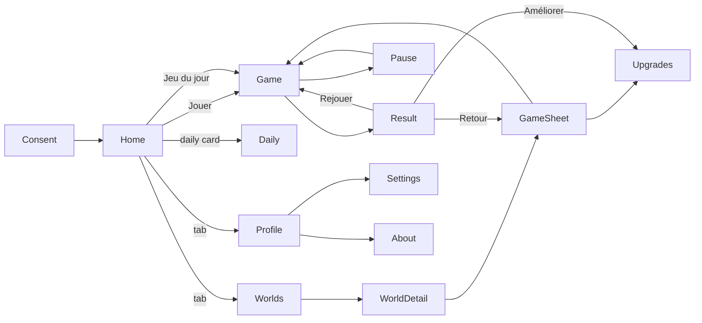

# PRD: Bric-à-Jeux

Status: approved
Project slug: mini-worlds
Final app name: Bric-à-Jeux
Android package: io.github.nhilaire.miniworlds
Version target: 0.4.0
Last updated: 2026-11-23 (v0.4.0 phone test: daily reward reset, game of the day, Couleur Éclair, Fruits en Fusion,
Plombier Express, Mini Défense and Bataille de Nombres reworked; v0.4.0: twelve more games, world Défis opens)

> Written in English. Player-facing text is quoted in the "Player copy" section, in every language of the game
> (`factory-app.json` "languages"; French is the reference).
> Status becomes `approved` only after the user explicitly approves this document.

## Summary

Bric-à-Jeux is a family collection of one-finger mini-games in pixel art, tied together by one shared progression.
v0.1.0 ships three mini-games in three different worlds (a falling-blocks arcade game, a turn-based match-3, a
bubble shooter) and the full meta-game core: stars of mastery, XP and global level, coins, per-game upgrades, a
7-day reward calendar, three daily challenges and achievements. Every round lasts 30 seconds to 3 minutes and feeds
the same profile, so playing any game brings the next unlock closer. No ads, no purchases, no account, no backend.
Pitch: « Des mini-jeux pour toute la famille, une progression pour tous. »

## Target players

- Families, parents included: casual players from about 7 years old (reading short sentences) to adults.
- Played on the couch, in transport or in a waiting room; the phone is held in one hand or passed around; a round
  is launched in a few seconds and lasts 30 s to 3 min.
- Accessibility: portrait, every control reachable with the thumb, large buttons, colour is never the only cue
  (each piece type has its own sprite shape), text rendered by the UI in a pixel font with a readable size.
- Tone: tu, light and encouraging.

## Core loop

1. The player opens the app, collects the daily reward if available, sees the three daily challenges.
2. Taps « Jouer » (last played game) or picks a game on the world map.
3. Plays a short round; the score, combos and stars feed the shared profile.
4. The result screen shows score, new best, stars, coins, XP and challenges completed; « Rejouer », « Améliorer »
   or « Retour ».
5. Spends coins on an upgrade of a favourite game, or chases the next star to unlock the next world.

What makes one more round tempting: a star threshold within reach, an upgrade almost affordable, a daily challenge
at 2/3, a world about to unlock. The player always sees the next goal.

## Use cases

| ID | As a player I want to... | So that... |
|---|---|---|
| UC-01 | choose whether to share anonymous statistics at first launch | my privacy is respected |
| UC-02 | start a round in two taps from Home | I can play during a short break |
| UC-03 | learn each mini-game during its first round, with short help bubbles | I never read a rulebook |
| UC-04 | play Pluie de Blocs, Potager Fou and Bulles en Folie with one finger in portrait | the games fit one hand |
| UC-05 | earn stars, coins and XP in every round | each game pushes the same progression |
| UC-06 | see the ten worlds and exactly what unlocks the next one | I never feel blocked arbitrarily |
| UC-07 | buy upgrades for the games I like, with coins earned anywhere | my favourite game gets better |
| UC-08 | collect a reward every day and complete three daily challenges | coming back every day is rewarded |
| UC-09 | unlock achievements shown on my profile | my milestones are visible |
| UC-10 | see my best score and stars per game and my global stats | I can measure my progress |
| UC-11 | pause a round, resume it, or leave it | an interruption does not cost me the round |
| UC-12 | turn sound, vibrations and statistics on or off, pick a theme and a language | the game fits the moment and my choices |
| UC-13 | read why the game exists and who made it | I know the game's story |
| UC-14 | reset my progression | another family member can start from scratch |

## Screens

Three bottom tabs: Accueil (Home), Jeux (Games), Profil (Profile). A game is at most two taps from Home.

- **Consent** (first launch only): explains the anonymous statistics; « Accepter » and « Refuser » equally visible.
- **Home** (tab): level badge and XP bar (« Niveau 4 · 120 / 400 XP »), coin balance, daily reward card when a
  reward is available (opens Daily reward), big « Jouer » button (opens the last played game, or Pluie de Blocs
  if none), the three daily challenges with progress (« 2 / 3 »), « Prochain déblocage » card (world name and
  progress of each condition), « Derniers jeux » row (up to 3 game chips, tap opens the game sheet), « Jeu du jour » card under the daily
  reward card (game icon and name, « Pièces ×2 aujourd'hui », « Jouer » starts that game at once; see Rules / Game
  of the day).
- **Worlds** (tab « Jeux »): vertical list of the 10 world cards: pixel icon, name, state (open / locked /
  coming soon), stars « 2 / 3 » (available stars = 3 × games present), games « 1 / 5 ». A locked world shows
  its condition(s) with progress; a coming-soon world shows « Bientôt » and its indicative condition. Tap on an
  open world opens World detail; tap on a locked or coming-soon world shows the conditions in a sheet.
- **World detail**: name and colour of the world, five slots: the game (icon, name, best score, stars, upgrade
  badge if one is affordable) and four « Bientôt » slots. Tap on the game opens the Game sheet.
- **Game sheet**: large pixel illustration, name, one-line description, « Jouer », best score, stars with their
  thresholds (« 500 · 1500 · 3000 »), « Améliorations » (with the count of affordable upgrades), « Revoir le
  tutoriel » (re-enables the guided round). Android back returns to World detail.
- **Upgrades**: the three upgrades of the game as cards: name, effect, current level « 1 / 3 », next effect,
  cost, « Acheter » (disabled when unaffordable or maxed, « Max » when maxed). Purchase is immediate; the coin
  balance is shown at the top.
- **Game** (one layout per mini-game, see Rules): HUD with score, the game-specific counter (lines, moves left,
  shots before next row), the next star threshold, « Pause » button; the board takes most of the screen.
  Guided first round: help bubbles (see Rules / Tutorial). Android back opens Pause.
- **Pause** (overlay): « Reprendre », « Recommencer », « Quitter » (quitting ends the round with the current
  score, which counts like any round).
- **Result**: animation (score counts up, stars light up one by one, coins and XP fly to their counters), score,
  « Nouveau record ! » when applicable, stars earned (new ones highlighted), coins and XP earned, level-up
  banner when applicable, challenges completed in this round, « Rejouer », « Améliorer », « Retour ».
- **Daily reward**: calendar of 7 days with today's reward highlighted and past days checked, one button
  « Récupérer » (then « Récupéré » and the next day's reward shown). Reached from the Home card.
- **Profile** (tab): avatar (pixel), level and XP, stats (rounds played, games discovered, stars « 4 / 9 »,
  coins earned in total, days played), achievements grid (locked ones greyed with their condition), buttons
  « Paramètres » and « À propos ».
- **Settings**: Son, Vibrations, Thème (Automatique / Clair / Sombre), Langue (Automatique / Français / English),
  Statistiques anonymes (with help text), « Réinitialiser la progression » (confirmation dialog), « Retour ».
- **About** (« À propos »): the story of the game (`about.story`), « Un mot de l'auteur », « Tes données »,
  version; « Retour ».

## Rules and scoring

### Randomness and determinism

All randomness (piece bags, board generation, bubble colours, challenge draw) goes through one seeded
pseudo-random generator. The seed is random in normal play. Opening the app through the deep link
`miniworlds://seed/<integer>` fixes the seed for the session (used by Maestro flows; it has no effect on the
save file). The variant `miniworlds://seed/<integer>/unlocked` also opens every world of this version and every game in memory
for the session and suppresses every write to the save (Maestro flows of Potager Fou, Bulles en Folie and the v0.2.0 smoke flow of the ten new games).

### Worlds and unlocks

| # | World (fr / en) | Content (v0.4.0) | Unlock condition |
|---|---|---|---|
| 1 | Arcade / Arcade | Pluie de Blocs, Tour Bancale, Saute-Lapin, Fruits en Fusion, Couleur Éclair | open from the start |
| 2 | Puzzle / Puzzle | Potager Fou, Lucioles, Plombier Express, Bloc Glissant, Glisse-Fusion | 2 stars in world 1 |
| 3 | Stratégie / Strategy | Armée de Poche, Fusion de Guerriers, Bataille de Nombres, Mini Défense | 15 stars in total AND level 7 |
| 4 | Cartes / Cards | Chaussettes Perdues, Vingt-et-Un, Suite de Cartes, Mains de Cartes, Réussite Express | 6 stars in total AND level 4 |
| 5 | Bulles / Bubbles | Bulles en Folie, Raz-de-Couleurs, Tri de Billes | 4 stars in total AND level 3 |
| 6 | Adresse / Skill | Bougies Folles, Lancer de Cible, Tir Parfait | 9 stars in total AND level 5 |
| 7 | Construction / Building | coming soon | level 12 (indicative) |
| 8 | Exploration / Exploration | Labyrinthe Express, Fil d'Ariane, Chasse au Trésor | 18 stars in total AND level 8 |
| 9 | Mémoire / Memory | Perroquet Copieur, Champ de Taupes, Calcul Éclair, Suite Logique, Chaîne de Nombres | 12 stars in total AND level 6 |
| 10 | Défis / Challenges | Miroirs et Laser, Duo Synchro | 30 stars in total AND level 10 |

A world is unlocked the moment its conditions are met (checked after every round and level-up); the unlock is
announced on the Result screen (« Monde débloqué : Puzzle ! ») and the world card changes state. Coming-soon
worlds never unlock in this version even when their indicative condition is met: their card keeps « Bientôt » and the
condition is shown as « à venir ». Unlocks are permanent.

Games inside a world (v0.2.0): the first game of a world is playable as soon as the world is unlocked; its k-th
game (k ≥ 2) needs 2 × (k − 1) stars earned in that world (Tour Bancale and Lucioles: 2 stars, Saute-Lapin and
Plombier Express: 4 stars). A game unlocked this way in a world that was already open is announced on the Result
screen (« Nouveau jeu : Tour Bancale ! »); its card shows its condition while it is locked (« 2 étoiles dans
Arcade ») and cannot be opened. Game unlocks are derived from the stars (nothing new is saved).

### Stars

Each game has three score thresholds. A star is earned when the round score reaches the threshold; stars are kept
forever (a lower score later never removes one). 69 stars exist in v0.3.0.

| Game | 1 star | 2 stars | 3 stars |
|---|---|---|---|
| Pluie de Blocs | 1 000 | 2 500 | 5 000 |
| Potager Fou | 1 500 | 3 000 | 5 000 |
| Bulles en Folie | 800 | 2 000 | 4 000 |
| Tour Bancale | 150 | 300 | 500 |
| Saute-Lapin | 150 | 350 | 600 |
| Lucioles | 500 | 750 | 950 |
| Plombier Express | 2 350 | 3 550 | 5 750 |
| Raz-de-Couleurs | 800 | 2 000 | 3 500 |
| Chaussettes Perdues | 800 | 1 600 | 2 800 |
| Vingt-et-Un | 400 | 600 | 750 |
| Bougies Folles | 200 | 450 | 800 |
| Perroquet Copieur | 150 | 400 | 800 |
| Champ de Taupes | 400 | 900 | 1 500 |
| Fruits en Fusion | 16 250 | 24 600 | 38 450 |
| Bloc Glissant | 500 | 900 | 1 300 |
| Suite de Cartes | 500 | 750 | 950 |
| Tri de Billes | 300 | 700 | 1 000 |
| Calcul Éclair | 300 | 700 | 1 200 |
| Armée de Poche | 300 | 800 | 1 500 |
| Fusion de Guerriers | 200 | 500 | 1 000 |
| Labyrinthe Express | 300 | 700 | 1 200 |
| Fil d'Ariane | 600 | 1 000 | 1 400 |
| Chasse au Trésor | 400 | 700 | 1 000 |

### XP and global level

- XP per round = 10 + floor(score / 50), capped at 100; plus 25 XP per new star earned in that round.
- Level starts at 1. XP needed to go from level L to L+1 = 100 × L (1→2: 100, 2→3: 200, 3→4: 300...).
  XP in excess carries over; several levels can be gained in one round. Level cap: 50 (XP still accumulates).
- Level-up reward: 25 × new level coins, granted immediately and shown on the Result screen, or on the Daily
  reward screen when the level-up comes from the day-7 XP (same for a world unlock triggered there).

### Coins

- Coins per round = 10 + floor(score / 25), multiplied by the game's « Bonus pièces » upgrade (1 + 0.10 × level),
  rounded down; plus 50 coins per new star earned in that round.
- Other sources: level-up rewards, daily rewards, daily challenges, achievements. Coins are only spent on
  upgrades (v0.1.0). The balance never goes negative; purchases are refused when unaffordable.
- Lifetime coins earned (never decreased) is kept for stats and achievements.

### Upgrades

Each of the first three games has three upgrades; each v0.2.0 game has two (see below). Every upgrade has three levels. Cost of level 1 / 2 / 3: 250 / 600 / 1 200 coins (same for every
upgrade; raised ×2.5 after the first phone test, where one session bought a whole upgrade line). Buying is immediate; the effect applies from the next round.

| Game | Upgrade (fr) | Effect per level |
|---|---|---|
| Pluie de Blocs | Aperçu | shows the next 1 / 2 / 3 pieces (0 without the upgrade) |
| Pluie de Blocs | Départ en douceur | initial fall interval 800 ms + 80 ms per level |
| Pluie de Blocs | Bonus pièces | coins per round +10 % per level |
| Potager Fou | Coup en plus | +1 move per level (20 → 23) |
| Potager Fou | Récolte en cascade | cascade multiplier +0.5 per level (see scoring) |
| Potager Fou | Bonus pièces | coins per round +10 % per level |
| Bulles en Folie | Visée | aim guide shows 0 / 1 / 2 / 3 wall bounces |
| Bulles en Folie | Prochaine bulle | shows the next 1 / 2 / 3 bubbles (0 without the upgrade) |
| Bulles en Folie | Bonus pièces | coins per round +10 % per level |
| Tour Bancale | Grand plateau | base floor +0.5 unit per level (4 → 5.5) |
| Saute-Lapin | Carapace | 1 / 2 / 3 shields per round |
| Lucioles | Indice | 1 / 2 / 3 hints per round |
| Plombier Express | Indice | 1 / 2 / 3 hints per round |
| Raz-de-Couleurs | Coup en plus (id more_moves) | +1 move per board per level |
| Chaussettes Perdues | Coup d'œil | cards shown 1 / 2 / 3 s at the start of each board |
| Vingt-et-Un | Main en plus | +1 hand per level (10 → 13) |
| Bougies Folles | Gâteau lent | rotation −8 % per level |
| Perroquet Copieur | Seconde chance | 1 / 2 / 3 second chances per round |
| Champ de Taupes | Radar | 1 / 2 / 3 radar uses per round |
| Fruits en Fusion | Coup de balai | 1 / 2 / 3 sweeps of the bottom row per round |
| Bloc Glissant | Indice | 1 / 2 / 3 hints per round |
| Suite de Cartes | Indice | 1 / 2 / 3 hints per round |
| Tri de Billes | Sablier | +10 s per level |
| Calcul Éclair | Sablier | +5 s per level |
| Armée de Poche | Recrues | +5 starting soldiers per level |
| Fusion de Guerriers | Vétéran | 10 / 20 / 30 % of new warriors at level 2 |
| Labyrinthe Express | Sablier | +5 s per level |
| Fil d'Ariane | Indice | 1 / 2 / 3 hints per round |
| Chasse au Trésor | Détecteur | +1 dig per map per level |
| Couleur Éclair | Bouclier | 1 / 2 / 3 wrong doors without losing a life per round |
| Glisse-Fusion | Annuler | 1 / 2 / 3 undos per round |
| Bataille de Nombres | Renforts | +2 / +4 / +6 starting units |
| Mini Défense | Arsenal | +20 / +40 / +60 starting gold |
| Mains de Cartes | Seconde donne | 1 / 2 / 3 second exchanges per round |
| Réussite Express | Joker | 1 / 2 / 3 free cards per round |
| Lancer de Cible | Main sûre | bounce angle 11° / 10° / 9° (12° without) |
| Tir Parfait | Viseur | first 25 / 40 / 55 % of the trajectory drawn |
| Suite Logique | Sablier | +5 s per level |
| Chaîne de Nombres | Mélange | 1 / 2 / 3 shuffles per round |
| Miroirs et Laser | Indice | 1 / 2 / 3 hints per round |
| Duo Synchro | Indice | 1 / 2 / 3 hints per round |

The v0.2.0, v0.3.0 and v0.4.0 games have two upgrades each: the one above and « Bonus pièces » (coins per round +10 % per level).

### Daily reward

- Calendar of 7 days: 100, 150, 200, 250, 300, 400, 600 coins; day 7 also grants 100 XP.
- A day is identified by the device's local date (YYYY-MM-DD). The reward can be collected at most once per local
  date. The save keeps `lastCollectedDate` (none at first) and `calendarDay` (0 at first, then 1-7): without
  `lastCollectedDate`, the first collection is day 1.
- Collecting on the day after `lastCollectedDate` advances `calendarDay` by one (8 wraps to 1). Any missed day (a
  gap of one day or more) resets `calendarDay` to 1 (v0.4.0 phone test: « il faut revenir au début si on rate un
  jour pour inciter à revenir tous les jours »). A device date earlier than `lastCollectedDate` counts as already collected.
- The Home card appears when the reward is collectable; the reward is added when « Récupérer » is tapped (never
  silently).

### Game of the day (v0.4.0 phone test)

- Each local date has one game of the day, drawn among the playable games (world unlocked and game unlocked in its
  world), listed in catalogue order: index = (hash of the date) mod (number of playable games), with the same date
  hash as the daily challenges (or the session seed). It is identical for the same date and the same set of playable
  games (players with different progress may get different games). The first time it is computed on a local date it
  is saved as `dailyGame {date, gameId}`, so a game unlocked later that day does not change it before midnight.
- Home shows the « Jeu du jour » card under the daily reward card: the game's icon and name, « Pièces ×2
  aujourd'hui » and « Jouer », which starts a round of that game at once (its tutorial still runs on a first round).
  Its game sheet shows the same « Pièces ×2 aujourd'hui » badge.
- A settled round of the game of the day, started on that local date, has its round coins doubled: coins = floor((10
  + floor(score / 25)) × « Bonus pièces » multiplier × 2); the 50 coins per new star are not doubled. A short round
  still earns nothing. The Result screen shows « Jeu du jour : pièces ×2 ! » next to the coins. The doubled coins
  count for the challenge « Gagner 200 pièces en jouant » and for the lifetime coins.

### Daily challenges

- Three challenges per local date: « Jouer 3 parties » is always the first; the two others are drawn without
  replacement from the rest of the pool below with the seeded generator (seed = hash of the date, or the session
  seed when the app was opened through the seed deep link), among challenges whose game (if any) is playable now (world and game unlocked)
  (« Jouer à 2 jeux différents » needs at least 2 unlocked games). The draw is recomputed when the date changes;
  progress of the previous date is discarded.
- Progress is counted from rounds ended on that date (including rounds quit from Pause). Each completed
  challenge grants its reward once; completing all three grants 50 bonus coins.

| ID | Challenge (fr) | Target | Reward |
|---|---|---|---|
| rounds3 | Jouer 3 parties | 3 rounds | 25 coins |
| games2 | Jouer à 2 jeux différents | 2 distinct games | 25 coins |
| star1 | Gagner une étoile | 1 new star | 50 coins |
| combos5 | Faire 5 combos | 5 combos (see per-game definition) | 50 coins |
| coins200 | Gagner 200 pièces en jouant | 200 coins from rounds | 50 XP |
| score_blocks | Marquer 1000 points à Pluie de Blocs | one round ≥ 1000 | 50 coins |
| score_garden | Marquer 1500 points à Potager Fou | one round ≥ 1500 | 50 coins |
| score_bubbles | Marquer 800 points à Bulles en Folie | one round ≥ 800 | 50 coins |
| score_<game> | Marquer <1-star threshold> points à <game>, for each of the 32 v0.2.0, v0.3.0 and v0.4.0 games | one round ≥ the 1-star threshold | 50 coins |

### Achievements

| ID | Name (fr) | Condition | Reward |
|---|---|---|---|
| first_round | Première partie | 1 round ended | 25 coins |
| rounds10 | Dix parties | 10 rounds | 50 coins |
| rounds100 | Cent parties | 100 rounds | 200 coins |
| first_star | Première étoile | 1 star | 50 coins |
| all_stars | Ciel étoilé | every star of the version (105 in v0.4.0) | 500 coins |
| explorer | Explorateur | 3 games played at least once | 100 coins |
| globetrotter | Globe-trotteur | 10 different games played at least once | 200 coins |
| first_upgrade | Bricoleur | 1 upgrade bought | 50 coins |
| maxed_upgrade | Expert | 1 upgrade at level 3 | 150 coins |
| level5 | Niveau 5 | level 5 | 100 coins |
| level10 | Niveau 10 | level 10 | 250 coins |
| week | Semaine complète | day 7 of the calendar collected | 200 coins |
| rich | Trésor | 5 000 coins earned in total | 150 coins |

Achievements are checked after every round, purchase and collection; each unlocks once and is announced with a
toast (« Succès : Première étoile ») and listed on the Profile.

### Common mini-game contract

Every mini-game implements the same interface: `init(seed, upgrades)`, `start()`, `pause()`, `resume()`,
`input(event)`, `tick(dt)` (real-time games), `state()` for rendering, and emits `combo` and `end(score)`.
In code every engine (the ten v0.2.0 games included) is a pure reducer `create(seed, upgrades)` /
`reduce(state, action)` with time as a `tick` action; the state carries `score`, `combos`, `status` and the
`events` of the last transition (`combo`, `over`...), and the game screen adapts it to the round frame.
The core engine, not the game, converts the score into stars, coins, XP, challenge progress and achievements.
A round quit from Pause ends with the current score. « Recommencer » ends the current round like « Quitter »
(settled, outcome quit) and starts a new one. Backgrounding the app pauses a running round and shows the Pause
overlay on return.

Short rounds: a round that lasted less than 20 s (paused time excluded) is not settled: no coins, no XP, no star,
no best score, it does not count as a round for stats, challenges and achievements. The Result screen shows the
score and « Partie trop courte : pas de récompense ». This prevents farming the fixed part of the rewards by
quitting at once.

### Pluie de Blocs (world Arcade)

- Board 10 columns × 16 rows; 7 tetrominoes (I, O, T, S, Z, J, L) drawn with a 7-bag; spawn centred at the top.
- Controls: horizontal drag moves the piece one cell per 1/10 of the board width; tap rotates clockwise (wall
  kicks: try 1 cell left then right; otherwise the rotation is refused); swipe down hard-drops.
- Gravity: the piece falls one row every interval; interval (ms) = max(150, 800 + 80 × slowStartLevel − 50 ×
  floor(lines / 10) − 25 × floor(piecesLocked / 5)): the fall speeds up gently with every 5 pieces locked, even
  when no line is cleared (first phone test: a round without lines never felt faster). The « level » shown is floor(lines / 10) + 1.
- Lock: a piece that cannot fall locks after 300 ms; completed rows disappear; rows above shift down.
- Scoring: 1 / 2 / 3 / 4 lines at once = 100 / 300 / 500 / 800 points; hard drop = 1 point per row dropped
  (1 point, not more: the stars must reward lines, not drops).
  Back-to-back: clearing lines with two consecutive locked pieces adds 50 × (chain length − 1).
- Combo (for challenges): a clear of 2 or more lines at once, or a back-to-back clear.
- End: a new piece overlaps existing blocks at spawn. Expected round: 1-3 min.
- Ghost piece: the landing position of the current piece is outlined for the first 5 locked pieces of each
  round, then hidden (the player has seen how the piece lands; the shadow would clutter the board afterwards).
- Tutorial bubbles (guided first round, fall slowed to one row every 2 s while a bubble is shown, normal
  interval from the moment the last bubble is dismissed): « Glisse pour déplacer » (dismissed
  by a horizontal drag), « Touche pour tourner » (by a tap), « Glisse vers le bas pour lâcher » (by a swipe down).

### Potager Fou (world Puzzle)

- Board 7 columns × 8 rows; 5 vegetable types (carotte, tomate, aubergine, maïs, brocoli), each with its own
  colour and sprite shape. From the 11th move, the refill also draws a 6th type (oignon).
- Initial board: generated without any existing line of 3 and with at least one valid move. When no valid move
  exists after cascades, the board is shuffled automatically: the result has no line of 3 and at least one valid
  move, scores nothing and consumes no move.
- Controls: swipe on a piece towards a neighbour swaps them. A swap that creates no line of 3 bounces back and
  does not consume a move. A valid swap consumes one move.
- Moves: 20 (+ « Coup en plus »). The HUD shows moves left.
- Matching: lines of 3+ identical pieces (horizontal or vertical) are removed; pieces above fall; new pieces
  refill from the top; cascades repeat until no line exists.
- Scoring: line of 3 = 100, of 4 = 200, of 5+ = 400 (an L or T shape counts its lines separately). Cascade
  multiplier: lines removed in the k-th cascade step (k = 1 for the direct result of the swap) are multiplied by
  1 + (k − 1) × m, with m = 1 (+0.5 per « Récolte en cascade » level).
- Combo (for challenges): a cascade step with k ≥ 2.
- End: no move left (after the last cascade). Expected round: 1-2 min.
- Feedback of a swap (first phone test: the board looked like a new puzzle after each move): the engine settles
  the swap at once (score, moves, HUD), then the screen replays it from the engine events: the two pieces slide
  (160 ms); a refused swap slides back; for each cascade step the aligned pieces are framed and flash with the
  points of the step popping above them (300 ms), shrink away (140 ms), then the pieces above slide down and the
  new ones enter from the top (240 ms). Inputs are locked while the replay runs (under 1 s per step).
- Tutorial bubble: « Glisse un légume vers son voisin pour aligner 3 identiques » (dismissed by a valid swap).

### Bulles en Folie (world Bubbles)

- Grid of 9 columns, rows offset by half a bubble (hexagonal packing), 12 rows visible; the launcher is below
  row 12. Start: 5 rows filled. 5 colours (rouge, jaune, vert, bleu, violet), each with its own face sprite.
- Controls: touch and drag anywhere to aim (the guide line shows the direction, and bounces per « Visée »
  level); release to shoot. Drag released below an angle of 10° from the horizontal does not shoot.
- The bubble flies in a straight line at constant speed, bounces on the side walls, and snaps to the nearest
  free cell adjacent to the first bubble (or the top row) it touches.
- Pop: a group of 3+ same-colour bubbles including the new one is removed; bubbles no longer connected to the
  top row then drop.
- Scoring: 10 points per popped bubble, 20 per dropped bubble. The next colour is drawn among colours still on
  the board.
- Pressure: a new row is pushed from the top every 6 shots; every 5 shots after 20 shots; every 4 after 40.
  The HUD shows shots left before the next row.
- Combo (for challenges): a shot that pops 5+ bubbles or drops at least one bubble.
- End: any bubble occupies row 12 (by snap or by a row push). An empty board grants 500 bonus points, is
  refilled with 5 rows and the round continues; the shot counter is not reset. Expected round: 1-3 min.
- Feedback of a shot (second phone test: the field jumped to its final state): the engine settles the shot at
  once (score, HUD), then the screen replays it from the engine events: the bubble flies along the engine path at
  22 units/s (bounces visible), the popped group glows and pulses with its points popping above it (250 ms), shrinks
  away (120 ms), the disconnected bubbles fall out of the field with their points (320 ms), and a pushed row slides
  the whole stack down one row (180 ms). Inputs are locked while the replay runs.
- Tutorial bubbles: « Garde le doigt appuyé pour viser » (dismissed after a drag of 0.5 s), « Relâche pour
  tirer » (by a release that shoots).

### v0.2.0: ten more mini-games (concept test)

After the acceptance of v0.1.0, the user asked for about ten more games before publishing, « pour voir si le
concept tient ». Choices: three new worlds open (Cartes, Adresse, Mémoire) plus new games in Arcade, Puzzle and
Bulles; finish « jouable et testé » (pure engine with unit tests, screen, one tutorial bubble, 3 stars, two
upgrades: one of the game + « Bonus pièces », sounds of the existing kit, short animation of each move, one
shared Maestro smoke flow); games unlock one by one inside a world.

Common rules of the ten games:

- Inputs are taps on cells or buttons (each with a testID). Each move is shown by a short animation (≤ 250 ms:
  flip, rotation, slide, fade); inputs are ignored while it runs only when the rule says so.
- One tutorial bubble per game, dismissed by the first action it describes; real-time games do not advance while
  it is shown.
- The engine is a pure reducer like the first three games (`create(seed, upgrades)`, `reduce(state, action)`,
  time as a `tick` action); the screen reads the injectable clock for any timer.
- Sounds: tick (move), clear / combo / pop (success), drop (failure of a move), over (end).

#### Tour Bancale (world Arcade, 2nd game) - real time

- Field 10 units wide. The base floor is 4 units wide (+0.5 per « Grand plateau » level). The moving block has
  the width of the top floor and slides left-right between 0 and 10 − width, bouncing on the edges, at
  4 units/s + 0.25 per floor placed (capped at 12 units/s). The base floor is centred (x = 3 to 7 without
  upgrade); each new block starts at the left edge moving right.
- Tap: the block drops onto the stack. Overlap = intersection with the top floor. Overlap ≤ 0: round over. If
  the offset from the top floor is ≤ 0.15 unit, the drop is perfect: the block is aligned, the width is kept and
  the perfect streak grows by 1; otherwise the new floor is the overlap only and the streak returns to 0.
- Scoring: 10 points per floor placed, plus 5 × streak on a perfect drop (1st perfect +5, 2nd in a row +10...).
- Combo (challenges): a perfect drop. HUD: floors. Stars 150 / 300 / 500 (phone test: 26 floors gave one star
  with 200 / 450 / 800).
- Tutorial bubble: « Touche pour lâcher le bloc » (dismissed by the first drop).

#### Saute-Lapin (world Arcade, 3rd game) - real time

- Side view, ground at y = 0, the bunny at x = 2 (box 0.8 × 0.8). Obstacles spawn at x = 12 and move left at
  6 units/s + 0.35 per obstacle passed (capped at 15: reached around the 26th obstacle; phone test: the speed-up of
  + 0.2 up to 14 was not felt and the game got boring fast).
- Obstacle kinds, one seeded draw per spawn: before 10 obstacles passed, fence 60 % (1 wide, 1 high), tall fence
  25 % (1 wide, 1.5 high), hedge 15 % (2 wide, 1 high); from 10 obstacles passed, fence 40 %, tall fence 20 %,
  hedge 20 %, bird 20 % (1 wide, flying from y = 1.3 to 1.9: the bunny on the ground passes under it, a jump at the
  wrong moment hits it). A hit is an overlap of the boxes (touching edges do not count).
- The next obstacle spawns when the gap between the last obstacle's right edge and x = 12 reaches a seeded
  distance between max(5, 0.8 × speed) and max(10, 1.8 × speed) units (speed in units/s: from 0.8 s, longer than
  one jump, to 1.8 s between two obstacles, so quick sequences alternate with breathers).
- Tap while on the ground: jump (vertical speed 13.5 units/s, gravity 36 units/s²: apex 2.53 units, 0.75 s in the
  air; 12 units/s left only a 33 ms window over a 1.5-high fence at the start, found while building the game).
  A tap in the air is ignored.
- A hit (boxes overlap) consumes a shield (« Carapace »: 1 / 2 / 3 shields per round) and removes that obstacle (no points, the streak returns to 0);
  without shield the round is over.
- Scoring: 10 points per obstacle passed. Combo (challenges): every 5th obstacle passed in a row without a hit.
- HUD: shields left. Stars 150 / 350 / 600.
- Tutorial bubble: « Touche pour sauter » (dismissed by the first jump).

#### Lucioles (world Puzzle, 2nd game) - turn based

- Grid of fireflies (4 × 4 or 5 × 5, see below), lit or off. Tapping a cell toggles it and its 4 orthogonal neighbours. Goal: all off.
- A round is 5 grids. Grid k (1-5) is built by pressing 1 + k distinct seeded cells on an all-off grid; par =
  1 + k (phone test: 3 + k on 5 × 5 was far too hard). Grids 1 and 2 are 4 × 4, grids 3 to 5 are 5 × 5. Grid score: max(50, 200 − 20 × (taps beyond par)). A grid still unsolved after par + 15 taps is failed (0 points). Hints are not taps.
  Either way the next grid comes; the round ends after the 5th grid (maximum 1 000 points).
- « Indice »: 1 / 2 / 3 hints per round; a hint highlights one cell of a solution (the seeded presses XOR the
  player's taps, so the hint is always right).
- Combo (challenges): a grid solved in at most par taps. HUD: grid k / 5, taps. Stars 500 / 750 / 950.
- Tutorial bubble: « Touche une luciole : elle et ses voisines changent. Éteins tout ! » (dismissed by a tap).

#### Plombier Express (world Puzzle, 3rd game) - turn based

- Grids of pipe pieces (straight or elbow) follow one another without end (v0.4.0 phone test: « la partie se
  termine trop vite »): grids 1 to 3 are 4 × 4, grids 4 to 6 are 5 × 5, grid 7 and the next ones are 6 × 6. Water
  enters the left side of a seeded row and must leave by the right side of a seeded row. Each grid holds one seeded
  self-avoiding path from entry to exit (pieces matching the path); the other cells get random pieces; every cell
  is then turned a random number of quarter turns.
- Tap a piece: it turns a quarter turn clockwise. The grid is solved when the pieces connected from the entry
  reach the exit (any path counts). Pieces connected to the entry are drawn filled with water.
- Par = the sum over the path cells of the quarter turns that bring them back (a straight piece needs 0 or 1).
  Allowed taps of grid k: par + max(6, 21 − k) (par + 20 on grid 1, par + 6 from grid 15). Grid score: max(50, 300
  − 15 × (taps beyond par)); hints are not taps. A grid that is already solved after the random turns is turned
  again (par ≥ 1). Each grid also has a time limit of max(15, 63 − 3 × k) seconds (60 s on grid 1, 15 s from grid 16; the
  clock is injectable and stops while the tutorial bubble, the pause or the solved grid of 1 s is shown). The round
  ends at the first grid still unsolved when its allowed taps are used or its time is up (that grid scores 0), so
  even a careful player ends (choice of the user after review).
- « Indice »: 1 / 2 / 3 hints per round; a hint highlights a path cell that is not yet turned right.
- Combo (challenges): a grid solved in at most par taps. HUD: grid k, taps / allowed taps, seconds left. Stars from the casual
  bot (rule of v0.4.0; bot: turns path cells right with a seeded error rate, capped at 60 grids in tests).
- Tutorial bubble: « Touche un tuyau pour le tourner. Relie l'eau à la sortie ! » (dismissed by a tap).

#### Raz-de-Couleurs (world Bubbles, 2nd game) - turn based

- Grid 10 × 10 of 5 colours (the bubble colours and their shapes). The tide is the region of the top-left cell's
  colour connected to it. Tapping one of the 5 colour buttons (not the tide's colour) recolours the tide, which
  absorbs the adjacent cells of that colour.
- Board n has 20 − (n − 1) moves (minimum 12), + 1 per « Coup en plus » level. A board filled with one colour
  scores 500 + 100 × moves left and the next board starts. A board whose moves run out scores 3 × cells in the
  tide and the round is over.
- Combo (challenges): a board won with 3 or more moves left. HUD: board n, moves left. Stars 800 / 2 000 / 3 500.
- Tutorial bubble: « Touche une couleur : ta vague grandit depuis le coin » (dismissed by a colour tap).

#### Chaussettes Perdues (world Cartes, 1st game) - turn based

- Cards face down hold sock patterns, two of each. Board n has 6 + 2 × (n − 1) pairs (maximum 12), in 4 columns.
- Tap a face-down card: it turns up. With two cards up: same sock → the pair stays up, + 100 + 50 × the number of
  pairs found in a row just before it; different socks → one miss, both turn back down on the next tap (that tap only hides
  them, it turns no card) or after 700 ms. A miss resets the streak; the streak carries over between boards.
- A board fully found scores 200 more and the next board starts. 8 misses in the round end it.
- « Coup d'œil »: every card is shown face up for 1 / 2 / 3 s at the start of each board (inputs ignored).
- Combo (challenges): every 3rd pair found in a row. HUD: board n, misses left. Stars 800 / 1 600 / 2 800.
- Tutorial bubble: « Retourne deux cartes pour trouver la paire » (dismissed by a first card).

#### Vingt-et-Un (world Cartes, 2nd game) - turn based

- A 52-card deck, shuffled for each hand (seeded). 2-10 count their value, figures 10, the ace 1 or 11. No bet,
  no money: points only.
- Each hand: the player gets 2 cards, the dealer 1 card up and 1 down. Buttons « Tirer » (one more card) and
  « Rester ». Over 21: the hand is lost at once. On « Rester », the dealer shows its card and draws until 17 or
  more (it stands on every 17, a soft one included). Dealer over 21: won hand. Otherwise the higher total wins,
  equal totals tie. A dealer 21 with its first two cards is only checked on « Rester » (or against a player's 21).
- Points: 21 with the first two cards (« Vingt-et-un ! ») 150 at once (25 if the dealer also has it); won hand
  100; tie 25; lost hand 0. « Main suivante » starts the next hand.
- 10 hands per round (+1 per « Main en plus » level); the round ends after the last one.
- Combo (challenges): every 3rd hand won in a row. HUD: hand k / n. Stars 400 / 600 / 750 (luck weighs a lot: 900 was
  out of reach for most rounds).
- Tutorial bubble: « Approche-toi de 21 sans dépasser : Tirer ou Rester » (dismissed by either button).

#### Bougies Folles (world Adresse, 1st game) - real time

- A cake turns at the centre; candles are thrown from the bottom and stick in the cake edge at the bottom point.
  Cake n needs 5 + n candles thrown (maximum 12; the pre-placed ones excluded), already holds min(n − 1, 4) seeded
  candles at least 30° apart, turns at min(250, 90 × (1 + 0.15 × (n − 1))) × (1 − 0.08 × « Gâteau lent » level) °/s,
  clockwise for the first cake, and changes direction at each cake.
- Tap: a candle is planted at once (a 120 ms flight is only drawn). If it lands less than 14° (cake frame) from
  another candle, the round is over.
- Guards (phone test: a quick double tap lost the round, and a tap carried over onto the next cake): a throw within
  250 ms of the previous one is ignored; when a cake is completed, the next cake stands still for 1 s with a
  « Gâteau n » banner and throws are ignored meanwhile. No flight is drawn for an ignored throw.
- Scoring: 10 points per candle planted, 100 per cake completed; the next cake follows.
- Combo (challenges): a cake completed. HUD: cake n, candles left. Stars 200 / 450 / 800.
- Tutorial bubble: « Touche pour lancer une bougie. Ne touche pas les autres ! » (dismissed by the first throw).

#### Perroquet Copieur (world Mémoire, 1st game) - turn based

- Four pads of distinct colour and shape (red circle, blue square, yellow triangle, green diamond), each with
  its tone. The parrot shows a sequence (starting at length 1, one seeded pad added each step): each pad lights
  for 500 − 20 × (length − 1) ms (minimum 250 ms), with 150 ms off between two pads and 600 ms before the
  sequence starts; inputs are ignored meanwhile. Then the player repeats it.
- The whole sequence repeated: 10 × length points, the next sequence (length + 1) is shown. A wrong pad: with a
  « Seconde chance » left (1 / 2 / 3 per round) the same sequence is shown again; otherwise the round is over.
- Combo (challenges): a sequence of length 5, 10, 15... repeated. HUD: length. Stars 150 / 400 / 800.
- Tutorial bubble: « Regarde le perroquet, puis répète la même suite » (dismissed by the first pad tapped).

#### Champ de Taupes (world Mémoire, 2nd game) - turn based

- Grid 8 × 8; board n hides 8 + 2 × (n − 1) moles (maximum 16). The first dig of a board is always safe: moles
  are placed after it, never on that cell nor its neighbours (seeded).
- Tap a covered cell: dig. A safe cell shows the number of neighbouring moles (8 neighbours); a 0 also digs its
  neighbours, repeatedly. A mole ends the round. The « Drapeau » button toggles flag mode: a tap then flags or
  unflags a covered cell (a flagged cell cannot be dug).
- Scoring: 5 points per safe cell revealed; 300 when every safe cell is revealed, then the next board starts.
- « Radar »: 1 / 2 / 3 uses per round; a use flags the first unflagged mole in seeded order (after the
  first dig of the board); it is refused, no use spent, when every mole is flagged.
- Combo (challenges): one dig that reveals 10 or more cells. HUD: board n, moles left to flag. Stars 400 / 900 / 1 500.
- Tutorial bubble: « Touche une case pour creuser. Les chiffres comptent les taupes voisines » (dismissed by a dig).

### v0.3.0: ten more mini-games, worlds Stratégie and Exploration open

After the v0.2.0 concept test the user said « le principe me va » and asked for about ten more games. Choice: open
Stratégie (world 3) and Exploration (world 8), and add one game to Arcade, Puzzle, Cartes, Bulles and Mémoire. Same
finish as v0.2.0 (pure engine with unit tests, screen, one tutorial bubble, 3 stars, two upgrades: one of the game +
« Bonus pièces », short move animations, one shared Maestro smoke flow).

Lessons of the v0.2.0 phone test, rules for the ten games:
- Real-time screens move things through animated values; React renders only when something else changes.
- Every timer reads the injectable clock and survives re-renders (no effect restarted by a new callback identity).
- A quick double tap never loses a round nor skips a step: each game below states its input guard.
- Balance: each engine has a seeded « casual bot » test (a simple, documented policy, no lookahead beyond one move):
  over 50 seeds its median score reaches the 1-star threshold and stays below the 3-star threshold. Generators are
  bounded (a fixed number of seeded attempts, then a fallback), so a round always starts.

Worlds: Stratégie unlocks at 15 stars in total AND level 7; Exploration at 18 stars in total AND level 8. Games inside
a world keep the rule 2 × (k − 1) stars in that world. 69 stars exist in v0.3.0.

#### Fruits en Fusion (world Arcade, 4th game) - turn based
- Grid 6 columns × 8 rows. 8 fruits, index 0 to 7: cerise, fraise, raisin, orange, pomme, poire, ananas, pastèque,
  each with its own shape. The next fruit is drawn among indexes 0-3 (seeded) and shown.
- Tap a column: the fruit falls to the lowest empty cell. Merge rule: a fruit that touches (orthogonally) one or more
  fruits of its kind merges with all of them into one fruit of the next index, placed in the lowest of the merged
  cells (left-most on a tie); every fruit then falls (gravity), and every fruit that was created or moved is checked
  again, bottom-up then left to right, until nothing merges. Two pastèques that touch vanish.
- Points: each merge scores 10 × 2^(index of the new fruit) (fraise 20 ... pastèque 1 280); pastèques vanishing 2 000.
- No fruit limit (v0.4.0 phone test: « on arrive à la fin trop vite », « il n'est pas assez long »): the round ends
  when the jar overflows, that is when, after a drop and its merges, the next fruit fits in no column. A tap on a
  full column is ignored; a column holding 7 fruits or more shows a red line at its top. Fruits 1 to 40 are drawn
  among indexes 0-3, fruits 41 to 120 among indexes 0-4, from the 121st among indexes 0-5 (seeded), so the jar fills
  faster. From the 41st piece, every 5th piece (the 45th, 50th...) is a stone (decided by the user on 2026-11-23,
  after the measure showed that the bigger fruits alone never made a careful player overflow): it is dropped like a
  fruit, never merges, scores nothing, and only « Coup de balai » removes it from the bottom row; it has its own grey
  block sprite. Even a careful player overflows in the end. Stars are set from the casual
  bot (1 star ≈ its p25, 2 stars ≈ its p90, 3 stars ≈ twice its median, rounded to 50); bot rounds are capped at 400
  drops in tests.
- Input guard: the drop and its merges play in 300 ms; taps are ignored meanwhile.
- « Coup de balai »: 1 / 2 / 3 uses per round; a use clears the bottom row (no points), fruits above fall and merge.
- Combo (challenges): a drop that chains 2 merges or more. HUD: next fruit, fruits dropped. Casual bot: drops on the
  column whose top fruit matches, else the lowest column.
- Tutorial bubble: « Touche une colonne pour lâcher le fruit. Deux fruits pareils fusionnent ! »

#### Bloc Glissant (world Puzzle, 4th game) - turn based
- 6 × 6 board (rows and columns 0-5) with blocks of length 2 or 3, horizontal or vertical, and the red block
  (horizontal, length 2) on row 2 (3rd from the top). The puzzle is solved when the red block occupies columns 4-5
  (it touches the exit on the right side).
- Swipe on a block: it moves one cell in that direction if the cell is free (blocks only move along their axis).
- Generation: start from a seeded solved layout (red block at columns 4-5, 5 + k other blocks) and apply up to 200
  seeded random legal moves backwards; par = minimum number of one-cell moves (breadth-first solver). Keep the first
  layout whose par is in [3 + 2k, 7 + 2k] within 30 attempts, else the attempt with the closest par.
- Puzzle score: max(50, 300 − 15 × (moves beyond par)); a puzzle still unsolved after par + 25 moves is failed (0).
  A round is 5 puzzles.
- « Indice » (upgrade id hint): 1 / 2 / 3 hints per round; a hint highlights the block and direction of the next
  move of a shortest solution from the current position.
- Input guard: a block slides in 120 ms; a swipe during the slide is ignored.
- Combo: a puzzle solved at par. HUD: puzzle k / 5, moves. Stars 500 / 900 / 1 300 (casual bot: the move of a
  shortest solution with a seeded 30 % chance of a random legal move instead).
- Tutorial bubble: « Glisse les blocs pour libérer la sortie du bloc rouge »

#### Suite de Cartes (world Cartes, 3rd game) - turn based
- A row of n cards (values 1 to n, seeded shuffle, never already in order). Tap a card, then another: they swap (tap
  the selected card again to unselect). Goal: ascending order. Par = minimum number of swaps (n − number of cycles).
- A round is 5 rows of 5, 6, 7, 8, 9 cards. Row score: max(50, 200 − 20 × (swaps beyond par)); a row still unsorted
  after par + 10 swaps is failed (0). Maximum 1 000.
- « Indice »: 1 / 2 / 3 hints per round; a hint highlights a swap that puts one card at its place.
- Input guard: a swap animates in 200 ms; taps are ignored meanwhile.
- Combo: a row sorted at par. HUD: row k / 5, swaps. Stars 500 / 750 / 950 (casual bot: puts the smallest misplaced
  card at its place, with a seeded 25 % chance of a useless swap).
- Tutorial bubble: « Touche deux cartes pour les échanger. Range-les dans l'ordre ! »

#### Tri de Billes (world Bulles, 3rd game) - real time (timer)
- Tubes of 4 marbles; puzzle n has 2 + n colours (maximum 6) with 4 marbles each and 2 empty tubes. Generation:
  seeded shuffles checked solvable by a depth-first solver bounded to 20 000 states, at most 50 attempts, else a
  fallback layout built by seeded legal moves backwards from the sorted state. Tap a tube, then another: the top
  marbles of the same colour move onto an empty tube or a tube whose top marble has that colour, as many as fit.
- « Recommencer » button: the current puzzle goes back to its start (the timer keeps running), so a dead end never
  wastes the rest of the round.
- A round lasts 90 s (+10 s per « Sablier » level). A sorted puzzle (each tube empty or 4 marbles of one colour)
  scores 100 + 20 × colours and the next puzzle starts.
- Input guard: a move animates in 200 ms; taps are ignored meanwhile.
- Combo: a puzzle sorted in under 20 s. HUD: time left, puzzle n. Stars 300 / 700 / 1 000 (casual bot: any legal move
  that completes or extends a same-colour run, else a seeded legal move, 1 move per 1.5 s of the timer).
- Tutorial bubble: « Touche un tube puis un autre pour déplacer les billes du dessus »

#### Calcul Éclair (world Mémoire, 3rd game) - real time (timer)
- A question is shown with 4 answer buttons: one right, three distinct wrong answers ≥ 0 within ±1..±10 of it
  (seeded). Level by right answers so far: 0-9: a + b with a, b ≥ 1 and a + b ≤ 20; 10-19: a + b with result ≤ 50, or
  a − b with 0 ≤ b ≤ a ≤ 50; 20+: also a × b with a, b in 2..10.
- Right answer: 10 + 5 × min(streak, 8) points, streak counted before this answer (the first right answer gives 10),
  then the streak grows. Wrong answer: −5 s, the streak returns to 0, the same question stays.
- A round lasts 60 s (+5 s per « Sablier » level). Input guard: a new question ignores taps for its first 250 ms.
- Combo: every 5th right answer in a row. HUD: time left, streak. Stars 300 / 700 / 1 200 (casual bot: right
  answer every 2.5 s, a wrong one 1 time in 5).
- Tutorial bubble: « Touche la bonne réponse, le plus vite possible ! »

#### Armée de Poche (world Stratégie, 1st game) - turn based
- The army starts with 10 soldiers (+5 per « Recrues » level). A run is 10 pairs of gates. Each gate (seeded) is +n
  (45 %, n in [2, 4 + 2r]), −n (25 %, n in [1, 2 + r]), × 2 (15 %) or ÷ 2 rounded down (15 %), r = run number; a pair
  holds at most one × 2 or ÷ 2 gate. The count never goes below 0.
- After the 10th pair, a fort with D defenders: D = floor(f × best), where best is the count reached by always taking
  the better gate (the operations are monotone, so that greedy choice is optimal) and f = 0.25 / 0.3 / 0.35 / 0.4
  then 0.45 for runs 1, 2, 3, 4, 5+ (lowered while building: with 0.6 ... 0.9 one worse pick on a × 2 / ÷ 2 pair lost the
  fort, and the casual bot scored a median of 0). A run whose best is below the start count is drawn again (seeded). Army > D: run won,
  + 100 + min(200, 5 × (army − D)), next run (army back to the start count). Otherwise the round is over.
- A round has at most 8 runs (maximum 2 400 points).
- Timed choice (amended after the v0.3.0 phone test, see below): the army walks on its own to each pair of gates and
  takes the gate of its lane; there is no 500 ms walk guard any more.
- Combo: a run won. HUD: soldiers, run n / 8. Stars 300 / 800 / 1 500 (casual bot: the better gate 3 times in 4).
- Tutorial bubble: « Touche à gauche ou à droite pour changer de couloir »

#### Fusion de Guerriers (world Stratégie, 2nd game) - turn based
- Grid 4 × 4; the round starts with 6 level-1 warriors on seeded cells including at least one adjacent pair. Tap a
  warrior, then an adjacent (orthogonal) warrior of the same level: they merge into one warrior of the next level in
  the second cell, scoring 10 × 2^(new level − 1). After each merge two level-1 warriors appear in seeded empty
  cells (each level 2 with a 10 / 20 / 30 % chance per « Vétéran » level); never more than the free cells (amended
  while building: with 4 warriors and one recruit per merge the casual bot ended after 2 merges, median 30).
- End: no two adjacent warriors share a level (whether or not the grid is full).
- Input guard: a merge animates in 200 ms; taps are ignored meanwhile.
- Combo: a merge that creates a level 5 warrior or higher. HUD: best level. Stars 200 / 500 / 1 000 (casual bot: the
  adjacent pair with the lowest level, top-left first).
- Tutorial bubble: « Touche deux guerriers pareils côte à côte pour les fusionner »

#### Labyrinthe Express (world Exploration, 1st game) - real time (timer)
- Seeded perfect mazes (one path between any two cells): 7 × 7, then 9 × 9, then 11 × 11 and so on. The explorer
  starts top-left, the exit is bottom-right. Swipe: the explorer runs in that direction cell by cell and stops when
  the next cell ahead is walled, or the current cell has an open side other than forward and back (a junction), or it
  is the exit. A swipe into a wall does nothing.
- A round lasts 60 s (+5 s per « Sablier » level). A maze reached: + 100 + 2 × cells of its shortest path (start and
  exit included), next maze.
- Input guard: a run animates at 12 cells/s; a swipe during it is ignored.
- Combo: a maze solved in under 15 s. HUD: time left, maze n. Stars 300 / 700 / 1 200 (casual bot: follows the
  left wall, one swipe per 0.6 s).
- Tutorial bubble: « Glisse pour courir jusqu'au prochain croisement. Trouve la sortie ! »

#### Fil d'Ariane (world Exploration, 2nd game) - turn based
- Grid 6 × 6. Grid k: the start is a seeded cell of the left column, the exit a seeded cell of the right column; a
  seeded self-avoiding path of at least 12 cells joins them; 3 + k gems: 1 + k on seeded path cells other than start
  and exit, and 2 on seeded free cells next to the path, placed so that one self-avoiding trail from start to exit can
  collect all of them (checked by a bounded search); 6 + k rocks sit on seeded cells off that full trail (amended
  while building: with every gem on the path a casual player scored the maximum 2 000 every round). Tap the cell next to the head of the trail to extend it (no
  cell twice, no rock); tap the head to step back one cell. Reaching the exit ends the grid.
- Grid score: 50 per gem collected, + 100 if all gems were collected. A round is 5 grids.
- « Indice »: 1 / 2 / 3 hints per round; while the trail follows the seeded path, a hint highlights its next cell;
  otherwise it highlights the head of the trail (step back).
- Input guard: taps on the head and on a new cell are 150 ms apart at least (a double tap does not extend then undo).
- Combo: a grid with every gem. HUD: grid k / 5, gems. Stars 600 / 1 000 / 1 400 (casual bot: follows the seeded path
  and takes an off-path gem only by a 2-cell detour starting next to its head and rejoining the next path cell).
- Tutorial bubble: « Touche les cases voisines pour tracer ton chemin jusqu'à la sortie »

#### Chasse au Trésor (world Exploration, 3rd game) - turn based
- An 8 × 8 beach hides one chest (seeded). Tap to dig: the hole shows how close the chest is by Manhattan distance:
  0 trésor, 1-2 brûlant (red), 3-4 chaud (orange), 5-7 tiède (yellow), 8+ froid (blue), each with its own symbol. A tap
  on a dug cell is ignored (no dig spent).
- 8 digs per map (+1 per « Détecteur » level). Chest found: 100 + 20 × digs left after the finding dig, next map.
  Out of digs: the map scores 0 and the next one starts. A round is 5 maps.
- Input guard: a dig animates in 200 ms; taps are ignored meanwhile.
- Combo: a chest found in 3 digs or fewer. HUD: map k / 5, digs left. Stars 400 / 700 / 1 000 (casual bot: digs the
  cell that best matches all clues so far, ties seeded).
- Tutorial bubble: « Touche le sable pour creuser. Les couleurs disent si tu chauffes ! »

Upgrades of v0.3.0: Coup de balai (sweep), Indice (hint, shared), Sablier (extra_time: +10 s for Tri de Billes,
+5 s for Calcul Éclair and Labyrinthe Express), Recrues (recruits), Vétéran (veteran), Détecteur (detector).
Game ids: fruit, slide, cardline, marbles, quicksum, army, merge, maze, trail, treasure.

#### Plombier Express: solved grid shown (v0.3.0)

- Phone test of v0.2.0: when a grid was solved, the next one appeared at once and the filled pipe was never seen.
  Now the solved grid stays on screen for 1 s: the water runs from the entry to the exit through the connected
  pieces (cells fill in path order), the grid points pop above it, and taps are ignored; then the next grid comes.

#### v0.3.0 phone test changes

First phone test of v0.3.0 (2026-11-16), decisions of the user:

- Fruits en Fusion: a merge must be seen. After a drop, the screen replays the drop and each merge step by step
  (as Potager Fou): the fruits that merge are framed and flash (280 ms) with « +points » above the cell of the new
  fruit, they shrink into that cell while the new fruit grows there (220 ms), then the fruits above fall (180 ms);
  two pastèques that vanish flash and shrink the same way. The input guard of a drop lasts 300 ms plus 680 ms per
  merge or vanish step, so taps are ignored until the replay ends.
- Armée de Poche: every gate has the same neutral colour (the colour must not tell a good gate from a bad one; the
  label alone does). The army walks on its own: it starts in the left lane and reaches the next pair of gates after
  the approach time of the run, 3 000 ms at run 1 down to 2 000 ms at run 8 (3 000 − round((r − 1) × 1 000 / 7)).
  A tap on the left or right half of the road moves it to that lane (any number of times during the approach; a tap
  on its own lane changes nothing). When it reaches the pair, it goes through the gate of its lane, and the next
  approach starts at once; the lane is kept from pair to pair and from run to run. The approach does not run while
  the tutorial bubble or the pause is shown.
- Champ de Taupes: a cleared board stays on screen 1 200 ms with a green check and « Gagné ! » over the board (the
  300 points pop), taps and the radar are ignored meanwhile, then the next board is dealt.
- Wish noted for v0.4.0: a 2048-like game (not in this release).

### v0.4.0: twelve more mini-games, world Défis opens

Asked by the user on 2026-11-22 (« implémente 5 ou 6 jeux supplémentaires », then all twelve proposals chosen).
v0.3.0 was verified but never accepted on the phone: v0.4.0 replaces it (its phone test changes are part of
v0.4.0). Same finish and same rules as the v0.3.0 games (pure engine with unit tests, screen, one tutorial bubble,
3 stars, two upgrades: one of the game + « Bonus pièces », input guards, injectable clock, seeded bounded
generators, a casual bot per engine whose median over 50 seeds reaches 1 star and stays below 3 stars; stars are
set from the bot: 1 star ≈ its p25, 2 stars ≈ its p90, 3 stars ≈ twice its median capped at the maximum score,
rounded to 50, and written in the catalogue).

Worlds: Arcade +Couleur Éclair (5th), Puzzle +Glisse-Fusion (5th), Stratégie +Bataille de Nombres (3rd) and Mini
Défense (4th), Cartes +Mains de Cartes (4th) and Réussite Express (5th), Adresse +Lancer de Cible (2nd) and Tir
Parfait (3rd), Mémoire +Suite Logique (4th) and Chaîne de Nombres (5th), Défis opens with Miroirs et Laser (1st) and
Duo Synchro (2nd). Défis unlocks at 30 stars in total AND level 10 (it is no longer « coming soon »; Construction
stays coming soon). Games inside a world keep the rule 2 × (k − 1) stars in that world. 35 games, 105 stars.
Game ids: dash, tiles, conquest, defense, hands, patience, darts, shot, pattern, chain, laser, twins.

#### Couleur Éclair (world Arcade, 5th game) - real time
- Three lanes. The runner has one of 3 colours, each with its own shape (rouge rond, bleu carré, jaune triangle).
  Gates come one after another; a gate has 3 doors, one per lane, holding the 3 colours in a seeded order.
- Tap the left, middle or right third of the road: the runner goes to that lane (any number of times). When the
  gate reaches the runner (after the approach time), the door of its lane must have its colour: +10 points and the
  streak grows, else one life is lost and the streak is reset. 3 lives.
- After gates 4, 8, 12... the runner takes a new colour (seeded, different from the current one), shown from the
  start of the next approach.
- Approach time of gate n (1-based): 2 200 − 30 × (n − 1) ms up to gate 44 (910 ms), then max(600, 910 − 5 × (n −
  44)) ms (600 ms from gate 106). The approach does not run while the tutorial bubble or the pause is shown. The round
  ends at the 3rd life lost, never after a number of gates (v0.4.0 phone test: « il faudrait jouer jusqu'à ce qu'on
  perde »). Stars from the casual bot (rule of v0.4.0); the bot reaches the right lane only when the approach lasts
  at least its seeded reaction time (700 to 1 100 ms per gate), else it stays in its lane.
- « Bouclier » (id guard): 1 / 2 / 3 wrong doors per round cost no life (the streak is still reset).
- Combo: every 5th door in a row. HUD: lives, gates passed, the runner's colour.
- Tutorial bubble: « Touche à gauche, au milieu ou à droite : passe la porte de ta couleur ! »

#### Glisse-Fusion (world Puzzle, 5th game) - turn based
- 4 × 4 board of gems, level 1 to 11, each level with its own shape and colour (caillou, galet, silex, quartz,
  ambre, jade, topaze, saphir, rubis, émeraude, diamant). Start: two level-1 gems on seeded cells.
- Swipe up, down, left or right (or tap one of the 4 arrows): every gem slides as far as it can; two gems of the
  same level that meet merge into one gem of the next level (a gem merges once per move; merges are resolved from
  the side the gems slide to). A move that changes nothing is ignored. After a move a new gem appears on a seeded
  empty cell: level 1 (90 %) or level 2 (10 %).
- Own rule, the joker: every 10th move the new gem is a joker (étoile). A joker merges with any gem it meets (the
  result is the next level of that gem); two jokers that meet make a level-3 gem.
- Points: a merge into level L scores 2^L × 5 (level 2: 20 ... level 11: 10 240). A round is 80 moves; it ends
  earlier when no move is possible.
- « Annuler » (id undo): 1 / 2 / 3 uses per round; a use restores the board, the score and the move count of before
  the last move (one step back only).
- Input guard: a move animates in 150 ms; swipes and taps are ignored meanwhile.
- Combo: a move with 2 merges or more. HUD: moves left, best gem.
- Tutorial bubble: « Glisse pour pousser toutes les gemmes. Deux pareilles fusionnent ! »

#### Bataille de Nombres (world Stratégie, 3rd game) - turn based
- A map of territories joined by roads: a training map of 3 territories in a line (player 10 units, neutral 3,
  enemy 6), then 3 fixed maps of 5, 6 and 7 territories, played in this order (v0.4.0 phone test: « ça a l'air super
  compliqué »). Each territory holds units; the player owns one (blue, 10 units), the enemy one (red, 10 units, 6 on
  the training map), the others are neutral (grey, seeded 2 to 8 units). Owners are told by colour and by an emblem.
- A turn: tap one of your territories with 2 units or more: it is selected, and each neighbour that is not yours
  shows the outcome of an attack, « Pris · n » (taken, n units left there) or « Reste n » (not taken, n units left).
  Then tap such a neighbour: all the units but one march; if they outnumber the units there, the territory is taken
  and holds the difference; else its units drop by the number sent (0 stays to its owner). Units never move onto
  one's own territory (simpler rule chosen after the phone test): tapping another of your territories selects it
  instead. Tapping the selected territory again unselects it. « Passer » skips the turn.
- Then the enemy plays one move with the same rules (the attack that takes a territory with the most units left;
  else it passes; on the training map it always passes), then every territory owned by the player or the enemy
  gains 1 unit.
- A battle ends when one side owns no territory, or after 15 turns. Battle score: 60 per territory owned + 200 if the
  enemy owns none + 10 per turn not played after such a win. A lost battle (no territory) scores 0. A round is the 4
  battles (training map included).
- « Renforts » (id reinforce): the player's first territory starts with +2 / +4 / +6 units, in each battle.
- Input guard: a move and the enemy's answer play in 600 ms; taps are ignored meanwhile.
- Combo: a battle won. HUD: battle k / 4, turns left. Stars from the casual bot (rule of v0.4.0).
- Tutorial: three bubbles in order on the training map: « Touche ton territoire bleu, puis un voisin : tes unités
  attaquent ! » (dismissed by the first move), then « Ensuite, l'ennemi rouge joue à son tour. » (dismissed by a tap),
  then « À chaque tour, tes territoires gagnent 1 unité. Prends-les tous ! » (dismissed by a tap). The flag
  `tutorialDone` is saved after the third.

#### Mini Défense (world Stratégie, 4th game) - turn based planning, real-time waves
- A fixed winding path of 20 cells on a 6 × 9 grid and 6 turret slots beside it (covering 4, 6, 4, 6, 5 and 2 path
  cells within 2 cells, Chebyshev distance). 5 lives, 100 gold at the start. Waves follow one another without end;
  the round ends when no life is left (v0.4.0 phone test: « ça manque de stratégie », « ça s'arrête trop vite »).
- Between waves, tap an empty slot: a picker shows the three turrets (name, cost, effect; unaffordable ones
  disabled). Every turret shoots the enemy furthest along the path within 2 cells of its slot.

  | Turret (id) | Cost | Damage per shot | One shot every | Effect |
  |---|---|---|---|---|
  | Rapide (rapid) | 40 | 1 | 400 ms | one target |
  | Canon (cannon) | 70 | 3 | 1 500 ms | also hits every enemy on the path cells just before and after the target |
  | Givre (frost) | 50 | 1 | 1 000 ms | the target walks twice slower for 1 500 ms, even a blindé whose armour cancels the damage |

  Tap a turret to upgrade it: level 2 costs 40 gold, level 3 costs 80 gold; level L multiplies its damage by L.
  « Lancer la vague » starts the wave; nothing can be built during a wave.
- Wave w (1, 2, 3...): min(30, 4 + 2w) enemies, one every 700 ms. H(w) = round(3 × 1.25^(w − 1)) and S(w) = max(250,
  500 − 40 × (w − 1)) ms. Three enemies, each with its own shape: normal (H(w) health, one cell every S(w)), rapide
  (ceil(H(w) / 2) health, one cell every 0.6 × S(w) rounded to 10 ms), blindé (2 × H(w) health, one cell every
  1.4 × S(w) rounded to 10 ms, armour: each hit loses 1 damage, so a hit of 1 does nothing). Waves 1 and 2 are only
  normal; from wave 3 each enemy draws u in [0, 1) (seeded): rapide when u < pR = min(0.4, 0.1 × (w − 2)), blindé
  when u < pR + pB with pB = min(0.3, 0.1 × (w − 3)) from wave 4, else normal. The simulation advances in ticks of 50
  ms of the injectable clock.
- A normal or rapide enemy killed: +10 points and +6 gold; a blindé: +20 points and +12 gold. An enemy that leaves
  the path: −1 life. A wave without any leak: +100 points and +20 gold.
- « Arsenal » (id arsenal): +20 / +40 / +60 gold at the start.
- Combo: a wave without any leak. HUD: lives, gold, wave k. Stars from the casual bot (rule of v0.4.0; bot: before
  each wave, builds in the free slot covering most path cells the turret of the rotation Rapide, Canon, Givre when
  affordable, else upgrades the turret covering most cells; capped at 60 waves in tests).
- Tutorial bubble: « Touche un emplacement et choisis une tourelle : le Canon perce les blindés, le Givre
  ralentit ! »

#### Mains de Cartes (world Cartes, 4th game) - turn based
- Each hand: a fresh seeded shuffle of the 52 cards, 5 cards dealt. Tap the cards to keep (tap again to release),
  then « Échanger »: the other cards are replaced from the deck, once; « Garder » keeps the hand as it is.
- The hand then scores its best combination: paire 20, deux paires 40, brelan 70, suite 110 (ace low or high),
  couleur 130, full 170, carré 260, quinte flush 500, nothing 0. No money, no bet.
- A round is 8 hands.
- « Seconde donne » (id redraw): 1 / 2 / 3 times per round, a second exchange is allowed on a hand.
- Input guard: the exchange animates in 300 ms and the result stays 900 ms; taps are ignored meanwhile.
- Combo: a hand worth a brelan or better. HUD: hand k / 8, the combination of the cards held.
- Tutorial bubble: « Garde tes meilleures cartes, échange les autres : vise la plus belle combinaison ! »

#### Réussite Express (world Cartes, 5th game) - turn based
- A fresh seeded shuffle; 5 columns of 4 cards face up (20 cards), 1 card on the pile, 15 cards in the stock.
- Tap the bottom card of a column: it goes onto the pile if its rank is one above or one below the pile's card
  (ace and king are neighbours; suits do not matter). Tap the stock: its next card goes onto the pile (streak reset).
- Points: 10 per card moved from a column + 5 × (streak − 1), the streak being the number of column cards played in
  a row without drawing. A cleared board: +200 and +10 per card left in the stock. A deal ends when the board is
  cleared, or when the stock is empty and no column card can be played. A round is 2 deals.
- « Joker » (id wild): 1 / 2 / 3 times per round, any bottom card may be played whatever its rank.
- Input guard: a card moves in 150 ms; taps are ignored meanwhile.
- Combo: a streak reaching 5. HUD: deal k / 2, cards in the stock, streak.
- Tutorial bubble: « Pose une carte qui suit ou précède celle de la pile. Sinon, pioche ! »

#### Lancer de Cible (world Adresse, 2nd game) - real time
- A round target turns; tap to throw a dart, which lands at the bottom of the target (flight 120 ms, the landing
  angle is the one under the bottom point when it lands). A dart landing within 12° of another one bounces off: one
  life lost (3 lives). Otherwise it sticks: +10 points.
- Level k (1 to 8): 4 + k darts to stick, min(k − 1, 4) darts already on the target at seeded angles (at least 30°
  apart), rotation 90 + 15 × (k − 1) degrees per second, clockwise on odd levels and anticlockwise on even ones; from
  level 5 the rotation reverses every 2 000 ms. A level cleared: +50 points, the next target appears after 600 ms.
- The round ends at the 3rd life lost or after level 8. The rotation does not run while the tutorial bubble or the
  pause is shown.
- « Main sûre » (id steady): the bounce angle is 11° / 10° / 9°.
- Input guard: one dart in flight at a time; a tap during a flight is ignored.
- Combo: a level cleared without losing a life in it. HUD: lives, level, darts left.
- Tutorial bubble: « Touche pour lancer. Ne touche pas une fléchette déjà plantée ! »

#### Tir Parfait (world Adresse, 3rd game) - turn based
- A catapult on the left, a target on the ground at a seeded distance (40 to 100 m). Set the angle (15° to 75° by
  steps of 5°, « − » and « + ») and the power (1 to 10, « − » and « + »), then « Tirer ».
- The shot follows a parabola: speed = 3.4 × power m/s, gravity 9.8 m/s², landing distance = speed² × sin(2 ×
  angle) / 9.8, shifted by the wind: + wind × flight time² / 2 with flight time = 2 × speed × sin(angle) / 9.8
  (wind in m/s², seeded in −2 to +2 from the 3rd target, 0 before; an arrow and a number show it). From the 5th
  target a wall (seeded height 6 to 14 m, half-way to the target) must be cleared: a shot lower than the wall at
  its distance stops there (it scores 0).
- Shot score from the distance between the landing point and the centre of the target: 2 m or less 100, 5 m or less
  60, 10 m or less 30, else 0. Up to 3 shots per target: the target is over at the first shot that scores (+50 if
  it is the 1st shot, +20 if it is the 2nd) or after the 3rd shot. The last landing point stays marked. 6 targets.
- « Viseur » (id sight): the first 25 / 40 / 55 % of the trajectory is drawn before the shot.
- Input guard: the flight plays in 700 ms; taps are ignored meanwhile.
- Combo: a 100-point shot. HUD: target k / 6, shots left, wind.
- Tutorial bubble: « Règle l'angle et la puissance, puis tire au plus près de la cible ! »

#### Suite Logique (world Mémoire, 4th game) - real time (timer)
- 60 s. A sequence of 4 terms and « ? » is shown with 4 answers, exactly one of them right. Families by level
  (level = 1 + right answers ÷ 4, capped at 5): 1 symbols repeating with period 2 or 3; 2 numbers with a constant
  step (+2 to +9); 3 numbers with a constant negative step or ×2; 4 two alternating steps (+a, +b); 5 growing steps
  (+1, +2, +3...) or the sum of the two previous terms. Terms and wrong answers are seeded; wrong answers differ
  from the right one and from each other.
- Right answer: 20 + 5 × level points. Wrong answer: −3 s and the streak is reset; the next question comes at once.
- « Sablier » (id extra_time): +5 s per level.
- Input guard: an answer is shown 250 ms (green or red); taps are ignored meanwhile.
- Combo: every 5th right answer in a row. HUD: time left, level.
- Tutorial bubble: « Trouve ce qui vient après. Vite et bien ! »

#### Chaîne de Nombres (world Mémoire, 5th game) - turn based
- 5 columns × 6 rows of numbers (seeded 1 to 3 at the start), each value with its own colour.
- Tap a cell, then cells next to the last one (8 directions) holding the same value, to build a chain; tap the last
  cell again to validate it (2 cells or more), tap any other cell to cancel it. The last cell becomes value + 1
  (chains of 2 or 3 cells) or value + 2 (4 cells or more); the other cells of the chain empty, the numbers above
  fall, and seeded numbers (1 to 3) fill the top.
- Points: 10 × value × cells of the chain. A round is 25 chains. A board with no two neighbours of the same value is
  dealt again (seeded, no move spent).
- « Mélange » (id shuffle): 1 / 2 / 3 times per round, the numbers of the board are shuffled (seeded).
- Input guard: a chain resolves in 250 ms; taps are ignored meanwhile.
- Combo: a chain of 4 cells or more. HUD: chains left, best number.
- Tutorial bubble: « Relie des nombres voisins identiques, puis retouche le dernier : ils fusionnent ! »

#### Miroirs et Laser (world Défis, 1st game) - turn based
- 6 × 6 grid. A laser enters from the left edge on a seeded row; a target sits on an edge cell. Mirrors lie on
  cells, each leaning « / » or « \ »; the beam turns on a mirror and goes straight otherwise.
- Tap a mirror: it flips to the other lean. The puzzle is solved when the beam reaches the target.
- Generation: a seeded beam path with 2 + k turns (k = puzzle number 1 to 5) gets its mirrors, plus k decoy mirrors
  off the path; then the mirrors get seeded leans: among at most 20 seeded draws the unsolved one with the highest
  par is kept, stopping as soon as par ≥ min(k + 1, 4) (amended while building: plain random leans gave a
  one-flip puzzle a third of the time). Par = the minimum number of
  flips that solve it (search over the mirror leans). Bounded attempts, then a fixed fallback puzzle.
- Puzzle score: max(50, 300 − 30 × (flips beyond par)); a puzzle still unsolved after par + 10 flips is failed (0).
  A solved puzzle stays 800 ms with the beam on the target. A round is 5 puzzles.
- « Indice » (id hint): 1 / 2 / 3 hints per round; a hint highlights a mirror to flip on a shortest solution.
- Input guard: a flip animates in 120 ms; taps are ignored meanwhile.
- Combo: a puzzle solved at par. HUD: puzzle k / 5, flips.
- Tutorial bubble: « Touche les miroirs pour guider le rayon jusqu'à la cible »

#### Duo Synchro (world Défis, 2nd game) - turn based
- 6 × 6 grid with walls. Two characters (rond bleu, carré orange) and two exits of the same shape and colour.
- Swipe or tap one of the 4 arrows: both characters move one cell in that direction, each one only if its cell is
  free (inside the grid, no wall); they may share a cell. Solved when each one stands on its own exit after the same
  move.
- Generation: seeded walls (6 + k, k = puzzle number 1 to 5) and seeded starts; the joint positions are explored
  breadth-first and the exits are a pair of different cells whose distance from the start (par, in moves) is in
  [4 + k, 7 + 2k], the furthest such pair in seeded order. Bounded attempts, then a fixed fallback puzzle.
- Puzzle score: max(50, 300 − 15 × (moves beyond par)); a puzzle still unsolved after par + 25 moves is failed (0).
  A move after which the exits can no longer be reached (e.g. both characters on one cell: they never part again)
  fails the puzzle at once (amended while building: the player had no way to know). A command that moves neither
  character changes nothing and is not counted. A solved or failed puzzle stays 800 ms. A round is 5 puzzles.
- « Indice » (id hint): 1 / 2 / 3 hints per round; a hint shows the direction of the next move of a shortest
  solution from the current positions.
- Input guard: a move animates in 120 ms; swipes and taps are ignored meanwhile.
- Combo: a puzzle solved at par. HUD: puzzle k / 5, moves.
- Tutorial bubble: « Les deux bougent ensemble : amène chacun sur sa sortie ! »

Stars of v0.4.0 (set from the casual bots over seeds 1 to 50; where the formula gave a 3rd star equal to the perfect
round or far above every simulated score, it was lowered by hand):

| Game | Bot p25 / median / p90 | Stars |
|---|---|---|
| Couleur Éclair | 430 / 470 / 550 (endless, reaction bot) | 250 / 450 / 800 (lowered by the user, 2026-11-23: families) |
| Glisse-Fusion | 3 720 / 4 190 / 4 660 | 3 700 / 4 650 / 8 400 |
| Bataille de Nombres | 540 / 860 / 1 390 (training map, no own moves) | 550 / 1 400 / 1 700 |
| Mini Défense | 1 400 / 1 600 / 2 170 (3 turrets, 3 enemies, endless) | 1 400 / 2 150 / 3 200 |
| Mains de Cartes | 130 / 180 / 290 | 150 / 250 / 350 |
| Réussite Express | 270 / 330 / 445 | 250 / 450 / 650 |
| Lancer de Cible | 350 / 390 / 540 | 350 / 550 / 800 |
| Tir Parfait | 500 / 550 / 670 | 500 / 650 / 800 |
| Suite Logique | 480 / 520 / 610 | 450 / 600 / 1 050 |
| Chaîne de Nombres | 1 370 / 1 440 / 1 580 | 1 350 / 1 600 / 2 500 |
| Miroirs et Laser | 1 020 / 1 165 / 1 350 | 1 000 / 1 350 / 1 450 |
| Duo Synchro | 690 / 862 / 1 140 | 700 / 1 150 / 1 400 |

Readings fixed while building (each is in the header of its engine): Couleur Éclair starts in the middle lane with
a seeded colour; Glisse-Fusion: a diamant merges with nothing and « Annuler » does not rewind the seeded draw;
Bataille de Nombres: « Renforts » applies to each of the 4 battles (training map included) and a finished battle stays 900 ms; Mini Défense:
6 × 9 grid, slots covering 4, 6, 4, 6, 5 and 2 path cells; Mains de Cartes: a hand scores at the end of its exchange
and stays 900 ms, the next one is dealt by itself; Réussite Express: an armed joker is only spent on a card that is
not a neighbour, a deal is not stuck while a joker is left; Lancer de Cible: a bounced dart is not consumed, exactly
12° sticks; Tir Parfait: whole metres, wind −2, −1, +1 or +2 from the 3rd target, angle and power kept from one
target to the next (start 45° and 5); Suite Logique: a number question is kept only when no other simple rule fits
its 4 terms; Chaîne de Nombres: a tap that cannot extend the chain cancels it.

Balance notes for the phone test (not blocking; Mini Défense was reworked after it): a random player of Glisse-Fusion comes close to 1 star; level 8 of Lancer de Cible forgives very little.

Upgrades of v0.4.0: Bouclier (guard), Annuler (undo), Renforts (reinforce), Arsenal (arsenal), Seconde donne
(redraw), Joker (wild), Main sûre (steady), Viseur (sight), Sablier (extra_time: +5 s for Suite Logique), Mélange
(shuffle), Indice (hint, shared: Miroirs et Laser, Duo Synchro).

#### v0.4.0 phone test changes

First phone test of v0.4.0 (2026-11-23, Android 11 phone), decisions of the user; each rule is written in its own
section above, and the version stays 0.4.0 (never accepted yet):

- Daily reward: any missed day resets the calendar to day 1.
- New: the game of the day, with coins ×2 on its rounds all day, started from a Home card.
- Couleur Éclair, Fruits en Fusion, Plombier Express and Mini Défense are played until the player loses (no fixed
  number of gates, fruits, grids or waves); Fruits en Fusion gets a stone every 5th piece from the 41st (user decision
  after the measure); Couleur Éclair stars lowered to 250 / 450 / 800 for families (user decision); Plombier grids grow from 4 × 4 to 6 × 6; Mini Défense gains three
  turrets and three enemies with less gold.
- Bataille de Nombres: outcome preview before an attack, a training map with a passive enemy, a 3-bubble tutorial,
  and no move onto one's own territory.
- The stars of these five games are recomputed from their casual bot (1 star ≈ its p25, 2 stars ≈ its p90, 3 stars
  ≈ twice its median, rounded to 50) while building and written in the Stars tables and the catalogue; every bot
  round ends (caps stated in each section).
- The other games keep their fixed end for now (the user will report them later).

### Tutorial (guided first round)

The first round of each game shows its help bubbles in order; each disappears when its action is performed. The
flag `tutorialDone[game]` is saved when the last bubble is dismissed; « Revoir le tutoriel » on the Game sheet
clears it. Real-time games pause their timers while a bubble is shown.

### Persistence

- One local save (AsyncStorage, key `save`), JSON with `schemaVersion: 1`, written after every change
  (debounced 300 ms) and read at start. Content: profile (xp, level, coins, lifetimeCoins, roundsPlayed,
  daysPlayed, lastPlayedDate, lastPlayedGame), per-game data keyed by game id (bestScore, stars, rounds,
  upgrades levels, tutorialDone), unlockedWorlds, daily reward state, game of the day (date, gameId), daily challenges state (date, ids,
  progress, completed), achievements unlocked, settings (sound, vibrations, theme, language, consent).
- Unknown game ids and unknown fields are preserved, not dropped; a missing field takes its default. A save with
  a higher schemaVersion than the app knows is kept untouched: the app starts with defaults in memory and
  suppresses every write for that session (read-only session).
- « Réinitialiser la progression » clears everything except settings and consent.

## Look, sound and feel

- Pixel art drawn in code: each sprite is a small grid (8×8 to 16×16) of palette indices in TypeScript, rendered
  with crisp scaling; UI chrome uses rounded pixel frames. Limited palette, colour-blind safe (every game piece has
  a distinct shape). Free pixel font (Jersey 20, OFL; softer than Press Start 2P, which the first phone test found too harsh, and with
  digits that stay distinct from letters, unlike Pixelify Sans whose 5 reads as an S) for titles and HUD, a readable
  pixel or system font for body text. No external image file, no copyrighted material; game and world names are original.
- Launcher icon and splash screen (first phone test: the Expo placeholders were still there): a pixel « toy box »,
  a cream rounded tile holding four game pieces (arcade box, bubble, tomato, trophy) on the orange accent, drawn by
  `scripts/generate-icons.mjs` from the game sprites (adaptive icon layers, monochrome layer, legacy icon, splash
  image, favicon). The splash shows the tile on the light background (dark background in dark mode), no text (the
  app name differs per language).
- Theme: follows the phone (light / dark) with a choice in Settings; each world has a dominant colour.
- Animations: short and juicy (≤ 400 ms): piece lock flash, line clear, cascades, bubble pop and drop, result
  count-up, stars lighting one by one, coins flying to the counter, level-up banner, world unlock reveal.
- Sound effects only (no music): move/rotate, line clear, match, cascade, pop, drop, star, coin, level-up,
  reward, button. Haptics: light tick on key events (line clear, match, pop, star, reward). Both toggles in
  Settings. Portrait only.

## Telemetry events

Only events listed here may be sent (after consent). Params: numbers, booleans or short enums. No identifiers.
`game` ∈ {blocks, garden, bubbles, tower, hop, lights, pipes, flood, socks, twentyone, candles, parrot, moles, fruit, slide, cardline, marbles, quicksum, army, merge, maze, trail, treasure, dash, tiles, conquest, defense, hands, patience, darts, shot, pattern, chain, laser, twins}; `world` ∈ {arcade, puzzle, strategy, cards, bubbles, skill, exploration, memory, challenges}; `outcome` ∈ {ended, quit, short}.

| Event | When | Params | Feeds KPI |
|---|---|---|---|
| round_start | a round starts | game | Rounds per session, Rounds per game |
| round_end | a round ends (end or quit) | game, score, duration_s, stars_new, outcome, daily_game (boolean: game of the day) | Score distribution, Rounds per game, Game of the day rate |
| tutorial_complete | last help bubble dismissed | game | Tutorial completion |
| level_up | the level increases | level | Level funnel |
| world_unlock | a world unlocks | world | World unlock rate |
| upgrade_buy | an upgrade is bought | game, upgrade (enum), level | Upgrade purchases, Replay after upgrade |
| daily_reward_collect | the daily reward is collected | day | Daily reward rate |
| daily_challenge_complete | a challenge completes | challenge (enum) | Challenge completion |
| achievement_unlock | an achievement unlocks | achievement (enum) | Achievement progress |
| settings_change | a setting changes | setting (enum), value (enum) | Settings usage |

## KPIs

Business and technical indicators followed in Firebase (free Spark plan). Details and console paths in `docs/KPIS.md`.

| KPI | Type | Target | Source |
|---|---|---|---|
| D1 retention | business | ≥ 35 % | Analytics > Retention |
| D7 retention | business | ≥ 15 % | Analytics > Retention |
| Rounds per session | business | ≥ 3 | `round_start` count / `session_start` count |
| Rounds per game | business | no unlocked game < 3 % of rounds | `round_start` by `game` |
| World unlock rate | business | ≥ 60 % of users unlock Puzzle, ≥ 30 % Bubbles | `world_unlock` by `world` / users |
| Daily reward rate | business | ≥ 50 % of DAU collect | `daily_reward_collect` / DAU |
| Replay after upgrade | business | ≥ 70 % of `upgrade_buy` followed by `round_start` in the session | Funnel exploration upgrade_buy → round_start |
| Challenge completion | business | ≥ 1 `daily_challenge_complete` per DAU | `daily_challenge_complete` / DAU |
| Upgrade purchases | business | ≥ 2 `upgrade_buy` per user in the first week | `upgrade_buy` by `game` / users |
| Tutorial completion | business | ≥ 90 % of users with `round_start` on a game send `tutorial_complete` for it | funnel round_start → tutorial_complete by `game` |
| Level funnel | business | ≥ 50 % of users reach level 3, ≥ 20 % level 10 | `level_up` by `level` / users |
| Score distribution | business | tracked (median per game, used to rebalance star thresholds) | `round_end` metric `score` by `game` |
| Achievement progress | business | tracked (users with ≥ 3 achievements) | `achievement_unlock` / users |
| Game of the day rate | business | tracked (share of `round_end` with `daily_game` true) | `round_end` by `daily_game` |
| Settings usage | business | tracked (share of users changing language or theme) | `settings_change` by `setting` |
| Consent rate | business | tracked (approximation: users with events vs installs; refusals send nothing) | Analytics users vs Play installs |
| Crash-free users | technical | ≥ 99 % | Crashlytics |
| Cold start | technical | < 3 s | evidence report (`verify.mjs`) |

## Non-functional requirements

- Performance: smooth on a mid-range Android phone (no visible jank during play, real-time games at the display
  refresh rate), cold start < 3 s.
- APK size (arm64): target < 40 MB (< 55 MB if the stack ADR picks a GL/Skia renderer).
- Works fully offline. No account. No ads. No in-app purchases.
- Android: minSdk from the stack defaults; portrait only.
- Privacy: opt-in telemetry, no personal data, AD_ID permission removed.
- Game logic (the three games and the core engine) is pure TypeScript without React, unit-testable and
  deterministic under a seed.

## Acceptance criteria

Each criterion is testable and tagged with its proof: `[unit]` Jest, `[e2e]` Maestro flow, `[device]` check on the
phone, `[manual]` human judgement (keep these rare).

Languages and consent

- AC-01 [e2e] Given a first launch on a French phone, when the app opens, then the consent screen is shown in
  French with « Accepter » and « Refuser » equally visible; tapping « Refuser » shows Home and the consent
  screen never comes back.
- AC-02 [unit] Given a phone in English / in French / in an unsupported language (e.g. de), then the UI language
  resolves to en / fr / en.
- AC-03 [e2e] Given Settings, when the player picks « English », then the whole UI switches at once (tabs,
  « Settings », « Sound ») and the choice survives a restart; « Automatique » follows the phone again.
- AC-04 [device] Given the release APK, when `aapt dump badging` is read, then the application label is
  « Bric-à-Jeux » for `fr` and « Game Grab-Bag » for `en` and by default (the default resource carries the
  fallback language, English, so a phone in an unsupported language shows the same language under the icon as in
  the game).
- AC-05 [unit] Given the dictionaries `fr.ts` and `en.ts`, then they have exactly the same keys and shapes and
  no value is empty; every mini-game, world, upgrade, challenge and achievement has a name in both.

Core engine

- AC-06 [unit] Given a round score s and n new stars, when the round is settled, then XP = min(100, 10 +
  floor(s / 50)) + 25 n and coins = floor((10 + floor(s / 25)) × (1 + 0.1 × bonusLevel)) + 50 n (examples:
  s = 3000, n = 1, bonus 0 → 95 XP and 180 coins; s = 0, n = 0 → 10 XP, 10 coins); given a round shorter than
  20 s, when it ends, then it grants nothing and is not counted.
- AC-07 [unit] Given level L and XP, when XP reaches 100 × L, then the level becomes L+1, the excess carries
  over, the level-up grants 25 × (L+1) coins, and one round can gain several levels (e.g. 350 XP at level 1 →
  level 3 with 50 XP left and 50 + 75 coins); the level never exceeds 50.
- AC-08 [unit] Given the star thresholds, when a round scores exactly a threshold, then the star is earned; a
  later lower score keeps every star; stars earned twice are not counted twice.
- AC-09 [unit] Given the unlock rules, then world 1 is open at start; world 2 unlocks exactly when world 1 has 2
  stars; world 5 unlocks exactly when total stars ≥ 4 and level ≥ 3 (not before, e.g. 4 stars at level 2); worlds
  3, 4, 6-10 never unlock in v0.1.0; unlocks are permanent.
- AC-10 [unit] Given 300 coins, when the player buys an upgrade at level 0, then its level is 1 and 50 coins
  remain; buying level 2 (600) is then refused as unaffordable; levels above 3 are refused; costs are 250 / 600 /
  1 200.
- AC-11 [unit] Given the daily reward state, when the player collects on consecutive local dates, then the first
  collection is day 1 and the calendar advances 1 → 2 → ... → 7 → 1 with rewards 100 / 150 / 200 / 250 / 300 / 400 / 600 (+100 XP on day
  7); a second collection on the same date is refused; any missed day (a gap of one day or more) resets
  it to 1; a device date earlier than the last collection is treated as collected.
- AC-12 [unit] Given a date and the unlocked games, when the three daily challenges are drawn, then the first is
  « Jouer 3 parties », the two others are distinct challenges from the pool, only referring to unlocked games
  (« Jouer à 2 jeux différents » only with 2+ unlocked games), identical for the same date and unlocked set (or
  for the same session seed), and progress is discarded when the date changes.
- AC-13 [unit] Given the challenges of the day, when rounds end, then each challenge's progress follows its
  definition (rounds, distinct games, new star, combos, coins from rounds, score per game), each reward is
  granted once, and 50 bonus coins are granted when the third completes.
- AC-14 [unit] Given the achievement list, when rounds, stars, upgrades, levels, calendar day 7 and lifetime
  coins reach each condition, then the matching achievement unlocks exactly once with its reward.
- AC-15 [unit] Given a save file, when it is written and read back, then the state is identical; a save with
  missing fields takes defaults; unknown game ids and fields are preserved; a higher schemaVersion is left
  untouched, the app starts with defaults and writes nothing during that session; « Réinitialiser » clears everything except settings and consent.
- AC-16 [unit] Given the same seed, when a game is played with the same inputs twice, then the states and scores
  are identical (all three games).

Pluie de Blocs

- AC-17 [unit] Given a 7-bag generator, then every 7 consecutive pieces contain each tetromino once.
- AC-18 [unit] Given a piece, when it is moved, rotated (with wall kicks) or hard-dropped, then it never overlaps
  blocks or leaves the board, a refused rotation leaves the piece unchanged, and a hard drop scores 1 point per
  row.
- AC-19 [unit] Given completed rows, when a piece locks, then 1 / 2 / 3 / 4 rows score 100 / 300 / 500 / 800,
  rows above shift down, back-to-back clears add 50 × (chain − 1), and the fall interval is max(150, 800 + 80 × slowStartLevel − 50 ×
  floor(lines / 10) − 25 × floor(piecesLocked / 5)) ms (e.g. 200 lines, level 3: 150 ms).
- AC-20 [unit] Given a stack reaching the spawn area, when the next piece cannot spawn, then the round ends with
  the current score.
- AC-21 [e2e] Given Home on a fresh install, when « Jouer » is tapped, then Pluie de Blocs starts with the bubble
  « Glisse pour déplacer », the three bubbles are dismissed by their actions, and quitting from Pause after at least 20 s shows
  the Result screen with score, stars, coins and XP.

Potager Fou

- AC-22 [unit] Given a seeded initial board, then it contains no line of 3 and at least one valid move; when no
  valid move exists after a cascade, then the board is shuffled into one with no line of 3 and at least one valid
  move, scoring nothing and consuming no move.
- AC-23 [unit] Given a swap, when it creates no line, then the pieces bounce back and no move is consumed; when it
  creates a line, then one move is consumed, lines of 3 / 4 / 5+ score 100 / 200 / 400 and pieces fall and
  refill.
- AC-24 [unit] Given a swap that triggers two cascade steps, then step 2 is multiplied by 1 + m (m = 1 + 0.5 ×
  upgrade level) and counts one combo; from the 11th move the refill may draw the 6th type and never before.
- AC-25 [unit] Given 20 moves (+ « Coup en plus »), when the last move's cascades finish, then the round ends.
- AC-26 [e2e] Given the seed deep link, when Potager Fou is started and the scripted first swap is made, then the
  score and moves-left counter update as the engine predicts for that seed.

Bulles en Folie

- AC-27 [unit] Given a shot direction, when the bubble flies, then it bounces on walls and snaps to the nearest
  free cell adjacent to the first bubble (or top row) hit; a release under 10° does not shoot.
- AC-28 [unit] Given a snapped bubble, when it forms a group of 3+ of its colour, then the group pops (10 each),
  disconnected bubbles drop (20 each), and the next colour is drawn only among colours still present.
- AC-29 [unit] Given the shot counter, then a row is pushed every 6 shots, every 5 after 20 shots, every 4 after
  40; any bubble on row 12 (snapped or pushed) ends the round; an empty board grants 500 and refills 5 rows
  without resetting the shot counter.
- AC-30 [e2e] Given the seed deep link, when Bulles en Folie is started and one scripted shot is made, then the
  score updates as predicted and the Pause / Quitter path shows the Result screen.

Screens and flow

- AC-31 [e2e] Given Home, when « Jeux » is tapped, then the 10 world cards are listed, Arcade open, Puzzle,
  Stratégie, Cartes, Bulles, Adresse, Exploration, Mémoire and Défis locked with their conditions, Construction
  « Bientôt »; tapping Arcade shows Pluie de Blocs, then Tour Bancale, Saute-Lapin, Fruits en Fusion and Couleur Éclair
  locked with their condition, and no « Bientôt » slot (v0.4.0: Défis opens and Arcade holds its five games, see
  AC-95); tapping the game shows its sheet with « Jouer ».
- AC-32 [e2e] Given the Game sheet, when « Améliorations » is opened with 0 coins, then the three upgrades are
  listed with « 0 / 3 » and « Acheter » disabled.
- AC-33 [unit] Given the Result screen data, when a round earns a new star, a level-up or unlocks a world, then
  the screen shows « Nouveau record ! » only on a new best, the new stars, the level-up banner and the unlock
  message as applicable.
- AC-34 [e2e] Given a fresh install, when Home is shown, then the daily reward card is visible; tapping it and
  « Récupérer » adds 100 coins to the balance and the card disappears until the next day.
- AC-35 [e2e] Given Home, then three daily challenges are shown, the first being « Jouer 3 parties » at
  « 0 / 3 »; after one settled round (≥ 20 s) it shows « 1 / 3 ».
- AC-36 [e2e] Given Profile, when « Paramètres » is opened and « Son », « Vibrations », « Thème » and
  « Statistiques anonymes » are changed, then the choices survive a restart.
- AC-37 [e2e] Given Settings, when « Réinitialiser la progression » is confirmed, then coins, XP, stars and
  unlocks are back to the initial state and the language and consent are kept.
- AC-38 [e2e] Given Profile, when « À propos » is tapped, then the About screen shows the story
  (`about.story`), « Un mot de l'auteur », « Tes données » and « Version <version of the build> ».
- AC-39 [unit] Given a running round, when the app goes to background, then the round is paused and the same
  state is shown with the Pause overlay on return.

Telemetry and technical

- AC-40 [unit] Given the telemetry module, when each event of the table is logged, then its name and params match
  the table (enums only, no free text) and nothing is sent when consent is refused or statistics are turned off.
- AC-41 [device] Given consent accepted on the emulator, when a round is played to the end, an upgrade bought
  and the daily reward collected, then `round_start`, `round_end`, `upgrade_buy` and `daily_reward_collect` appear
  in logcat.
- AC-42 [device] Given the release APK, when its manifest is inspected, then it has no AD_ID, INTERNET-only
  network permission and no RECORD_AUDIO or location permission.
- AC-43 [device] Given the release APK on the emulator, when it is cold started, then the first screen is shown in
  less than 3 s and no crash is reported.
- AC-44 [unit] Given the pixel sprite definitions, then every sprite references only palette indices that exist
  and every game piece type has a distinct sprite.
- AC-45 [manual] Given the release APK on the user's phone, when each game is played for a few rounds, then the
  controls feel responsive, the animations are short and readable, and a round lasts 30 s to 3 min.
- AC-46 [unit] Given a round of Pluie de Blocs, then the ghost piece (landing outline) is available while fewer than 5
  pieces have locked and is null from the 5th locked piece on; a new round shows it again.
- AC-47 [unit] Given a tutorial bubble shown in Pluie de Blocs, when the engine ticks in tutorial mode, then the piece
  falls one row every 2 000 ms (whatever the slow-start level), and at the normal interval once the tutorial
  mode ends; the guided first round therefore never freezes.
- AC-48 [unit] Given the app fonts, then titles and HUD use Jersey 20 (file present, loaded at start, listed in
  assets/LICENSES.md under the OFL) and neither Press Start 2P nor Pixelify Sans is shipped.
- AC-49 [unit] Given a round of Pluie de Blocs without any line cleared, when pieces lock, then the fall interval
  shortens by 25 ms every 5 locked pieces (800 → 775 ms at the 5th, 600 ms at the 40th, 300 ms at the 100th), never
  below 150 ms, and the slow-start upgrade keeps adding its 80 ms per level.
- AC-50 [unit] Given a first session of three Pluie de Blocs rounds at 1 000, 1 500 and 2 000 points on one date plus
  the day-1 reward, when everything is settled (achievements, challenges of that date, level-ups), then the
  balance affords the first upgrade level (250) but not the first two levels together (850): coins pace the
  progression instead of being spent at once.
- AC-51 [unit] Given the board before a swap and the engine events of that swap, when the replay plan is built,
  then it holds a swap phase, then per cascade step a flash phase (aligned cells, points), a pop phase and a fall
  phase whose per-cell distances match the collapse (survivors keep their order, new pieces enter from above the
  board); the board of the first match equals the swapped board, the board of the last fall equals the settled
  board; a refused swap yields a swap and a swap-back phase; and the Potager screen shows the points of the first
  step above the pieces after a valid swap, then removes them when the replay ends.
- AC-52 [unit] Given the icon generator, then the committed PNG files (icon, adaptive foreground / background /
  monochrome, splash, favicon) are byte for byte what it produces, have the expected sizes, embed the game sprites
  and palette unchanged, and app.json points the icon, the adaptive icon and the expo-splash-screen plugin at them.
- AC-53 [device] Given the release APK on the emulator, when the launcher is shown, then the app icon is the toy box
  tile (not the Expo placeholder) and the cold start shows the splash tile on the light background before Home.
- AC-54 [unit] Given the field before a shot and the engine events of that shot, when the replay plan is built,
  then it holds a fly phase (the engine path from the launcher, duration from the path length at 22 units/s, at
  least 120 ms), then for a pop a flash phase (group cells, points) and a pop phase, then for dropped bubbles a fall
  phase (cells, their colours, points) whose board no longer holds them, then a push phase when a row was pushed;
  the boards chain to the settled board; a too-flat release yields no phase; and the Bulles screen shows the points
  of the pop above the group after a scripted shot, then removes them when the replay ends.
- AC-55 [unit] Given the v0.2.0 catalogue, then 13 games exist in their worlds and order (Arcade: Pluie de Blocs,
  Tour Bancale, Saute-Lapin; Puzzle: Potager Fou, Lucioles, Plombier Express; Cartes: Chaussettes Perdues,
  Vingt-et-Un; Bulles: Bulles en Folie, Raz-de-Couleurs; Adresse: Bougies Folles; Mémoire: Perroquet Copieur,
  Champ de Taupes) with the star thresholds of the table; each new game has its own upgrade and « Bonus pièces »;
  Cartes, Adresse and Mémoire are no longer coming soon and unlock at 6 stars + level 4, 9 stars + level 5,
  12 stars + level 6.
- AC-56 [unit] Given a world, then its first game is playable as soon as the world is unlocked and its k-th game
  (k ≥ 2) needs 2 × (k − 1) stars in that world; a round that reaches the stars of a game of an already open
  world lists it in the Result data (« Nouveau jeu : … ! »); the Game sheet refuses a locked game; the world detail
  shows a locked game with its condition « N étoiles dans <monde> ».
- AC-57 [unit] Given the daily challenge draw, then score challenges exist for the 13 games and only games
  playable now are drawn; achievements: Explorateur at 3 different games, Globe-trotteur at 10 (200 coins),
  Ciel étoilé at every star (39 in v0.2.0, 69 in v0.3.0).
- AC-58 [unit] Given a save written by v0.1.0 (3 games), when it is loaded, then nothing is lost, the 10 new games
  get default data, and the seed deep link variant /unlocked opens every world and every game in memory.
- AC-59 [unit] Tour Bancale: the block slides and bounces at the speed of the rules; a drop keeps the overlap, a
  perfect drop (offset ≤ 0.15) keeps the width and scores 10 + 5 × streak; no overlap ends the round; « Grand
  plateau » widens the base. AC-59 to AC-68 also check that each engine emits a combo exactly per its rule.
- AC-60 [unit] Saute-Lapin: the run speeds up by 0.35 per obstacle up to 15; obstacle kinds follow their seeded
  shares (no bird before 10 obstacles), a hedge is cleared by a timely jump, a bird passes over a bunny on the
  ground and hits a bunny jumping into it; a jump follows the speed and gravity of the rules and is ignored in the air; a jump in
  the middle of its window clears a 1.5-high fence at 6 and at 15 units/s (the speed cap) and lands before the next fence; an
  obstacle passed scores 10 and speeds up the run; a hit consumes a shield or ends the round; spawns are seeded.
- AC-61 [unit] Lucioles: grids 1-2 are 4 × 4 and 3-5 are 5 × 5 with par 1 + k; a tap toggles the cell and its
  neighbours; every generated grid is solvable at par; the
  grid score follows max(50, 200 − 20 × extra taps), par + 15 taps fail the grid, the round ends after 5 grids;
  a hint always points at a cell of a remaining solution.
- AC-62 [unit] Plombier Express: a tap turns a piece clockwise; every generated grid has a path whose pieces
  connect entry to exit once turned right; par is the sum of the minimal turns; solved detection follows any
  connected path; no grid starts solved (par ≥ 1); grids 1-3 are 4 × 4, 4-6 are 5 × 5, then 6 × 6; scoring and hints follow the
  rules; the round ends only at the first grid of rank k still unsolved after par + max(6, 21 − k) taps or after max(15,
  63 − 3 × k) s (the clock stops during the tutorial bubble, the pause and the solved grid).
- AC-63 [unit] Raz-de-Couleurs: a colour tap absorbs the adjacent cells of that colour, the tide's own colour is
  refused; moves per board follow 20 − (n − 1) (minimum 12, + upgrade); a full board scores 500 + 100 × moves left,
  an exhausted board scores 3 × tide cells and ends the round.
- AC-64 [unit] Chaussettes Perdues: boards hold 6 + 2 × (n − 1) pairs; a pair scores 100 + 50 × streak, a miss
  hides both cards on the next tap (no card turned) or « hide » and resets the streak, 8 misses end the round, a full board scores 200 and deals the
  next one; « Coup d'œil » sets the peek duration and inputs are ignored during the peek.
- AC-65 [unit] Vingt-et-Un: card values with the ace as 1 or 11; over 21 loses; the dealer draws to 17; points
  150 / 100 / 25 / 0 as in the rules; the dealer stands on soft 17, a dealer bust is a won hand, equal totals
  tie; the round has 10 hands + upgrade and ends after the last.
- AC-66 [unit] Bougies Folles: the cake turns at the speed of the rules and reverses at each cake; a candle closer
  than 14° to another ends the round; a cake completed scores 100 and deals the next with its seeded candles;
  « Gâteau lent » slows the rotation by 8 % per level after the 250°/s cap.
- AC-67 [unit] Perroquet Copieur: the sequence grows by one seeded pad, the display time follows the rules,
  a repeated pad shows two separate lights,
  inputs are ignored while it is shown, a repeated sequence scores 10 × length, a mistake uses a second chance or
  ends the round.
- AC-68 [unit] Champ de Taupes: the first dig is safe with its neighbours, counts and flood reveal are right,
  flags block digging, a mole ends the round, a cleared board scores 300 and deals the next; radar flags the first unflagged mole
  and is refused when none is left.
- AC-69 [unit] Given each of the 10 new game screens on a first round, then its tutorial bubble is shown, a
  scripted input updates the score or HUD as its engine predicts, and Pause → Quitter shows the Result.
- AC-70 [e2e] Given the seed deep link /unlocked, when each of the 10 new games is opened from its world, then its
  screen shows (one capture per game) and Pause → Quitter returns to the Result.
- AC-71 [manual] Given the release APK on the user's phone, when the 10 new games are played, then each is
  understandable from its bubble and plays smoothly, and the user judges whether the collection concept holds.
- AC-74 [unit] Given a round screen, then its round clock is one stable object across renders, and the Perroquet
  show ends and gives the turn to the player with the clock moving frame by frame (phone test: a lit pad
  re-rendered the screen, which restarted the show for ever, so no pad could be tapped).
- AC-75 [unit] Given the v0.3.0 catalogue, then 23 games sit in their worlds and unlock order (Arcade +Fruits en
  Fusion; Puzzle +Bloc Glissant; Stratégie: Armée de Poche, Fusion de Guerriers; Cartes +Suite de Cartes; Bulles +Tri
  de Billes; Exploration: Labyrinthe Express, Fil d'Ariane, Chasse au Trésor; Mémoire +Calcul Éclair) with the star
  thresholds of the table and their two upgrades; Stratégie unlocks at 15 stars + level 7 and Exploration at 18 stars
  + level 8; a v0.2.0 save loads without loss; score challenges exist for every game; Ciel étoilé needs 69 stars.
- AC-76 [unit] Fruits en Fusion: a fruit falls to the lowest empty cell, merges with every touching fruit of its kind
  into the next index in the lowest merged cell, gravity then re-checks created or moved fruits bottom-up, two
  pastèques vanish for 2 000, points follow 10 × 2^index, a tap on a full column is ignored, there is no fruit limit and
  the round ends only when no column fits, fruits 1-40 are drawn among 0-3, 41-120 among 0-4 and the next ones among 0-5, every 5th piece from the 41st is a
  stone that never merges and that only « Coup de balai » clears, « Coup de balai » clears the bottom row; a chain of 2+ merges is a combo.
- AC-77 [unit] Bloc Glissant: blocks move one cell along their axis into free cells only; every generated puzzle is
  solvable with its par in [3 + 2k, 7 + 2k] or the closest attempt (bounded generator); solved at columns 4-5;
  scoring 300 − 15 per extra move, failure after par + 25 and hints (next move of a shortest solution) follow the
  rules; a puzzle at par is a combo.
- AC-78 [unit] Suite de Cartes: rows of 5 to 9 cards never start sorted; par = n − cycles; a swap exchanges two
  cards; scoring, failure after par + 10, hints that place a card, combo at par.
- AC-79 [unit] Tri de Billes: moves take the top run of one colour onto an empty tube or the same colour, as many
  as fit; every generated puzzle is solvable (bounded solver + fallback); « Recommencer » restores the puzzle
  without stopping the timer; a sorted puzzle scores 100 + 20 × colours and deals the next;
  the timer follows 90 s + 10 s per « Sablier » level; a puzzle under 20 s is a combo.
- AC-80 [unit] Calcul Éclair: questions follow the operand ranges of each level with exactly one right answer among
  4 distinct answers ≥ 0; points 10 + 5 × min(streak before the answer, 8); a wrong answer costs 5 s and the streak
  and keeps the question; taps in the first 250 ms of a question are ignored; timer 60 s + 5 s per level; combo every
  5th right answer in a row.
- AC-81 [unit] Armée de Poche: gates follow the shares and ranges per run (one multiplicative gate per pair at most)
  and apply +n, −n, × 2, ÷ 2 (never below 0); best is reached by the greedy choice and is at least the start count;
  D = floor(f × best) with f = 0.25 / 0.3 / 0.35 / 0.4 / 0.45; a won run scores 100 + min(200, 5 × (army − D)); a lost fort or the 8th run ends
  the round; « Recrues » adds 5 soldiers per level (the 500 ms walk guard was replaced by the timed choice, AC-92).
- AC-82 [unit] Fusion de Guerriers: the start holds 6 warriors with an adjacent pair; only adjacent warriors of the same
  level merge, scoring 10 × 2^(level − 1); two warriors spawn after each merge, never more than the free cells (level 2 with the « Vétéran » chance); the round ends as soon as no adjacent pair shares a level; a level 5+ merge is a combo.
- AC-83 [unit] Labyrinthe Express: every generated maze is perfect (one path between any two cells) and grows with
  n; a swipe runs until a wall ahead, a junction or the exit, and does nothing into a wall; reaching the exit scores
  100 + 2 × shortest path cells (start and exit included); timer 60 s + 5 s
  per level; combo under 15 s.
- AC-84 [unit] Fil d'Ariane: every grid has its start in the left column, its exit in the right column, a seeded path
  of 12+ cells, 1 + k gems on it and 2 next to it, all collectable by one trail, and 6 + k rocks off that trail; the trail extends to free neighbours only, steps back
  from its head, ends at the exit; scoring 50 per gem + 100 when all; a hint gives the next path cell, or the head
  when the trail left the path; combo with every gem.
- AC-85 [unit] Chasse au Trésor: each dig shows the band of its Manhattan distance to the chest (0, 1-2, 3-4, 5-7,
  8+); a dug cell cannot be dug again; a found chest scores 100 + 20 × digs left after the finding dig; 8 digs per map + 1 per « Détecteur » level; out of digs the map
  scores 0; 5 maps per round; combo in 3 digs or fewer.
- AC-86 [unit] Given each of the 10 v0.3.0 engines, then its casual bot (policy of its rules) reaches over 50 seeds a
  median score at or above the 1-star threshold and below the 3-star threshold, every generator starts a round for
  every seed tried, and a double tap during the input guard changes nothing. Given each of the 10 new v0.3.0 game
  screens on a first round, then its tutorial bubble is shown, a
  scripted input updates the score or HUD as its engine predicts (timers driven frame by frame through the injectable
  clock), and Pause → Quitter ends the round.
- AC-87 [e2e] Given the seed deep link /unlocked, when each of the 10 new v0.3.0 games is opened from its world, then
  its screen shows (one capture per game) and Pause → Quitter reaches the Result.
- AC-88 [unit] Given Plombier Express, when a grid is solved, then the solved grid stays shown 1 s with the water
  filling its connected pieces in path order and its points, taps are ignored meanwhile, then the next grid comes.
- AC-89 [manual] Given the release APK on the user's phone, when the ten v0.3.0 games are played, then each is
  understandable from its bubble, smooth and fair, and the solved Plombier grid shows its water.
- AC-72 [unit] Given Bougies Folles, when a throw comes less than 250 ms after the previous one, then it is ignored
  (no candle, no loss: two candles of a double tap are at least 22.5° apart at 90°/s); when a cake is completed, the
  next cake does not turn for 1 s and throws are ignored, then it turns and throws are accepted again.
- AC-73 [unit] Given a round of Saute-Lapin, then the frame loop moves the bunny and the fences through animated
  values and React re-renders on less than 10 % of the ticks (fence spawned or removed, event, shields, end); a
  plain tick re-renders nothing.
- AC-90 [device] Given the release APK on the user's phone, when a round of Saute-Lapin is played, then it runs
  without visible lag (split from AC-73 on 2026-11-15, at the user's request, so the unit part and the phone part
  each get their own verdict).
- AC-91 [unit] Given a drop of Fruits en Fusion that merges, then its replay plan lists the drop, then for each merge
  or vanish step a flash of the merged cells with its points, a shrink into the new fruit's cell and a fall, ending
  on the engine's board; the input guard covers the whole replay (300 + 680 ms per step); the screen shows the framed
  cells and « +points » during a flash and removes them after the replay.
- AC-92 [unit] Given a round of Armée de Poche, then every gate has the same colour; the army starts in the left
  lane, a tap on a half of the road sets the lane, and after the approach time of the run (3 000 ms at run 1, 2 000
  ms at run 8) it goes through the gate of its lane without any other tap; the lane is kept to the next pair and
  the next run; ticks do not advance the approach before the first tap of a first round.
- AC-93 [unit] Given a cleared board of Champ de Taupes, then it stays 1 200 ms with « Gagné ! » and a green check,
  digs, flags and the radar are ignored meanwhile, and the next board is dealt afterwards.
- AC-94 [manual] Given the release APK on the user's phone, then merges of Fruits en Fusion are clearly seen, Armée
  de Poche is a timed choice that is no longer obvious from the colours, and a cleared board of Champ de Taupes
  is seen as won before the next one.

v0.4.0: twelve more games
- AC-95 [unit] Given the v0.4.0 catalogue, then 35 games sit in their worlds and unlock order (Arcade +Couleur Éclair;
  Puzzle +Glisse-Fusion; Stratégie +Bataille de Nombres, Mini Défense; Cartes +Mains de Cartes, Réussite Express;
  Adresse +Lancer de Cible, Tir Parfait; Mémoire +Suite Logique, Chaîne de Nombres; Défis: Miroirs et Laser, Duo
  Synchro), Défis unlocks at 30 stars in total AND level 10 and is no longer coming soon, 105 stars exist, each new
  game has its upgrade and « Bonus pièces », and a v0.3.0 save loads with its stars, coins and upgrades unchanged.
- AC-96 [unit] Couleur Éclair: a gate holds the 3 colours once each; the door of the runner's lane with its colour
  scores 10, a wrong door costs a life (or a shield) and resets the streak; the colour changes after every 4th gate
  to another colour; the approach time follows 2 200 − 30 × (n − 1) up to gate 44, then max(600, 910 − 5 × (n − 44)); the round
  ends at the 3rd life lost and never after a number of gates (a run past gate 200 goes on).
- AC-97 [unit] Glisse-Fusion: a swipe slides every gem and merges equal neighbours once per move from the side they
  slide to, scoring 2^L × 5; a move that changes nothing is ignored; a new gem (level 1 or 2) appears after each
  move and a joker every 10th move, which merges with any gem; « Annuler » restores the previous board, score and
  move count once; the round ends after 80 moves or when no move is possible.
- AC-98 [unit] Bataille de Nombres: a move sends all units but one onto a neighbour that is not one's own (a move
  onto one's own territory is refused); it takes a weaker one with the difference, else lowers it; the outcome
  preview of each neighbour equals the result of that move; the enemy answers with its rule (it passes when no
  attack takes a territory, and always on the training map), then owned territories gain 1; a battle ends when a side
  owns nothing or after 15 turns and scores 60 per territory, +200 and +10 per turn left for a win, 0 when lost; the
  round is the 4 maps of 3, 5, 6 and 7 territories.
- AC-99 [unit] Mini Défense: the three turrets cost 40 / 70 / 50 and their levels 40 and 80, shoot as their table
  says (Rapide 1 every 400 ms, Canon 3 every 1 500 ms on the target and its two path neighbours, Givre 1 every 1 000
  ms and slows to half speed for 1 500 ms, a blindé too although its armour cancels the damage) at the enemy furthest along the path within 2 cells, damage × level;
  wave w sends min(30, 4 + 2w) enemies every 700 ms with H(w) and S(w), rapide and blindé as drawn (none before wave
  3 and 4), a blindé's armour removes 1 damage per hit; kills give 10 / 20 points and 6 / 12 gold, a leak costs a
  life, a clean wave gives 100 points and 20 gold; nothing is built during a wave; the round ends only without lives
  (wave 7 starts after wave 6); the same seed, builds and ticks give the same result whatever the tick grouping.
- AC-100 [unit] Mains de Cartes: each hand deals 5 cards of a fresh 52-card shuffle; one exchange replaces the cards
  not kept (a second one only with « Seconde donne »); every combination is recognised and scored (paire 20, deux
  paires 40, brelan 70, suite 110 with the ace low or high, couleur 130, full 170, carré 260, quinte flush 500); a
  round is 8 hands.
- AC-101 [unit] Réussite Express: a deal has 5 columns of 4, a pile card and 15 stock cards; only a bottom card one
  rank above or below the pile (ace and king neighbours) is played; drawing resets the streak; points are 10 + 5 ×
  (streak − 1) per card, +200 and +10 per stock card for a cleared board; a deal ends when cleared or stuck with an
  empty stock; « Joker » plays any bottom card; a round is 2 deals.
- AC-102 [unit] Lancer de Cible: the landing angle is the one under the bottom point after the 120 ms flight; a dart
  within the bounce angle of another costs a life, else it sticks for 10 points; level k follows its darts, planted
  darts, speed, direction and reversals; a level cleared gives 50; a tap during a flight is ignored; the round ends
  at the 3rd life lost or after level 8; « Main sûre » narrows the bounce angle.
- AC-103 [unit] Tir Parfait: the landing distance follows the stated formula with wind from the 3rd target and the
  wall from the 5th (a shot under the wall scores 0); bands 2 / 5 / 10 m score 100 / 60 / 30; a target ends at the
  first scoring shot (+50 on the 1st, +20 on the 2nd) or after 3 shots; every target can be hit at 2 m or less with
  some angle and power; a round is 6 targets.
- AC-104 [unit] Suite Logique: each question follows the family of its level with exactly one right answer among 4
  different ones; a right answer scores 20 + 5 × level, a wrong one costs 3 s and resets the streak; the round lasts
  60 s (+5 s per « Sablier » level).
- AC-105 [unit] Chaîne de Nombres: a chain accepts only cells next to the last one with the same value, each once;
  validating 2 cells or more turns the last cell into value + 1 (or + 2 from 4 cells), empties the others, makes
  the numbers fall and refills the top, scoring 10 × value × cells; a board without any pair is dealt again; «
  Mélange » shuffles the board; a round is 25 chains.
- AC-106 [unit] Miroirs et Laser: the beam turns on mirrors as their lean says and stops at the edges; every
  generated puzzle starts unsolved and is solvable in its par, the minimum number of flips; the score is max(50, 300
  − 30 × flips beyond par), 0 after par + 10 flips; a hint is a flip of a shortest solution; a round is 5 puzzles.
- AC-107 [unit] Duo Synchro: both characters move one cell when their own cell is free; a puzzle is solved when each
  stands on its own exit; every generated puzzle is solvable in its par (breadth-first on the joint positions) within
  [4 + k, 7 + 2k]; the score is max(50, 300 − 15 × moves beyond par), 0 after par + 25 moves; a hint is the next
  move of a shortest solution; a round is 5 puzzles.
- AC-108 [unit] Given each of the 12 v0.4.0 engines, then its casual bot (policy of its rules) reaches over 50 seeds
  a median score at or above the 1-star threshold and below the 3-star threshold, every generator starts a round for
  every seed tried, and an input during the input guard changes nothing. Given each of the 12 new game screens on a
  first round, then its tutorial bubble is shown, a scripted input updates the score or HUD as its engine predicts
  (timers driven through the injectable clock), and Pause → Quitter ends the round.
- AC-109 [e2e] Given the seed deep link /unlocked, when each of the 12 new v0.4.0 games is opened from its world,
  then its screen shows (one capture per game) and Pause → Quitter reaches the Result.
- AC-110 [manual] Given the release APK on the user's phone, when the twelve v0.4.0 games are played, then each is
  understandable from its bubble, smooth and fair.

v0.4.0 phone test changes
- AC-111 [unit] Given a date and the playable games, then the game of the day is one of them, identical for the same
  date and set (or session seed), never a locked game; a settled round of it started that date earns floor((10 +
  floor(score / 25)) × bonus × 2) round coins plus 50 per new star (not doubled), a round of another game or started
  on another date is not doubled, a short round earns nothing, the doubled coins count for « Gagner 200 pièces en jouant » and the lifetime coins, a
  game unlocked later that day does not change the saved game of the day, `round_end` carries `daily_game`; the Result screen
  shows « Jeu du jour : pièces ×2 ! » only on such a round.
- AC-112 [e2e] Given Home (seed deep link /unlocked), then the « Jeu du jour » card shows a game name and « Pièces ×2
  aujourd'hui », and that game's sheet shows the same badge; tapping the card's « Jouer » opens that game's screen, and Pause → Quitter reaches the Result.
- AC-113 [unit] Given the Bataille de Nombres screen on a first round, then the training map is shown with the three
  tutorial bubbles in order (first move, then a tap, then a tap); selecting a territory shows « Pris · n » or « Reste
  n » on each neighbour that is not one's own, as the engine predicts; tapping another own territory selects it.
- AC-114 [unit] Given the Mini Défense screen between waves, then tapping an empty slot shows the picker with Rapide
  40, Canon 70 and Givre 50 (unaffordable ones disabled), picking one builds it and lowers the gold, and the HUD shows
  « Vague k » without a total.
- AC-115 [unit] Given each of the five reworked engines (Couleur Éclair, Fruits en Fusion, Plombier Express, Mini
  Défense, Bataille de Nombres), then over 50 seeds every casual bot round ends within its cap, its median score
  reaches the 1-star threshold and stays below the 3-star threshold, and its stars are the recomputed ones of the
  catalogue.
- AC-116 [manual] Given the release APK on the user's phone, then Couleur Éclair, Fruits en Fusion, Plombier Express
  and Mini Défense last until the player loses and give stars that follow skill, Mini Défense asks real choices
  (turret type and place), Bataille de Nombres is understood from its training map, and the game of the day card
  starts its game with coins ×2 on the Result.

## Player copy

Final app name: fr « Bric-à-Jeux », en « Game Grab-Bag ». No language-specific asset (sprites contain no text,
no spoken audio). French tone: tu.

| Key | fr | en |
|---|---|---|
| app.name | Bric-à-Jeux | Game Grab-Bag |
| app.pitch | Des mini-jeux pour toute la famille, une progression pour tous. | Mini-games for the whole family, one progression for all. |
| consent.title | Statistiques anonymes | Anonymous statistics |
| consent.body | Pour améliorer le jeu, Bric-à-Jeux peut envoyer des statistiques anonymes (parties jouées, scores, déblocages, plantages). Aucune donnée personnelle. Tu peux changer d'avis dans les paramètres. | To improve the game, Game Grab-Bag can send anonymous statistics (rounds played, scores, unlocks, crashes). No personal data. You can change your mind in the settings. |
| consent.accept | Accepter | Accept |
| consent.refuse | Refuser | Decline |
| tabs.home | Accueil | Home |
| tabs.games | Jeux | Games |
| tabs.profile | Profil | Profile |
| home.level | Niveau {level} | Level {level} |
| home.xp | {xp} / {next} XP | {xp} / {next} XP |
| home.play | Jouer | Play |
| home.dailyReady | Ta récompense du jour t'attend ! | Your daily reward is waiting! |
| home.challenges | Défis du jour | Daily challenges |
| home.nextUnlock | Prochain déblocage | Next unlock |
| home.recent | Derniers jeux | Recent games |
| worlds.title | Les mondes | Worlds |
| worlds.stars | {got} / {total} étoiles | {got} / {total} stars |
| worlds.games | {got} / {total} jeux | {got} / {total} games |
| worlds.locked | Verrouillé | Locked |
| worlds.soon | Bientôt | Coming soon |
| worlds.condition.starsIn | {n} étoiles dans {world} | {n} stars in {world} |
| worlds.condition.starsTotal | {n} étoiles au total | {n} stars in total |
| worlds.condition.level | Niveau {n} | Level {n} |
| worlds.conditionSoon | À venir : {condition} | Later: {condition} |
| world.arcade | Arcade | Arcade |
| world.puzzle | Puzzle | Puzzle |
| world.strategy | Stratégie | Strategy |
| world.cards | Cartes | Cards |
| world.bubbles | Bulles | Bubbles |
| world.skill | Adresse | Skill |
| world.building | Construction | Building |
| world.exploration | Exploration | Exploration |
| world.memory | Mémoire | Memory |
| world.challenges | Défis | Challenges |
| game.blocks.name | Pluie de Blocs | Block Rain |
| game.blocks.desc | Empile les blocs, complète des lignes, tiens le plus longtemps possible. | Stack the blocks, clear lines, last as long as you can. |
| game.garden.name | Potager Fou | Crazy Patch |
| game.garden.desc | Aligne 3 légumes identiques en {n} coups. | Line up 3 identical vegetables in {n} moves. |
| game.bubbles.name | Bulles en Folie | Bubble Frenzy |
| game.bubbles.desc | Vise, tire, fais éclater les groupes de bulles avant qu'elles descendent. | Aim, shoot, pop bubble groups before they come down. |
| sheet.best | Meilleur score | Best score |
| sheet.stars | Étoiles | Stars |
| sheet.thresholds | {s1} · {s2} · {s3} | {s1} · {s2} · {s3} |
| sheet.upgrades | Améliorations | Upgrades |
| sheet.affordable | {n} disponible(s) | {n} available |
| sheet.tutorial | Revoir le tutoriel | Replay the tutorial |
| upgrades.title | Améliorations | Upgrades |
| upgrades.level | Niveau {level} / 3 | Level {level} / 3 |
| upgrades.cost | {cost} pièces | {cost} coins |
| upgrades.buy | Acheter | Buy |
| upgrades.max | Max | Max |
| upgrade.blocks.preview | Aperçu | Preview |
| upgrade.blocks.preview.desc | Affiche les {n} prochaines pièces | Shows the next {n} pieces |
| upgrade.blocks.slowStart | Départ en douceur | Gentle start |
| upgrade.blocks.slowStart.desc | Les blocs tombent plus lentement au début | Blocks fall more slowly at first |
| upgrade.garden.extraMove | Coup en plus | Extra move |
| upgrade.garden.extraMove.desc | +{n} coup(s) par partie | +{n} move(s) per round |
| upgrade.garden.cascade | Récolte en cascade | Cascade harvest |
| upgrade.garden.cascade.desc | Les cascades rapportent plus de points | Cascades score more points |
| upgrade.bubbles.aim | Visée | Aim |
| upgrade.bubbles.aim.desc | Le guide montre {n} rebond(s) | The guide shows {n} bounce(s) |
| upgrade.bubbles.next | Prochaine bulle | Next bubble |
| upgrade.bubbles.next.desc | Affiche les {n} prochaines bulles | Shows the next {n} bubbles |
| upgrade.coins | Bonus pièces | Coin bonus |
| upgrade.coins.desc | +{n} % de pièces par partie | +{n}% coins per round |
| hud.score | Score | Score |
| hud.lines | Lignes | Lines |
| hud.level | Niv. {level} | Lvl {level} |
| hud.moves | Coups | Moves |
| hud.nextRow | Rangée dans {n} | Row in {n} |
| hud.nextStar | Étoile à {score} | Star at {score} |
| hud.pause | Pause | Pause |
| pause.title | Pause | Paused |
| pause.resume | Reprendre | Resume |
| pause.restart | Recommencer | Restart |
| pause.quit | Quitter | Quit |
| result.title | Partie terminée | Round over |
| result.score | Score | Score |
| result.newBest | Nouveau record ! | New best! |
| result.short | Partie trop courte : pas de récompense | Round too short: no reward |
| result.stars | Étoiles | Stars |
| result.coins | +{n} pièces | +{n} coins |
| result.xp | +{n} XP | +{n} XP |
| result.levelUp | Niveau {level} ! +{coins} pièces | Level {level}! +{coins} coins |
| result.unlock | Monde débloqué : {world} ! | World unlocked: {world}! |
| result.challengeDone | Défi réussi : {challenge} | Challenge done: {challenge} |
| result.replay | Rejouer | Replay |
| result.upgrade | Améliorer | Upgrade |
| result.back | Retour | Back |
| daily.title | Récompense du jour | Daily reward |
| daily.day | Jour {n} | Day {n} |
| daily.coins | {n} pièces | {n} coins |
| daily.coinsXp | {n} pièces + {xp} XP | {n} coins + {xp} XP |
| daily.collect | Récupérer | Collect |
| daily.collected | Récupéré | Collected |
| daily.tomorrow | Reviens demain pour le jour {n} ! | Come back tomorrow for day {n}! |
| challenge.rounds3 | Jouer 3 parties | Play 3 rounds |
| challenge.games2 | Jouer à 2 jeux différents | Play 2 different games |
| challenge.star1 | Gagner une étoile | Earn a star |
| challenge.combos5 | Faire 5 combos | Make 5 combos |
| challenge.coins200 | Gagner 200 pièces en jouant | Earn 200 coins by playing |
| challenge.score_blocks | Marquer 1000 points à Pluie de Blocs | Score 1000 in Block Rain |
| challenge.score_garden | Marquer 1500 points à Potager Fou | Score 1500 in Crazy Patch |
| challenge.score_bubbles | Marquer 800 points à Bulles en Folie | Score 800 in Bubble Frenzy |
| challenge.progress | {done} / {target} | {done} / {target} |
| challenge.allDone | Les 3 défis réussis : +50 pièces ! | All 3 challenges done: +50 coins! |
| achievement.toast | Succès : {name} | Achievement: {name} |
| achievement.first_round | Première partie | First round |
| achievement.rounds10 | Dix parties | Ten rounds |
| achievement.rounds100 | Cent parties | A hundred rounds |
| achievement.first_star | Première étoile | First star |
| achievement.all_stars | Ciel étoilé | Starry sky |
| achievement.explorer | Explorateur | Explorer |
| achievement.first_upgrade | Bricoleur | Tinkerer |
| achievement.maxed_upgrade | Expert | Expert |
| achievement.level5 | Niveau 5 | Level 5 |
| achievement.level10 | Niveau 10 | Level 10 |
| achievement.week | Semaine complète | Full week |
| achievement.rich | Trésor | Treasure |
| profile.title | Profil | Profile |
| profile.rounds | Parties jouées | Rounds played |
| profile.games | Jeux découverts | Games discovered |
| profile.stars | Étoiles | Stars |
| profile.coinsTotal | Pièces gagnées | Coins earned |
| profile.days | Jours de jeu | Days played |
| profile.achievements | Succès | Achievements |
| profile.settings | Paramètres | Settings |
| profile.about | À propos | About |
| settings.title | Paramètres | Settings |
| settings.sound | Son | Sound |
| settings.vibrations | Vibrations | Vibrations |
| settings.theme | Thème | Theme |
| settings.themeAuto | Automatique | Automatic |
| settings.themeLight | Clair | Light |
| settings.themeDark | Sombre | Dark |
| settings.language | Langue | Language |
| settings.languageAuto | Automatique (langue du téléphone) | Automatic (phone language) |
| settings.stats | Statistiques anonymes | Anonymous statistics |
| settings.statsHelp | Aide à corriger les erreurs et à améliorer le jeu. Aucune donnée personnelle n'est envoyée. | Helps fix errors and improve the game. No personal data is sent. |
| settings.reset | Réinitialiser la progression | Reset progress |
| settings.resetConfirm | Tout effacer ? Les scores, étoiles, pièces et améliorations seront perdus. | Erase everything? Scores, stars, coins and upgrades will be lost. |
| settings.resetYes | Effacer | Erase |
| settings.resetNo | Annuler | Cancel |
| settings.back | Retour | Back |
| about.title | À propos | About |
| about.storyTitle | L'histoire de ce jeu | The story of this game |
| about.story | J'ai créé ce jeu pour que toute la famille, parents compris, ait un jeu à se passer de main en main : des parties d'une minute, chacun son mini-jeu préféré, et une progression commune qui avance avec tout le monde. Pas de pub, pas d'achat intégré : juste des jeux à découvrir. | I made this game so that the whole family, parents included, has a game to pass from hand to hand: one-minute rounds, everyone with their favourite mini-game, and a shared progression that moves forward with everyone. No ads, no in-app purchases: just games to discover. |
| about.authorTitle | Un mot de l'auteur | A word from the author |
| about.author | Ce jeu ne sort pas d'un studio : je l'ai imaginé et programmé sur mon temps libre, en développeur passionné, sans prétention. Il est donc perfectible et sans doute pas exempt de bugs. Merci d'avance pour ton indulgence, et surtout : amuse-toi bien ! | This game does not come from a studio: I imagined and programmed it in my free time, as a passionate developer, without pretension. So it is far from perfect and probably not free of bugs. Thank you in advance for your patience, and above all: have fun! |
| about.dataTitle | Tes données | Your data |
| about.data | Aucun compte, aucune publicité, aucun achat. Ta progression reste sur ton téléphone. Des statistiques anonymes (parties jouées, scores, déblocages, plantages) ne sont envoyées que si tu l'as accepté. Tu peux changer d'avis dans les paramètres. | No account, no ads, no purchases. Your progress stays on your phone. Anonymous statistics (rounds played, scores, unlocks, crashes) are only sent if you agreed. You can change your mind in the settings. |
| about.version | Version {version} | Version {version} |
| about.back | Retour | Back |
| tutorial.blocks.move | Glisse pour déplacer | Drag to move |
| tutorial.blocks.rotate | Touche pour tourner | Tap to rotate |
| tutorial.blocks.drop | Glisse vers le bas pour lâcher | Swipe down to drop |
| tutorial.garden.swap | Glisse un légume vers son voisin pour aligner 3 identiques | Drag a vegetable onto its neighbour to line up 3 of a kind |
| tutorial.bubbles.aim | Garde le doigt appuyé pour viser | Hold your finger to aim |
| tutorial.bubbles.shoot | Relâche pour tirer | Release to shoot |
| game.<id>.name | Tour Bancale, Saute-Lapin, Lucioles, Plombier Express, Raz-de-Couleurs, Chaussettes Perdues, Vingt-et-Un, Bougies Folles, Perroquet Copieur, Champ de Taupes | Wobbly Tower, Bunny Hop, Fireflies, Pipe Rush, Colour Tide, Lost Socks, Twenty-One, Candle Toss, Copycat Parrot, Mole Patch |
| game.tower.desc | Empile les étages : plus tu es précis, plus la tour monte. | Stack the floors: the more precise you are, the higher it goes. |
| game.hop.desc | Saute par-dessus les barrières, de plus en plus vite. | Jump over the fences, faster and faster. |
| game.lights.desc | Éteins toutes les lucioles en 5 grilles. | Switch off every firefly in 5 grids. |
| game.pipes.desc | Tourne les tuyaux pour amener l'eau à la sortie. | Turn the pipes to bring the water to the exit. |
| game.flood.desc | Recouvre la grille d'une seule couleur avant la fin des coups. | Cover the grid with a single colour before you run out of moves. |
| game.socks.desc | Retrouve les paires de chaussettes. | Find the pairs of socks. |
| game.twentyone.desc | Approche-toi de 21 sans dépasser, mieux que la banque. Sans mise : que des points. | Get close to 21 without going over, better than the dealer. No bets: points only. |
| game.candles.desc | Plante les bougies dans le gâteau qui tourne. | Plant the candles in the spinning cake. |
| game.parrot.desc | Répète la suite du perroquet, toujours plus longue. | Repeat the parrot's sequence, longer every time. |
| game.moles.desc | Creuse sans tomber sur une taupe. | Dig without hitting a mole. |
| upgrade.wide.name / desc | Grand plateau / Base plus large (+{size}) | Wide base / Wider first floor (+{size}) |
| upgrade.shield.name / desc | Carapace / {n} bouclier(s) par partie | Shell / {n} shield(s) per round |
| upgrade.hint.name / desc | Indice / {n} indice(s) par partie | Hint / {n} hint(s) per round |
| upgrade.more_moves.name / desc (Raz-de-Couleurs) | Coup en plus / +{n} coup(s) par grille | Extra move / +{n} move(s) per board |
| upgrade.peek.name / desc | Coup d'œil / Cartes visibles {n} s au début | Sneak peek / Cards shown for {n} s at the start |
| upgrade.extra_hand.name / desc | Main en plus / +{n} main(s) par partie | Extra hand / +{n} hand(s) per round |
| upgrade.slow_spin.name / desc | Gâteau lent / Le gâteau tourne {pct} % moins vite | Slow cake / The cake turns {pct}% slower |
| upgrade.second_chance.name / desc | Seconde chance / {n} essai(s) de plus par partie | Second chance / {n} more try(ies) per round |
| upgrade.radar.name / desc | Radar / {n} taupe(s) repérée(s) par partie | Radar / {n} mole(s) spotted per round |
| hud.floors / shields / grid / taps / board / misses / hand / cake / candles / length / moles | Étages / Boucliers / Grille / Touches / Grille / Erreurs / Main / Gâteau / Bougies / Suite / Taupes | Floors / Shields / Grid / Taps / Board / Misses / Hand / Cake / Candles / Length / Moles |
| play.hint / hit / stand / nextHand / flag / radar | Indice / Tirer / Rester / Main suivante / Drapeau / Radar | Hint / Hit / Stand / Next hand / Flag / Radar |
| play.twentyone.win / blackjack / push / lose / bust | Gagné ! / Vingt-et-un ! / Égalité / Perdu / Plus de 21 ! | You win! / Twenty-one! / Tie / You lose / Over 21! |
| play.parrot.watch / yourTurn | Regarde… / À toi ! | Watch… / Your turn! |
| result.newGame | Nouveau jeu : {game} ! | New game: {game}! |
| worlds.gameLocked | {n} étoiles dans {world} | {n} stars in {world} |
| challenge.score_<game> | Marquer {target} points à {game} | Score {target} at {game} |
| achievement.globetrotter | Globe-trotteur | Globetrotter |
| achievementHint.globetrotter | Joue à 10 jeux différents | Play 10 different games |
| achievementHint.explorer / all_stars | Joue à 3 jeux différents / Gagne toutes les étoiles | Play 3 different games / Earn every star |
| tutorial.tower | Touche pour lâcher le bloc | Tap to drop the block |
| tutorial.hop | Touche pour sauter | Tap to jump |
| tutorial.lights | Touche une luciole : elle et ses voisines changent. Éteins tout ! | Tap a firefly: it and its neighbours switch. Turn them all off! |
| tutorial.pipes | Touche un tuyau pour le tourner. Relie l'eau à la sortie ! | Tap a pipe to turn it. Bring the water to the exit! |
| tutorial.flood | Touche une couleur : ta vague grandit depuis le coin | Tap a colour: your tide grows from the corner |
| tutorial.socks | Retourne deux cartes pour trouver la paire | Turn over two cards to find the pair |
| tutorial.twentyone | Approche-toi de 21 sans dépasser : Tirer ou Rester | Get close to 21 without going over: Hit or Stand |
| tutorial.candles | Touche pour lancer une bougie. Ne touche pas les autres ! | Tap to throw a candle. Don't hit the others! |
| tutorial.parrot | Regarde le perroquet, puis répète la même suite | Watch the parrot, then repeat the same sequence |
| tutorial.moles | Touche une case pour creuser. Les chiffres comptent les taupes voisines | Tap a square to dig. Numbers count the moles next to it |
| game.<id>.name (v0.3.0) | Fruits en Fusion, Bloc Glissant, Suite de Cartes, Tri de Billes, Calcul Éclair, Armée de Poche, Fusion de Guerriers, Labyrinthe Express, Fil d'Ariane, Chasse au Trésor | Fruit Fusion, Slide Out, Card Line, Marble Sort, Quick Sums, Pocket Army, Warrior Merge, Maze Dash, Gem Trail, Treasure Dig |
| game.fruit.desc | Lâche les fruits : deux pareils fusionnent en un plus gros. | Drop the fruits: two of a kind merge into a bigger one. |
| game.slide.desc | Fais glisser les blocs pour libérer le bloc rouge. | Slide the blocks to free the red one. |
| game.cardline.desc | Range les cartes dans l'ordre en un minimum d'échanges. | Put the cards in order with as few swaps as possible. |
| game.marbles.desc | Trie les billes par couleur avant la fin du temps. | Sort the marbles by colour before time runs out. |
| game.quicksum.desc | Trouve la bonne réponse, le plus vite possible. | Find the right answer, as fast as you can. |
| game.army.desc | Choisis les bonnes portes pour grossir ton armée et prendre le fort. | Pick the right gates to grow your army and take the fort. |
| game.merge.desc | Fusionne les guerriers pareils pour former les plus forts. | Merge matching warriors into stronger ones. |
| game.maze.desc | Cours jusqu'à la sortie des labyrinthes avant la fin du temps. | Run to the exit of the mazes before time runs out. |
| game.trail.desc | Trace ton chemin jusqu'à la sortie en ramassant les gemmes. | Draw your way to the exit and pick up the gems. |
| game.treasure.desc | Creuse le sable : les couleurs disent si tu chauffes. | Dig the sand: the colours tell you if you are getting warmer. |
| tutorial.fruit | Touche une colonne pour lâcher le fruit. Deux fruits pareils fusionnent ! | Tap a column to drop the fruit. Two of a kind merge! |
| tutorial.slide | Glisse les blocs pour libérer la sortie du bloc rouge | Swipe the blocks to clear the way for the red one |
| tutorial.cardline | Touche deux cartes pour les échanger. Range-les dans l'ordre ! | Tap two cards to swap them. Put them in order! |
| tutorial.marbles | Touche un tube puis un autre pour déplacer les billes du dessus | Tap a tube, then another, to move the top marbles |
| tutorial.quicksum | Touche la bonne réponse, le plus vite possible ! | Tap the right answer, as fast as you can! |
| tutorial.army | Touche à gauche ou à droite pour changer de couloir | Tap left or right to switch lanes |
| play.boardWon | Gagné ! | Cleared! |
| tutorial.merge | Touche deux guerriers pareils côte à côte pour les fusionner | Tap two matching warriors side by side to merge them |
| tutorial.maze | Glisse pour courir jusqu'au prochain croisement. Trouve la sortie ! | Swipe to run to the next crossing. Find the exit! |
| tutorial.trail | Touche les cases voisines pour tracer ton chemin jusqu'à la sortie | Tap the next squares to draw your way to the exit |
| tutorial.treasure | Touche le sable pour creuser. Les couleurs disent si tu chauffes ! | Tap the sand to dig. The colours tell you if you are getting warmer! |
| upgrade.sweep / extra_time / recruits / veteran / detector (name / desc) | Coup de balai / {n} rangée(s) balayée(s) par partie · Sablier / +{s} s par partie · Recrues / +{n} soldats au départ · Vétéran / {pct} % de guerriers niveau 2 · Détecteur / +{n} coup(s) de pelle par carte | Sweep / {n} row(s) swept per round · Hourglass / +{s} s per round · Recruits / +{n} soldiers at the start · Veteran / {pct}% level-2 warriors · Detector / +{n} dig(s) per map |
| hud.next / puzzle / row / time / streak / soldiers / run / best / maze / gems / map / digs | Suivant / Puzzle / Rangée / Temps / Série / Soldats / Course / Meilleur / Labyrinthe / Gemmes / Carte / Pelles | Next / Puzzle / Row / Time / Streak / Soldiers / Run / Best / Maze / Gems / Map / Digs |
| play.sweep / left / right / fort / burning / hot / warm / cold / found / restart | Balai ({n}) / Gauche / Droite / Fort : {n} / Brûlant / Chaud / Tiède / Froid / Trésor ! / Recommencer | Sweep ({n}) / Left / Right / Fort: {n} / Burning / Hot / Warm / Cold / Treasure! / Restart |
| game.<id>.name (v0.4.0) | Couleur Éclair, Glisse-Fusion, Bataille de Nombres, Mini Défense, Mains de Cartes, Réussite Express, Lancer de Cible, Tir Parfait, Suite Logique, Chaîne de Nombres, Miroirs et Laser, Duo Synchro (ids dash, tiles, conquest, defense, hands, patience, darts, shot, pattern, chain, laser, twins) | Colour Dash, Slide and Merge, Number Battle, Mini Defence, Card Hands, Quick Patience, Target Throw, Perfect Shot, What Comes Next, Number Chain, Mirrors and Laser, Twin Steps |
| game.dash.desc | Passe les portes de ta couleur, de plus en plus vite. | Go through the doors of your colour, faster and faster. |
| game.tiles.desc | Glisse les gemmes : deux pareilles fusionnent en une plus rare. | Slide the gems: two of a kind merge into a rarer one. |
| game.conquest.desc | Envoie tes unités conquérir tous les territoires. | Send your units to take every territory. |
| game.defense.desc | Pose des tourelles et arrête les vagues d'ennemis. | Build turrets and stop the enemy waves. |
| game.hands.desc | Compose les plus belles combinaisons de cartes. | Make the best card combinations. |
| game.patience.desc | Vide les colonnes en posant les cartes qui se suivent. | Clear the columns by playing cards that follow each other. |
| game.darts.desc | Plante tes fléchettes sur la cible qui tourne. | Stick your darts in the spinning target. |
| game.shot.desc | Règle l'angle et la puissance pour toucher la cible. | Set the angle and the power to hit the target. |
| game.pattern.desc | Trouve la suite logique avant la fin du temps. | Find what comes next before time runs out. |
| game.chain.desc | Relie les nombres identiques pour en créer de plus grands. | Link equal numbers to make bigger ones. |
| game.laser.desc | Tourne les miroirs pour guider le rayon jusqu'à la cible. | Flip the mirrors to guide the beam to the target. |
| game.twins.desc | Deux personnages, une seule commande : amène-les à leur sortie. | Two characters, one control: bring them to their exits. |
| tutorial.dash | Touche à gauche, au milieu ou à droite : passe la porte de ta couleur ! | Tap left, middle or right: go through the door of your colour! |
| tutorial.tiles | Glisse pour pousser toutes les gemmes. Deux pareilles fusionnent ! | Swipe to push all the gems. Two of a kind merge! |
| tutorial.conquest (3 bubbles) | Touche ton territoire bleu, puis un voisin : tes unités attaquent ! · Ensuite, l'ennemi rouge joue à son tour. · À chaque tour, tes territoires gagnent 1 unité. Prends-les tous ! | Tap your blue territory, then a neighbour: your units attack! · Then the red enemy takes its turn. · Each turn, your territories gain 1 unit. Take them all! |
| tutorial.defense | Touche un emplacement et choisis une tourelle : le Canon perce les blindés, le Givre ralentit ! | Tap a slot and pick a turret: the Cannon breaks armour, the Frost slows down! |
| tutorial.hands | Garde tes meilleures cartes, échange les autres : vise la plus belle combinaison ! | Keep your best cards, swap the others: aim for the best combination! |
| tutorial.patience | Pose une carte qui suit ou précède celle de la pile. Sinon, pioche ! | Play a card one above or one below the pile. Otherwise, draw! |
| tutorial.darts | Touche pour lancer. Ne touche pas une fléchette déjà plantée ! | Tap to throw. Do not hit a dart already stuck! |
| tutorial.shot | Règle l'angle et la puissance, puis tire au plus près de la cible ! | Set the angle and the power, then shoot as close to the target as you can! |
| tutorial.pattern | Trouve ce qui vient après. Vite et bien ! | Find what comes next. Fast and right! |
| tutorial.chain | Relie des nombres voisins identiques, puis retouche le dernier : ils fusionnent ! | Link equal neighbouring numbers, then tap the last one again: they merge! |
| tutorial.laser | Touche les miroirs pour guider le rayon jusqu'à la cible | Tap the mirrors to guide the beam to the target |
| tutorial.twins | Les deux bougent ensemble : amène chacun sur sa sortie ! | Both move together: bring each one to its exit! |
| upgrade.guard / undo / reinforce / arsenal / redraw / wild / steady / sight / shuffle (name / desc) | Bouclier / {n} erreur(s) sans perdre de vie · Annuler / {n} retour(s) en arrière par partie · Renforts / +{n} unités au départ · Arsenal / +{n} pièces d'or au départ · Seconde donne / {n} second(s) échange(s) par partie · Joker / {n} carte(s) libre(s) par partie · Main sûre / fléchettes plus serrées · Viseur / début de la trajectoire affiché · Mélange / {n} mélange(s) par partie | Shield / {n} mistake(s) without losing a life · Undo / {n} step(s) back per round · Reinforcements / +{n} starting units · Arsenal / +{n} starting gold · Second deal / {n} second swap(s) per round · Joker / {n} free card(s) per round · Steady hand / darts may land closer · Sight / start of the trajectory shown · Shuffle / {n} shuffle(s) per round |
| hud / play (v0.4.0) | Vies / Portes / Coups / Bataille / Tours / Or / Vague / Main / Donne / Pioche / Niveau / Fléchettes / Cible / Tirs / Vent / Chaînes / Bascules ; Passer / Lancer la vague / Échanger / Garder / Tirer / Angle / Puissance / Annuler ({n}) / Joker ({n}) / Mélange ({n}) ; Paire / Deux paires / Brelan / Suite / Couleur / Full / Carré / Quinte flush / Rien | Lives / Gates / Moves / Battle / Turns / Gold / Wave / Hand / Deal / Stock / Level / Darts / Target / Shots / Wind / Chains / Flips ; Pass / Start the wave / Swap / Keep / Shoot / Angle / Power / Undo ({n}) / Joker ({n}) / Shuffle ({n}) ; Pair / Two pairs / Three of a kind / Straight / Flush / Full house / Four of a kind / Straight flush / Nothing |
| home.dailyGame / home.dailyGameBoost / result.dailyGame (v0.4.0 phone test) | Jeu du jour / Pièces ×2 aujourd'hui / Jeu du jour : pièces ×2 ! | Game of the day / Coins ×2 today / Game of the day: coins ×2! |
| defense.pick / defense.cost | Choisis une tourelle / {n} or | Pick a turret / {n} gold |
| defense.rapid / cannon / frost (name / desc) | Rapide / Tire vite, petits dégâts · Canon / Gros dégâts, touche les voisins · Givre / Ralentit l'ennemi | Rapid / Fast shots, small damage · Cannon / Big damage, hits the neighbours · Frost / Slows the enemy |
| conquest.take / conquest.left | Pris · {n} / Reste {n} | Taken · {n} / {n} left |
| hud (v0.4.0 phone test) | Grille {k} · Touches {n} / {max} · {s} s (Plombier) ; Fruits {n} (Fruits en Fusion) ; Bataille {k} / 4 ; Vague {k} | Grid {k} · Taps {n} / {max} · {s} s (Pipe Rush) ; Fruits {n} (Fruit Fusion) ; Battle {k} / 4 ; Wave {k} |

## Out of scope

- The 15 other mini-games of the brief (including Coin Miner and the other idle games of world 7), world 7
  content; replays as detailed as the first three games and three upgrades for the v0.2.0, v0.3.0 and v0.4.0 games.
- Shop, cosmetics, themes to buy, avatars, boosters (the free coins ×2 of the game of the day is not one); crystals; weekly challenges; passive / idle production;
  events, seasonal content, limited-time games; leaderboards (local or online) and multi-profile.
- Selectable difficulty tiers (Débutant / Normal / Avancé / Expert).
- Music; images or audio to translate.
- Ads, in-app purchases, accounts, backend, server-side reward validation, iOS.

## Open questions

None
