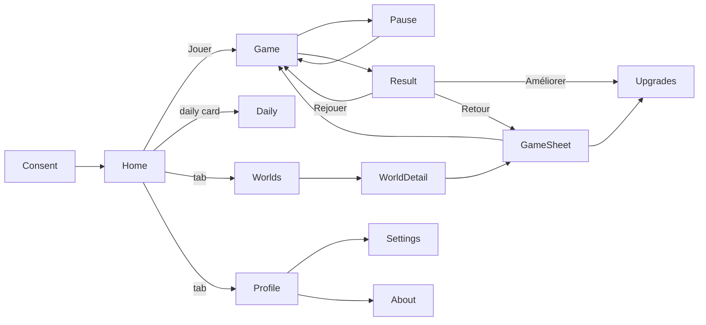

# PRD: Bric-à-Jeux

Status: approved
Project slug: mini-worlds
Final app name: Bric-à-Jeux
Android package: io.github.nhilaire.miniworlds
Version target: 0.2.0
Last updated: 2026-11-13 (v0.2.0 phone test: Tour Bancale stars, Bougies Folles guards, Saute-Lapin smoothness, speed-up and obstacle variety)

> Written in English. Player-facing text is quoted in the "Player copy" section, in every language of the game
> (`factory-app.json` "languages"; French is the reference).
> Status becomes `approved` only after the user explicitly approves this document.

## Summary

Bric-à-Jeux is a family collection of one-finger mini-games in pixel art, tied together by one shared progression.
v0.1.0 ships three mini-games in three different worlds (a falling-blocks arcade game, a turn-based match-3, a
bubble shooter) and the full meta-game core: stars of mastery, XP and global level, coins, per-game upgrades, a
7-day reward calendar, three daily challenges and achievements. Every round lasts 30 seconds to 3 minutes and feeds
the same profile, so playing any game brings the next unlock closer. No ads, no purchases, no account, no backend.
Pitch: « Des mini-jeux pour toute la famille, une progression pour tous. »

## Target players

- Families, parents included: casual players from about 7 years old (reading short sentences) to adults.
- Played on the couch, in transport or in a waiting room; the phone is held in one hand or passed around; a round
  is launched in a few seconds and lasts 30 s to 3 min.
- Accessibility: portrait, every control reachable with the thumb, large buttons, colour is never the only cue
  (each piece type has its own sprite shape), text rendered by the UI in a pixel font with a readable size.
- Tone: tu, light and encouraging.

## Core loop

1. The player opens the app, collects the daily reward if available, sees the three daily challenges.
2. Taps « Jouer » (last played game) or picks a game on the world map.
3. Plays a short round; the score, combos and stars feed the shared profile.
4. The result screen shows score, new best, stars, coins, XP and challenges completed; « Rejouer », « Améliorer »
   or « Retour ».
5. Spends coins on an upgrade of a favourite game, or chases the next star to unlock the next world.

What makes one more round tempting: a star threshold within reach, an upgrade almost affordable, a daily challenge
at 2/3, a world about to unlock. The player always sees the next goal.

## Use cases

| ID | As a player I want to... | So that... |
|---|---|---|
| UC-01 | choose whether to share anonymous statistics at first launch | my privacy is respected |
| UC-02 | start a round in two taps from Home | I can play during a short break |
| UC-03 | learn each mini-game during its first round, with short help bubbles | I never read a rulebook |
| UC-04 | play Pluie de Blocs, Potager Fou and Bulles en Folie with one finger in portrait | the games fit one hand |
| UC-05 | earn stars, coins and XP in every round | each game pushes the same progression |
| UC-06 | see the ten worlds and exactly what unlocks the next one | I never feel blocked arbitrarily |
| UC-07 | buy upgrades for the games I like, with coins earned anywhere | my favourite game gets better |
| UC-08 | collect a reward every day and complete three daily challenges | coming back every day is rewarded |
| UC-09 | unlock achievements shown on my profile | my milestones are visible |
| UC-10 | see my best score and stars per game and my global stats | I can measure my progress |
| UC-11 | pause a round, resume it, or leave it | an interruption does not cost me the round |
| UC-12 | turn sound, vibrations and statistics on or off, pick a theme and a language | the game fits the moment and my choices |
| UC-13 | read why the game exists and who made it | I know the game's story |
| UC-14 | reset my progression | another family member can start from scratch |

## Screens

Three bottom tabs: Accueil (Home), Jeux (Games), Profil (Profile). A game is at most two taps from Home.

- **Consent** (first launch only): explains the anonymous statistics; « Accepter » and « Refuser » equally visible.
- **Home** (tab): level badge and XP bar (« Niveau 4 · 120 / 400 XP »), coin balance, daily reward card when a
  reward is available (opens Daily reward), big « Jouer » button (opens the last played game, or Pluie de Blocs
  if none), the three daily challenges with progress (« 2 / 3 »), « Prochain déblocage » card (world name and
  progress of each condition), « Derniers jeux » row (up to 3 game chips, tap opens the game sheet).
- **Worlds** (tab « Jeux »): vertical list of the 10 world cards: pixel icon, name, state (open / locked /
  coming soon), stars « 2 / 3 » (available stars = 3 × games present), games « 1 / 5 ». A locked world shows
  its condition(s) with progress; a coming-soon world shows « Bientôt » and its indicative condition. Tap on an
  open world opens World detail; tap on a locked or coming-soon world shows the conditions in a sheet.
- **World detail**: name and colour of the world, five slots: the game (icon, name, best score, stars, upgrade
  badge if one is affordable) and four « Bientôt » slots. Tap on the game opens the Game sheet.
- **Game sheet**: large pixel illustration, name, one-line description, « Jouer », best score, stars with their
  thresholds (« 500 · 1500 · 3000 »), « Améliorations » (with the count of affordable upgrades), « Revoir le
  tutoriel » (re-enables the guided round). Android back returns to World detail.
- **Upgrades**: the three upgrades of the game as cards: name, effect, current level « 1 / 3 », next effect,
  cost, « Acheter » (disabled when unaffordable or maxed, « Max » when maxed). Purchase is immediate; the coin
  balance is shown at the top.
- **Game** (one layout per mini-game, see Rules): HUD with score, the game-specific counter (lines, moves left,
  shots before next row), the next star threshold, « Pause » button; the board takes most of the screen.
  Guided first round: help bubbles (see Rules / Tutorial). Android back opens Pause.
- **Pause** (overlay): « Reprendre », « Recommencer », « Quitter » (quitting ends the round with the current
  score, which counts like any round).
- **Result**: animation (score counts up, stars light up one by one, coins and XP fly to their counters), score,
  « Nouveau record ! » when applicable, stars earned (new ones highlighted), coins and XP earned, level-up
  banner when applicable, challenges completed in this round, « Rejouer », « Améliorer », « Retour ».
- **Daily reward**: calendar of 7 days with today's reward highlighted and past days checked, one button
  « Récupérer » (then « Récupéré » and the next day's reward shown). Reached from the Home card.
- **Profile** (tab): avatar (pixel), level and XP, stats (rounds played, games discovered, stars « 4 / 9 »,
  coins earned in total, days played), achievements grid (locked ones greyed with their condition), buttons
  « Paramètres » and « À propos ».
- **Settings**: Son, Vibrations, Thème (Automatique / Clair / Sombre), Langue (Automatique / Français / English),
  Statistiques anonymes (with help text), « Réinitialiser la progression » (confirmation dialog), « Retour ».
- **About** (« À propos »): the story of the game (`about.story`), « Un mot de l'auteur », « Tes données »,
  version; « Retour ».

## Rules and scoring

### Randomness and determinism

All randomness (piece bags, board generation, bubble colours, challenge draw) goes through one seeded
pseudo-random generator. The seed is random in normal play. Opening the app through the deep link
`miniworlds://seed/<integer>` fixes the seed for the session (used by Maestro flows; it has no effect on the
save file). The variant `miniworlds://seed/<integer>/unlocked` also opens every world of this version and every game in memory
for the session and suppresses every write to the save (Maestro flows of Potager Fou, Bulles en Folie and the v0.2.0 smoke flow of the ten new games).

### Worlds and unlocks

| # | World (fr / en) | Content (v0.2.0) | Unlock condition |
|---|---|---|---|
| 1 | Arcade / Arcade | Pluie de Blocs, Tour Bancale, Saute-Lapin | open from the start |
| 2 | Puzzle / Puzzle | Potager Fou, Lucioles, Plombier Express | 2 stars in world 1 |
| 3 | Stratégie / Strategy | coming soon | 6 stars in total (indicative) |
| 4 | Cartes / Cards | Chaussettes Perdues, Vingt-et-Un | 6 stars in total AND level 4 |
| 5 | Bulles / Bubbles | Bulles en Folie, Raz-de-Couleurs | 4 stars in total AND level 3 |
| 6 | Adresse / Skill | Bougies Folles | 9 stars in total AND level 5 |
| 7 | Construction / Building | coming soon | level 12 (indicative) |
| 8 | Exploration / Exploration | coming soon | level 15 (indicative) |
| 9 | Mémoire / Memory | Perroquet Copieur, Champ de Taupes | 12 stars in total AND level 6 |
| 10 | Défis / Challenges | coming soon | level 25 (indicative) |

A world is unlocked the moment its conditions are met (checked after every round and level-up); the unlock is
announced on the Result screen (« Monde débloqué : Puzzle ! ») and the world card changes state. Coming-soon
worlds never unlock in this version even when their indicative condition is met: their card keeps « Bientôt » and the
condition is shown as « à venir ». Unlocks are permanent.

Games inside a world (v0.2.0): the first game of a world is playable as soon as the world is unlocked; its k-th
game (k ≥ 2) needs 2 × (k − 1) stars earned in that world (Tour Bancale and Lucioles: 2 stars, Saute-Lapin and
Plombier Express: 4 stars). A game unlocked this way in a world that was already open is announced on the Result
screen (« Nouveau jeu : Tour Bancale ! »); its card shows its condition while it is locked (« 2 étoiles dans
Arcade ») and cannot be opened. Game unlocks are derived from the stars (nothing new is saved).

### Stars

Each game has three score thresholds. A star is earned when the round score reaches the threshold; stars are kept
forever (a lower score later never removes one). 39 stars exist in v0.2.0.

| Game | 1 star | 2 stars | 3 stars |
|---|---|---|---|
| Pluie de Blocs | 1 000 | 2 500 | 5 000 |
| Potager Fou | 1 500 | 3 000 | 5 000 |
| Bulles en Folie | 800 | 2 000 | 4 000 |
| Tour Bancale | 150 | 300 | 500 |
| Saute-Lapin | 150 | 350 | 600 |
| Lucioles | 500 | 750 | 950 |
| Plombier Express | 700 | 1 100 | 1 400 |
| Raz-de-Couleurs | 800 | 2 000 | 3 500 |
| Chaussettes Perdues | 800 | 1 600 | 2 800 |
| Vingt-et-Un | 400 | 600 | 750 |
| Bougies Folles | 200 | 450 | 800 |
| Perroquet Copieur | 150 | 400 | 800 |
| Champ de Taupes | 400 | 900 | 1 500 |

### XP and global level

- XP per round = 10 + floor(score / 50), capped at 100; plus 25 XP per new star earned in that round.
- Level starts at 1. XP needed to go from level L to L+1 = 100 × L (1→2: 100, 2→3: 200, 3→4: 300...).
  XP in excess carries over; several levels can be gained in one round. Level cap: 50 (XP still accumulates).
- Level-up reward: 25 × new level coins, granted immediately and shown on the Result screen, or on the Daily
  reward screen when the level-up comes from the day-7 XP (same for a world unlock triggered there).

### Coins

- Coins per round = 10 + floor(score / 25), multiplied by the game's « Bonus pièces » upgrade (1 + 0.10 × level),
  rounded down; plus 50 coins per new star earned in that round.
- Other sources: level-up rewards, daily rewards, daily challenges, achievements. Coins are only spent on
  upgrades (v0.1.0). The balance never goes negative; purchases are refused when unaffordable.
- Lifetime coins earned (never decreased) is kept for stats and achievements.

### Upgrades

Each of the first three games has three upgrades; each v0.2.0 game has two (see below). Every upgrade has three levels. Cost of level 1 / 2 / 3: 250 / 600 / 1 200 coins (same for every
upgrade; raised ×2.5 after the first phone test, where one session bought a whole upgrade line). Buying is immediate; the effect applies from the next round.

| Game | Upgrade (fr) | Effect per level |
|---|---|---|
| Pluie de Blocs | Aperçu | shows the next 1 / 2 / 3 pieces (0 without the upgrade) |
| Pluie de Blocs | Départ en douceur | initial fall interval 800 ms + 80 ms per level |
| Pluie de Blocs | Bonus pièces | coins per round +10 % per level |
| Potager Fou | Coup en plus | +1 move per level (20 → 23) |
| Potager Fou | Récolte en cascade | cascade multiplier +0.5 per level (see scoring) |
| Potager Fou | Bonus pièces | coins per round +10 % per level |
| Bulles en Folie | Visée | aim guide shows 0 / 1 / 2 / 3 wall bounces |
| Bulles en Folie | Prochaine bulle | shows the next 1 / 2 / 3 bubbles (0 without the upgrade) |
| Bulles en Folie | Bonus pièces | coins per round +10 % per level |
| Tour Bancale | Grand plateau | base floor +0.5 unit per level (4 → 5.5) |
| Saute-Lapin | Carapace | 1 / 2 / 3 shields per round |
| Lucioles | Indice | 1 / 2 / 3 hints per round |
| Plombier Express | Indice | 1 / 2 / 3 hints per round |
| Raz-de-Couleurs | Coup en plus (id more_moves) | +1 move per board per level |
| Chaussettes Perdues | Coup d'œil | cards shown 1 / 2 / 3 s at the start of each board |
| Vingt-et-Un | Main en plus | +1 hand per level (10 → 13) |
| Bougies Folles | Gâteau lent | rotation −8 % per level |
| Perroquet Copieur | Seconde chance | 1 / 2 / 3 second chances per round |
| Champ de Taupes | Radar | 1 / 2 / 3 radar uses per round |

The ten v0.2.0 games have two upgrades each: the one above and « Bonus pièces » (coins per round +10 % per level).

### Daily reward

- Calendar of 7 days: 100, 150, 200, 250, 300, 400, 600 coins; day 7 also grants 100 XP.
- A day is identified by the device's local date (YYYY-MM-DD). The reward can be collected at most once per local
  date. The save keeps `lastCollectedDate` (none at first) and `calendarDay` (0 at first, then 1-7): without
  `lastCollectedDate`, the first collection is day 1.
- Collecting on the day after `lastCollectedDate` advances `calendarDay` by one (8 wraps to 1). A gap of exactly
  one missed day keeps `calendarDay` (the player collects the same day again). A gap of two or more missed days
  resets `calendarDay` to 1. A device date earlier than `lastCollectedDate` counts as already collected.
- The Home card appears when the reward is collectable; the reward is added when « Récupérer » is tapped (never
  silently).

### Daily challenges

- Three challenges per local date: « Jouer 3 parties » is always the first; the two others are drawn without
  replacement from the rest of the pool below with the seeded generator (seed = hash of the date, or the session
  seed when the app was opened through the seed deep link), among challenges whose game (if any) is playable now (world and game unlocked)
  (« Jouer à 2 jeux différents » needs at least 2 unlocked games). The draw is recomputed when the date changes;
  progress of the previous date is discarded.
- Progress is counted from rounds ended on that date (including rounds quit from Pause). Each completed
  challenge grants its reward once; completing all three grants 50 bonus coins.

| ID | Challenge (fr) | Target | Reward |
|---|---|---|---|
| rounds3 | Jouer 3 parties | 3 rounds | 25 coins |
| games2 | Jouer à 2 jeux différents | 2 distinct games | 25 coins |
| star1 | Gagner une étoile | 1 new star | 50 coins |
| combos5 | Faire 5 combos | 5 combos (see per-game definition) | 50 coins |
| coins200 | Gagner 200 pièces en jouant | 200 coins from rounds | 50 XP |
| score_blocks | Marquer 1000 points à Pluie de Blocs | one round ≥ 1000 | 50 coins |
| score_garden | Marquer 1500 points à Potager Fou | one round ≥ 1500 | 50 coins |
| score_bubbles | Marquer 800 points à Bulles en Folie | one round ≥ 800 | 50 coins |
| score_<game> | Marquer <1-star threshold> points à <game>, for each of the 10 v0.2.0 games | one round ≥ the 1-star threshold | 50 coins |

### Achievements

| ID | Name (fr) | Condition | Reward |
|---|---|---|---|
| first_round | Première partie | 1 round ended | 25 coins |
| rounds10 | Dix parties | 10 rounds | 50 coins |
| rounds100 | Cent parties | 100 rounds | 200 coins |
| first_star | Première étoile | 1 star | 50 coins |
| all_stars | Ciel étoilé | 39 stars | 500 coins |
| explorer | Explorateur | 3 games played at least once | 100 coins |
| globetrotter | Globe-trotteur | 10 different games played at least once | 200 coins |
| first_upgrade | Bricoleur | 1 upgrade bought | 50 coins |
| maxed_upgrade | Expert | 1 upgrade at level 3 | 150 coins |
| level5 | Niveau 5 | level 5 | 100 coins |
| level10 | Niveau 10 | level 10 | 250 coins |
| week | Semaine complète | day 7 of the calendar collected | 200 coins |
| rich | Trésor | 5 000 coins earned in total | 150 coins |

Achievements are checked after every round, purchase and collection; each unlocks once and is announced with a
toast (« Succès : Première étoile ») and listed on the Profile.

### Common mini-game contract

Every mini-game implements the same interface: `init(seed, upgrades)`, `start()`, `pause()`, `resume()`,
`input(event)`, `tick(dt)` (real-time games), `state()` for rendering, and emits `combo` and `end(score)`.
In code every engine (the ten v0.2.0 games included) is a pure reducer `create(seed, upgrades)` /
`reduce(state, action)` with time as a `tick` action; the state carries `score`, `combos`, `status` and the
`events` of the last transition (`combo`, `over`...), and the game screen adapts it to the round frame.
The core engine, not the game, converts the score into stars, coins, XP, challenge progress and achievements.
A round quit from Pause ends with the current score. « Recommencer » ends the current round like « Quitter »
(settled, outcome quit) and starts a new one. Backgrounding the app pauses a running round and shows the Pause
overlay on return.

Short rounds: a round that lasted less than 20 s (paused time excluded) is not settled: no coins, no XP, no star,
no best score, it does not count as a round for stats, challenges and achievements. The Result screen shows the
score and « Partie trop courte : pas de récompense ». This prevents farming the fixed part of the rewards by
quitting at once.

### Pluie de Blocs (world Arcade)

- Board 10 columns × 16 rows; 7 tetrominoes (I, O, T, S, Z, J, L) drawn with a 7-bag; spawn centred at the top.
- Controls: horizontal drag moves the piece one cell per 1/10 of the board width; tap rotates clockwise (wall
  kicks: try 1 cell left then right; otherwise the rotation is refused); swipe down hard-drops.
- Gravity: the piece falls one row every interval; interval (ms) = max(150, 800 + 80 × slowStartLevel − 50 ×
  floor(lines / 10) − 25 × floor(piecesLocked / 5)): the fall speeds up gently with every 5 pieces locked, even
  when no line is cleared (first phone test: a round without lines never felt faster). The « level » shown is floor(lines / 10) + 1.
- Lock: a piece that cannot fall locks after 300 ms; completed rows disappear; rows above shift down.
- Scoring: 1 / 2 / 3 / 4 lines at once = 100 / 300 / 500 / 800 points; hard drop = 1 point per row dropped
  (1 point, not more: the stars must reward lines, not drops).
  Back-to-back: clearing lines with two consecutive locked pieces adds 50 × (chain length − 1).
- Combo (for challenges): a clear of 2 or more lines at once, or a back-to-back clear.
- End: a new piece overlaps existing blocks at spawn. Expected round: 1-3 min.
- Ghost piece: the landing position of the current piece is outlined for the first 5 locked pieces of each
  round, then hidden (the player has seen how the piece lands; the shadow would clutter the board afterwards).
- Tutorial bubbles (guided first round, fall slowed to one row every 2 s while a bubble is shown, normal
  interval from the moment the last bubble is dismissed): « Glisse pour déplacer » (dismissed
  by a horizontal drag), « Touche pour tourner » (by a tap), « Glisse vers le bas pour lâcher » (by a swipe down).

### Potager Fou (world Puzzle)

- Board 7 columns × 8 rows; 5 vegetable types (carotte, tomate, aubergine, maïs, brocoli), each with its own
  colour and sprite shape. From the 11th move, the refill also draws a 6th type (oignon).
- Initial board: generated without any existing line of 3 and with at least one valid move. When no valid move
  exists after cascades, the board is shuffled automatically: the result has no line of 3 and at least one valid
  move, scores nothing and consumes no move.
- Controls: swipe on a piece towards a neighbour swaps them. A swap that creates no line of 3 bounces back and
  does not consume a move. A valid swap consumes one move.
- Moves: 20 (+ « Coup en plus »). The HUD shows moves left.
- Matching: lines of 3+ identical pieces (horizontal or vertical) are removed; pieces above fall; new pieces
  refill from the top; cascades repeat until no line exists.
- Scoring: line of 3 = 100, of 4 = 200, of 5+ = 400 (an L or T shape counts its lines separately). Cascade
  multiplier: lines removed in the k-th cascade step (k = 1 for the direct result of the swap) are multiplied by
  1 + (k − 1) × m, with m = 1 (+0.5 per « Récolte en cascade » level).
- Combo (for challenges): a cascade step with k ≥ 2.
- End: no move left (after the last cascade). Expected round: 1-2 min.
- Feedback of a swap (first phone test: the board looked like a new puzzle after each move): the engine settles
  the swap at once (score, moves, HUD), then the screen replays it from the engine events: the two pieces slide
  (160 ms); a refused swap slides back; for each cascade step the aligned pieces are framed and flash with the
  points of the step popping above them (300 ms), shrink away (140 ms), then the pieces above slide down and the
  new ones enter from the top (240 ms). Inputs are locked while the replay runs (under 1 s per step).
- Tutorial bubble: « Glisse un légume vers son voisin pour aligner 3 identiques » (dismissed by a valid swap).

### Bulles en Folie (world Bubbles)

- Grid of 9 columns, rows offset by half a bubble (hexagonal packing), 12 rows visible; the launcher is below
  row 12. Start: 5 rows filled. 5 colours (rouge, jaune, vert, bleu, violet), each with its own face sprite.
- Controls: touch and drag anywhere to aim (the guide line shows the direction, and bounces per « Visée »
  level); release to shoot. Drag released below an angle of 10° from the horizontal does not shoot.
- The bubble flies in a straight line at constant speed, bounces on the side walls, and snaps to the nearest
  free cell adjacent to the first bubble (or the top row) it touches.
- Pop: a group of 3+ same-colour bubbles including the new one is removed; bubbles no longer connected to the
  top row then drop.
- Scoring: 10 points per popped bubble, 20 per dropped bubble. The next colour is drawn among colours still on
  the board.
- Pressure: a new row is pushed from the top every 6 shots; every 5 shots after 20 shots; every 4 after 40.
  The HUD shows shots left before the next row.
- Combo (for challenges): a shot that pops 5+ bubbles or drops at least one bubble.
- End: any bubble occupies row 12 (by snap or by a row push). An empty board grants 500 bonus points, is
  refilled with 5 rows and the round continues; the shot counter is not reset. Expected round: 1-3 min.
- Feedback of a shot (second phone test: the field jumped to its final state): the engine settles the shot at
  once (score, HUD), then the screen replays it from the engine events: the bubble flies along the engine path at
  22 units/s (bounces visible), the popped group glows and pulses with its points popping above it (250 ms), shrinks
  away (120 ms), the disconnected bubbles fall out of the field with their points (320 ms), and a pushed row slides
  the whole stack down one row (180 ms). Inputs are locked while the replay runs.
- Tutorial bubbles: « Garde le doigt appuyé pour viser » (dismissed after a drag of 0.5 s), « Relâche pour
  tirer » (by a release that shoots).

### v0.2.0: ten more mini-games (concept test)

After the acceptance of v0.1.0, the user asked for about ten more games before publishing, « pour voir si le
concept tient ». Choices: three new worlds open (Cartes, Adresse, Mémoire) plus new games in Arcade, Puzzle and
Bulles; finish « jouable et testé » (pure engine with unit tests, screen, one tutorial bubble, 3 stars, two
upgrades: one of the game + « Bonus pièces », sounds of the existing kit, short animation of each move, one
shared Maestro smoke flow); games unlock one by one inside a world.

Common rules of the ten games:

- Inputs are taps on cells or buttons (each with a testID). Each move is shown by a short animation (≤ 250 ms:
  flip, rotation, slide, fade); inputs are ignored while it runs only when the rule says so.
- One tutorial bubble per game, dismissed by the first action it describes; real-time games do not advance while
  it is shown.
- The engine is a pure reducer like the first three games (`create(seed, upgrades)`, `reduce(state, action)`,
  time as a `tick` action); the screen reads the injectable clock for any timer.
- Sounds: tick (move), clear / combo / pop (success), drop (failure of a move), over (end).

#### Tour Bancale (world Arcade, 2nd game) - real time

- Field 10 units wide. The base floor is 4 units wide (+0.5 per « Grand plateau » level). The moving block has
  the width of the top floor and slides left-right between 0 and 10 − width, bouncing on the edges, at
  4 units/s + 0.25 per floor placed (capped at 12 units/s). The base floor is centred (x = 3 to 7 without
  upgrade); each new block starts at the left edge moving right.
- Tap: the block drops onto the stack. Overlap = intersection with the top floor. Overlap ≤ 0: round over. If
  the offset from the top floor is ≤ 0.15 unit, the drop is perfect: the block is aligned, the width is kept and
  the perfect streak grows by 1; otherwise the new floor is the overlap only and the streak returns to 0.
- Scoring: 10 points per floor placed, plus 5 × streak on a perfect drop (1st perfect +5, 2nd in a row +10...).
- Combo (challenges): a perfect drop. HUD: floors. Stars 150 / 300 / 500 (phone test: 26 floors gave one star
  with 200 / 450 / 800).
- Tutorial bubble: « Touche pour lâcher le bloc » (dismissed by the first drop).

#### Saute-Lapin (world Arcade, 3rd game) - real time

- Side view, ground at y = 0, the bunny at x = 2 (box 0.8 × 0.8). Obstacles spawn at x = 12 and move left at
  6 units/s + 0.35 per obstacle passed (capped at 15: reached around the 26th obstacle; phone test: the speed-up of
  + 0.2 up to 14 was not felt and the game got boring fast).
- Obstacle kinds, one seeded draw per spawn: before 10 obstacles passed, fence 60 % (1 wide, 1 high), tall fence
  25 % (1 wide, 1.5 high), hedge 15 % (2 wide, 1 high); from 10 obstacles passed, fence 40 %, tall fence 20 %,
  hedge 20 %, bird 20 % (1 wide, flying from y = 1.3 to 1.9: the bunny on the ground passes under it, a jump at the
  wrong moment hits it). A hit is an overlap of the boxes (touching edges do not count).
- The next obstacle spawns when the gap between the last obstacle's right edge and x = 12 reaches a seeded
  distance between max(5, 0.8 × speed) and max(10, 1.8 × speed) units (speed in units/s: from 0.8 s, longer than
  one jump, to 1.8 s between two obstacles, so quick sequences alternate with breathers).
- Tap while on the ground: jump (vertical speed 13.5 units/s, gravity 36 units/s²: apex 2.53 units, 0.75 s in the
  air; 12 units/s left only a 33 ms window over a 1.5-high fence at the start, found while building the game).
  A tap in the air is ignored.
- A hit (boxes overlap) consumes a shield (« Carapace »: 1 / 2 / 3 shields per round) and removes that obstacle (no points, the streak returns to 0);
  without shield the round is over.
- Scoring: 10 points per obstacle passed. Combo (challenges): every 5th obstacle passed in a row without a hit.
- HUD: shields left. Stars 150 / 350 / 600.
- Tutorial bubble: « Touche pour sauter » (dismissed by the first jump).

#### Lucioles (world Puzzle, 2nd game) - turn based

- Grid of fireflies (4 × 4 or 5 × 5, see below), lit or off. Tapping a cell toggles it and its 4 orthogonal neighbours. Goal: all off.
- A round is 5 grids. Grid k (1-5) is built by pressing 1 + k distinct seeded cells on an all-off grid; par =
  1 + k (phone test: 3 + k on 5 × 5 was far too hard). Grids 1 and 2 are 4 × 4, grids 3 to 5 are 5 × 5. Grid score: max(50, 200 − 20 × (taps beyond par)). A grid still unsolved after par + 15 taps is failed (0 points). Hints are not taps.
  Either way the next grid comes; the round ends after the 5th grid (maximum 1 000 points).
- « Indice »: 1 / 2 / 3 hints per round; a hint highlights one cell of a solution (the seeded presses XOR the
  player's taps, so the hint is always right).
- Combo (challenges): a grid solved in at most par taps. HUD: grid k / 5, taps. Stars 500 / 750 / 950.
- Tutorial bubble: « Touche une luciole : elle et ses voisines changent. Éteins tout ! » (dismissed by a tap).

#### Plombier Express (world Puzzle, 3rd game) - turn based

- Grid 5 × 5 of pipe pieces (straight or elbow). Water enters the left side of a seeded row and must leave by the
  right side of a seeded row. Each grid holds one seeded self-avoiding path from entry to exit (pieces matching
  the path); the other cells get random pieces; every cell is then turned a random number of quarter turns.
- Tap a piece: it turns a quarter turn clockwise. The grid is solved when the pieces connected from the entry
  reach the exit (any path counts). Pieces connected to the entry are drawn filled with water.
- Par = the sum over the path cells of the quarter turns that bring them back (a straight piece needs 0 or 1).
  Grid score: max(50, 300 − 15 × (taps beyond par)); a grid still unsolved after par + 20 taps is failed (0 points);
  hints are not taps. A grid that is already solved after the random turns is turned again (par ≥ 1). A round is
  5 grids (maximum 1 500 points).
- « Indice »: 1 / 2 / 3 hints per round; a hint highlights a path cell that is not yet turned right.
- Combo (challenges): a grid solved in at most par taps. HUD: grid k / 5, taps. Stars 700 / 1 100 / 1 400.
- Tutorial bubble: « Touche un tuyau pour le tourner. Relie l'eau à la sortie ! » (dismissed by a tap).

#### Raz-de-Couleurs (world Bubbles, 2nd game) - turn based

- Grid 10 × 10 of 5 colours (the bubble colours and their shapes). The tide is the region of the top-left cell's
  colour connected to it. Tapping one of the 5 colour buttons (not the tide's colour) recolours the tide, which
  absorbs the adjacent cells of that colour.
- Board n has 20 − (n − 1) moves (minimum 12), + 1 per « Coup en plus » level. A board filled with one colour
  scores 500 + 100 × moves left and the next board starts. A board whose moves run out scores 3 × cells in the
  tide and the round is over.
- Combo (challenges): a board won with 3 or more moves left. HUD: board n, moves left. Stars 800 / 2 000 / 3 500.
- Tutorial bubble: « Touche une couleur : ta vague grandit depuis le coin » (dismissed by a colour tap).

#### Chaussettes Perdues (world Cartes, 1st game) - turn based

- Cards face down hold sock patterns, two of each. Board n has 6 + 2 × (n − 1) pairs (maximum 12), in 4 columns.
- Tap a face-down card: it turns up. With two cards up: same sock → the pair stays up, + 100 + 50 × the number of
  pairs found in a row just before it; different socks → one miss, both turn back down on the next tap (that tap only hides
  them, it turns no card) or after 700 ms. A miss resets the streak; the streak carries over between boards.
- A board fully found scores 200 more and the next board starts. 8 misses in the round end it.
- « Coup d'œil »: every card is shown face up for 1 / 2 / 3 s at the start of each board (inputs ignored).
- Combo (challenges): every 3rd pair found in a row. HUD: board n, misses left. Stars 800 / 1 600 / 2 800.
- Tutorial bubble: « Retourne deux cartes pour trouver la paire » (dismissed by a first card).

#### Vingt-et-Un (world Cartes, 2nd game) - turn based

- A 52-card deck, shuffled for each hand (seeded). 2-10 count their value, figures 10, the ace 1 or 11. No bet,
  no money: points only.
- Each hand: the player gets 2 cards, the dealer 1 card up and 1 down. Buttons « Tirer » (one more card) and
  « Rester ». Over 21: the hand is lost at once. On « Rester », the dealer shows its card and draws until 17 or
  more (it stands on every 17, a soft one included). Dealer over 21: won hand. Otherwise the higher total wins,
  equal totals tie. A dealer 21 with its first two cards is only checked on « Rester » (or against a player's 21).
- Points: 21 with the first two cards (« Vingt-et-un ! ») 150 at once (25 if the dealer also has it); won hand
  100; tie 25; lost hand 0. « Main suivante » starts the next hand.
- 10 hands per round (+1 per « Main en plus » level); the round ends after the last one.
- Combo (challenges): every 3rd hand won in a row. HUD: hand k / n. Stars 400 / 600 / 750 (luck weighs a lot: 900 was
  out of reach for most rounds).
- Tutorial bubble: « Approche-toi de 21 sans dépasser : Tirer ou Rester » (dismissed by either button).

#### Bougies Folles (world Adresse, 1st game) - real time

- A cake turns at the centre; candles are thrown from the bottom and stick in the cake edge at the bottom point.
  Cake n needs 5 + n candles thrown (maximum 12; the pre-placed ones excluded), already holds min(n − 1, 4) seeded
  candles at least 30° apart, turns at min(250, 90 × (1 + 0.15 × (n − 1))) × (1 − 0.08 × « Gâteau lent » level) °/s,
  clockwise for the first cake, and changes direction at each cake.
- Tap: a candle is planted at once (a 120 ms flight is only drawn). If it lands less than 14° (cake frame) from
  another candle, the round is over.
- Guards (phone test: a quick double tap lost the round, and a tap carried over onto the next cake): a throw within
  250 ms of the previous one is ignored; when a cake is completed, the next cake stands still for 1 s with a
  « Gâteau n » banner and throws are ignored meanwhile. No flight is drawn for an ignored throw.
- Scoring: 10 points per candle planted, 100 per cake completed; the next cake follows.
- Combo (challenges): a cake completed. HUD: cake n, candles left. Stars 200 / 450 / 800.
- Tutorial bubble: « Touche pour lancer une bougie. Ne touche pas les autres ! » (dismissed by the first throw).

#### Perroquet Copieur (world Mémoire, 1st game) - turn based

- Four pads of distinct colour and shape (red circle, blue square, yellow triangle, green diamond), each with
  its tone. The parrot shows a sequence (starting at length 1, one seeded pad added each step): each pad lights
  for 500 − 20 × (length − 1) ms (minimum 250 ms), with 150 ms off between two pads and 600 ms before the
  sequence starts; inputs are ignored meanwhile. Then the player repeats it.
- The whole sequence repeated: 10 × length points, the next sequence (length + 1) is shown. A wrong pad: with a
  « Seconde chance » left (1 / 2 / 3 per round) the same sequence is shown again; otherwise the round is over.
- Combo (challenges): a sequence of length 5, 10, 15... repeated. HUD: length. Stars 150 / 400 / 800.
- Tutorial bubble: « Regarde le perroquet, puis répète la même suite » (dismissed by the first pad tapped).

#### Champ de Taupes (world Mémoire, 2nd game) - turn based

- Grid 8 × 8; board n hides 8 + 2 × (n − 1) moles (maximum 16). The first dig of a board is always safe: moles
  are placed after it, never on that cell nor its neighbours (seeded).
- Tap a covered cell: dig. A safe cell shows the number of neighbouring moles (8 neighbours); a 0 also digs its
  neighbours, repeatedly. A mole ends the round. The « Drapeau » button toggles flag mode: a tap then flags or
  unflags a covered cell (a flagged cell cannot be dug).
- Scoring: 5 points per safe cell revealed; 300 when every safe cell is revealed, then the next board starts.
- « Radar »: 1 / 2 / 3 uses per round; a use flags the first unflagged mole in seeded order (after the
  first dig of the board); it is refused, no use spent, when every mole is flagged.
- Combo (challenges): one dig that reveals 10 or more cells. HUD: board n, moles left to flag. Stars 400 / 900 / 1 500.
- Tutorial bubble: « Touche une case pour creuser. Les chiffres comptent les taupes voisines » (dismissed by a dig).

### Tutorial (guided first round)

The first round of each game shows its help bubbles in order; each disappears when its action is performed. The
flag `tutorialDone[game]` is saved when the last bubble is dismissed; « Revoir le tutoriel » on the Game sheet
clears it. Real-time games pause their timers while a bubble is shown.

### Persistence

- One local save (AsyncStorage, key `save`), JSON with `schemaVersion: 1`, written after every change
  (debounced 300 ms) and read at start. Content: profile (xp, level, coins, lifetimeCoins, roundsPlayed,
  daysPlayed, lastPlayedDate, lastPlayedGame), per-game data keyed by game id (bestScore, stars, rounds,
  upgrades levels, tutorialDone), unlockedWorlds, daily reward state, daily challenges state (date, ids,
  progress, completed), achievements unlocked, settings (sound, vibrations, theme, language, consent).
- Unknown game ids and unknown fields are preserved, not dropped; a missing field takes its default. A save with
  a higher schemaVersion than the app knows is kept untouched: the app starts with defaults in memory and
  suppresses every write for that session (read-only session).
- « Réinitialiser la progression » clears everything except settings and consent.

## Look, sound and feel

- Pixel art drawn in code: each sprite is a small grid (8×8 to 16×16) of palette indices in TypeScript, rendered
  with crisp scaling; UI chrome uses rounded pixel frames. Limited palette, colour-blind safe (every game piece has
  a distinct shape). Free pixel font (Jersey 20, OFL; softer than Press Start 2P, which the first phone test found too harsh, and with
  digits that stay distinct from letters, unlike Pixelify Sans whose 5 reads as an S) for titles and HUD, a readable
  pixel or system font for body text. No external image file, no copyrighted material; game and world names are original.
- Launcher icon and splash screen (first phone test: the Expo placeholders were still there): a pixel « toy box »,
  a cream rounded tile holding four game pieces (arcade box, bubble, tomato, trophy) on the orange accent, drawn by
  `scripts/generate-icons.mjs` from the game sprites (adaptive icon layers, monochrome layer, legacy icon, splash
  image, favicon). The splash shows the tile on the light background (dark background in dark mode), no text (the
  app name differs per language).
- Theme: follows the phone (light / dark) with a choice in Settings; each world has a dominant colour.
- Animations: short and juicy (≤ 400 ms): piece lock flash, line clear, cascades, bubble pop and drop, result
  count-up, stars lighting one by one, coins flying to the counter, level-up banner, world unlock reveal.
- Sound effects only (no music): move/rotate, line clear, match, cascade, pop, drop, star, coin, level-up,
  reward, button. Haptics: light tick on key events (line clear, match, pop, star, reward). Both toggles in
  Settings. Portrait only.

## Telemetry events

Only events listed here may be sent (after consent). Params: numbers, booleans or short enums. No identifiers.
`game` ∈ {blocks, garden, bubbles, tower, hop, lights, pipes, flood, socks, twentyone, candles, parrot, moles}; `world` ∈ {arcade, puzzle, cards, bubbles, skill, memory}; `outcome` ∈ {ended, quit, short}.

| Event | When | Params | Feeds KPI |
|---|---|---|---|
| round_start | a round starts | game | Rounds per session, Rounds per game |
| round_end | a round ends (end or quit) | game, score, duration_s, stars_new, outcome | Score distribution, Rounds per game |
| tutorial_complete | last help bubble dismissed | game | Tutorial completion |
| level_up | the level increases | level | Level funnel |
| world_unlock | a world unlocks | world | World unlock rate |
| upgrade_buy | an upgrade is bought | game, upgrade (enum), level | Upgrade purchases, Replay after upgrade |
| daily_reward_collect | the daily reward is collected | day | Daily reward rate |
| daily_challenge_complete | a challenge completes | challenge (enum) | Challenge completion |
| achievement_unlock | an achievement unlocks | achievement (enum) | Achievement progress |
| settings_change | a setting changes | setting (enum), value (enum) | Settings usage |

## KPIs

Business and technical indicators followed in Firebase (free Spark plan). Details and console paths in `docs/KPIS.md`.

| KPI | Type | Target | Source |
|---|---|---|---|
| D1 retention | business | ≥ 35 % | Analytics > Retention |
| D7 retention | business | ≥ 15 % | Analytics > Retention |
| Rounds per session | business | ≥ 3 | `round_start` count / `session_start` count |
| Rounds per game | business | no unlocked game < 3 % of rounds | `round_start` by `game` |
| World unlock rate | business | ≥ 60 % of users unlock Puzzle, ≥ 30 % Bubbles | `world_unlock` by `world` / users |
| Daily reward rate | business | ≥ 50 % of DAU collect | `daily_reward_collect` / DAU |
| Replay after upgrade | business | ≥ 70 % of `upgrade_buy` followed by `round_start` in the session | Funnel exploration upgrade_buy → round_start |
| Challenge completion | business | ≥ 1 `daily_challenge_complete` per DAU | `daily_challenge_complete` / DAU |
| Upgrade purchases | business | ≥ 2 `upgrade_buy` per user in the first week | `upgrade_buy` by `game` / users |
| Tutorial completion | business | ≥ 90 % of users with `round_start` on a game send `tutorial_complete` for it | funnel round_start → tutorial_complete by `game` |
| Level funnel | business | ≥ 50 % of users reach level 3, ≥ 20 % level 10 | `level_up` by `level` / users |
| Score distribution | business | tracked (median per game, used to rebalance star thresholds) | `round_end` metric `score` by `game` |
| Achievement progress | business | tracked (users with ≥ 3 achievements) | `achievement_unlock` / users |
| Settings usage | business | tracked (share of users changing language or theme) | `settings_change` by `setting` |
| Consent rate | business | tracked (approximation: users with events vs installs; refusals send nothing) | Analytics users vs Play installs |
| Crash-free users | technical | ≥ 99 % | Crashlytics |
| Cold start | technical | < 3 s | evidence report (`verify.mjs`) |

## Non-functional requirements

- Performance: smooth on a mid-range Android phone (no visible jank during play, real-time games at the display
  refresh rate), cold start < 3 s.
- APK size (arm64): target < 40 MB (< 55 MB if the stack ADR picks a GL/Skia renderer).
- Works fully offline. No account. No ads. No in-app purchases.
- Android: minSdk from the stack defaults; portrait only.
- Privacy: opt-in telemetry, no personal data, AD_ID permission removed.
- Game logic (the three games and the core engine) is pure TypeScript without React, unit-testable and
  deterministic under a seed.

## Acceptance criteria

Each criterion is testable and tagged with its proof: `[unit]` Jest, `[e2e]` Maestro flow, `[device]` check on the
phone, `[manual]` human judgement (keep these rare).

Languages and consent

- AC-01 [e2e] Given a first launch on a French phone, when the app opens, then the consent screen is shown in
  French with « Accepter » and « Refuser » equally visible; tapping « Refuser » shows Home and the consent
  screen never comes back.
- AC-02 [unit] Given a phone in English / in French / in an unsupported language (e.g. de), then the UI language
  resolves to en / fr / en.
- AC-03 [e2e] Given Settings, when the player picks « English », then the whole UI switches at once (tabs,
  « Settings », « Sound ») and the choice survives a restart; « Automatique » follows the phone again.
- AC-04 [device] Given the release APK, when `aapt dump badging` is read, then the application label is
  « Bric-à-Jeux » for `fr` and « Game Grab-Bag » for `en` and by default (the default resource carries the
  fallback language, English, so a phone in an unsupported language shows the same language under the icon as in
  the game).
- AC-05 [unit] Given the dictionaries `fr.ts` and `en.ts`, then they have exactly the same keys and shapes and
  no value is empty; every mini-game, world, upgrade, challenge and achievement has a name in both.

Core engine

- AC-06 [unit] Given a round score s and n new stars, when the round is settled, then XP = min(100, 10 +
  floor(s / 50)) + 25 n and coins = floor((10 + floor(s / 25)) × (1 + 0.1 × bonusLevel)) + 50 n (examples:
  s = 3000, n = 1, bonus 0 → 95 XP and 180 coins; s = 0, n = 0 → 10 XP, 10 coins); given a round shorter than
  20 s, when it ends, then it grants nothing and is not counted.
- AC-07 [unit] Given level L and XP, when XP reaches 100 × L, then the level becomes L+1, the excess carries
  over, the level-up grants 25 × (L+1) coins, and one round can gain several levels (e.g. 350 XP at level 1 →
  level 3 with 50 XP left and 50 + 75 coins); the level never exceeds 50.
- AC-08 [unit] Given the star thresholds, when a round scores exactly a threshold, then the star is earned; a
  later lower score keeps every star; stars earned twice are not counted twice.
- AC-09 [unit] Given the unlock rules, then world 1 is open at start; world 2 unlocks exactly when world 1 has 2
  stars; world 5 unlocks exactly when total stars ≥ 4 and level ≥ 3 (not before, e.g. 4 stars at level 2); worlds
  3, 4, 6-10 never unlock in v0.1.0; unlocks are permanent.
- AC-10 [unit] Given 300 coins, when the player buys an upgrade at level 0, then its level is 1 and 50 coins
  remain; buying level 2 (600) is then refused as unaffordable; levels above 3 are refused; costs are 250 / 600 /
  1 200.
- AC-11 [unit] Given the daily reward state, when the player collects on consecutive local dates, then the first
  collection is day 1 and the calendar advances 1 → 2 → ... → 7 → 1 with rewards 100 / 150 / 200 / 250 / 300 / 400 / 600 (+100 XP on day
  7); a second collection on the same date is refused; a one-day gap keeps the calendar day; a two-day gap resets
  it to 1; a device date earlier than the last collection is treated as collected.
- AC-12 [unit] Given a date and the unlocked games, when the three daily challenges are drawn, then the first is
  « Jouer 3 parties », the two others are distinct challenges from the pool, only referring to unlocked games
  (« Jouer à 2 jeux différents » only with 2+ unlocked games), identical for the same date and unlocked set (or
  for the same session seed), and progress is discarded when the date changes.
- AC-13 [unit] Given the challenges of the day, when rounds end, then each challenge's progress follows its
  definition (rounds, distinct games, new star, combos, coins from rounds, score per game), each reward is
  granted once, and 50 bonus coins are granted when the third completes.
- AC-14 [unit] Given the achievement list, when rounds, stars, upgrades, levels, calendar day 7 and lifetime
  coins reach each condition, then the matching achievement unlocks exactly once with its reward.
- AC-15 [unit] Given a save file, when it is written and read back, then the state is identical; a save with
  missing fields takes defaults; unknown game ids and fields are preserved; a higher schemaVersion is left
  untouched, the app starts with defaults and writes nothing during that session; « Réinitialiser » clears everything except settings and consent.
- AC-16 [unit] Given the same seed, when a game is played with the same inputs twice, then the states and scores
  are identical (all three games).

Pluie de Blocs

- AC-17 [unit] Given a 7-bag generator, then every 7 consecutive pieces contain each tetromino once.
- AC-18 [unit] Given a piece, when it is moved, rotated (with wall kicks) or hard-dropped, then it never overlaps
  blocks or leaves the board, a refused rotation leaves the piece unchanged, and a hard drop scores 1 point per
  row.
- AC-19 [unit] Given completed rows, when a piece locks, then 1 / 2 / 3 / 4 rows score 100 / 300 / 500 / 800,
  rows above shift down, back-to-back clears add 50 × (chain − 1), and the fall interval is max(150, 800 + 80 × slowStartLevel − 50 ×
  floor(lines / 10) − 25 × floor(piecesLocked / 5)) ms (e.g. 200 lines, level 3: 150 ms).
- AC-20 [unit] Given a stack reaching the spawn area, when the next piece cannot spawn, then the round ends with
  the current score.
- AC-21 [e2e] Given Home on a fresh install, when « Jouer » is tapped, then Pluie de Blocs starts with the bubble
  « Glisse pour déplacer », the three bubbles are dismissed by their actions, and quitting from Pause after at least 20 s shows
  the Result screen with score, stars, coins and XP.

Potager Fou

- AC-22 [unit] Given a seeded initial board, then it contains no line of 3 and at least one valid move; when no
  valid move exists after a cascade, then the board is shuffled into one with no line of 3 and at least one valid
  move, scoring nothing and consuming no move.
- AC-23 [unit] Given a swap, when it creates no line, then the pieces bounce back and no move is consumed; when it
  creates a line, then one move is consumed, lines of 3 / 4 / 5+ score 100 / 200 / 400 and pieces fall and
  refill.
- AC-24 [unit] Given a swap that triggers two cascade steps, then step 2 is multiplied by 1 + m (m = 1 + 0.5 ×
  upgrade level) and counts one combo; from the 11th move the refill may draw the 6th type and never before.
- AC-25 [unit] Given 20 moves (+ « Coup en plus »), when the last move's cascades finish, then the round ends.
- AC-26 [e2e] Given the seed deep link, when Potager Fou is started and the scripted first swap is made, then the
  score and moves-left counter update as the engine predicts for that seed.

Bulles en Folie

- AC-27 [unit] Given a shot direction, when the bubble flies, then it bounces on walls and snaps to the nearest
  free cell adjacent to the first bubble (or top row) hit; a release under 10° does not shoot.
- AC-28 [unit] Given a snapped bubble, when it forms a group of 3+ of its colour, then the group pops (10 each),
  disconnected bubbles drop (20 each), and the next colour is drawn only among colours still present.
- AC-29 [unit] Given the shot counter, then a row is pushed every 6 shots, every 5 after 20 shots, every 4 after
  40; any bubble on row 12 (snapped or pushed) ends the round; an empty board grants 500 and refills 5 rows
  without resetting the shot counter.
- AC-30 [e2e] Given the seed deep link, when Bulles en Folie is started and one scripted shot is made, then the
  score updates as predicted and the Pause / Quitter path shows the Result screen.

Screens and flow

- AC-31 [e2e] Given Home, when « Jeux » is tapped, then the 10 world cards are listed, Arcade open, Puzzle,
  Cartes, Bulles, Adresse and Mémoire locked with their conditions, the four others « Bientôt »; tapping Arcade shows
  Pluie de Blocs, Tour Bancale and Saute-Lapin locked with their condition, and two « Bientôt » slots (v0.2.0); tapping the game shows its sheet with « Jouer ».
- AC-32 [e2e] Given the Game sheet, when « Améliorations » is opened with 0 coins, then the three upgrades are
  listed with « 0 / 3 » and « Acheter » disabled.
- AC-33 [unit] Given the Result screen data, when a round earns a new star, a level-up or unlocks a world, then
  the screen shows « Nouveau record ! » only on a new best, the new stars, the level-up banner and the unlock
  message as applicable.
- AC-34 [e2e] Given a fresh install, when Home is shown, then the daily reward card is visible; tapping it and
  « Récupérer » adds 100 coins to the balance and the card disappears until the next day.
- AC-35 [e2e] Given Home, then three daily challenges are shown, the first being « Jouer 3 parties » at
  « 0 / 3 »; after one settled round (≥ 20 s) it shows « 1 / 3 ».
- AC-36 [e2e] Given Profile, when « Paramètres » is opened and « Son », « Vibrations », « Thème » and
  « Statistiques anonymes » are changed, then the choices survive a restart.
- AC-37 [e2e] Given Settings, when « Réinitialiser la progression » is confirmed, then coins, XP, stars and
  unlocks are back to the initial state and the language and consent are kept.
- AC-38 [e2e] Given Profile, when « À propos » is tapped, then the About screen shows the story
  (`about.story`), « Un mot de l'auteur », « Tes données » and « Version <version of the build> » (0.2.0 here).
- AC-39 [unit] Given a running round, when the app goes to background, then the round is paused and the same
  state is shown with the Pause overlay on return.

Telemetry and technical

- AC-40 [unit] Given the telemetry module, when each event of the table is logged, then its name and params match
  the table (enums only, no free text) and nothing is sent when consent is refused or statistics are turned off.
- AC-41 [device] Given consent accepted on the emulator, when a round is played to the end, an upgrade bought
  and the daily reward collected, then `round_start`, `round_end`, `upgrade_buy` and `daily_reward_collect` appear
  in logcat.
- AC-42 [device] Given the release APK, when its manifest is inspected, then it has no AD_ID, INTERNET-only
  network permission and no RECORD_AUDIO or location permission.
- AC-43 [device] Given the release APK on the emulator, when it is cold started, then the first screen is shown in
  less than 3 s and no crash is reported.
- AC-44 [unit] Given the pixel sprite definitions, then every sprite references only palette indices that exist
  and every game piece type has a distinct sprite.
- AC-45 [manual] Given the release APK on the user's phone, when each game is played for a few rounds, then the
  controls feel responsive, the animations are short and readable, and a round lasts 30 s to 3 min.
- AC-46 [unit] Given a round of Pluie de Blocs, then the ghost piece (landing outline) is available while fewer than 5
  pieces have locked and is null from the 5th locked piece on; a new round shows it again.
- AC-47 [unit] Given a tutorial bubble shown in Pluie de Blocs, when the engine ticks in tutorial mode, then the piece
  falls one row every 2 000 ms (whatever the slow-start level), and at the normal interval once the tutorial
  mode ends; the guided first round therefore never freezes.
- AC-48 [unit] Given the app fonts, then titles and HUD use Jersey 20 (file present, loaded at start, listed in
  assets/LICENSES.md under the OFL) and neither Press Start 2P nor Pixelify Sans is shipped.
- AC-49 [unit] Given a round of Pluie de Blocs without any line cleared, when pieces lock, then the fall interval
  shortens by 25 ms every 5 locked pieces (800 → 775 ms at the 5th, 600 ms at the 40th, 300 ms at the 100th), never
  below 150 ms, and the slow-start upgrade keeps adding its 80 ms per level.
- AC-50 [unit] Given a first session of three Pluie de Blocs rounds at 1 000, 1 500 and 2 000 points on one date plus
  the day-1 reward, when everything is settled (achievements, challenges of that date, level-ups), then the
  balance affords the first upgrade level (250) but not the first two levels together (850): coins pace the
  progression instead of being spent at once.
- AC-51 [unit] Given the board before a swap and the engine events of that swap, when the replay plan is built,
  then it holds a swap phase, then per cascade step a flash phase (aligned cells, points), a pop phase and a fall
  phase whose per-cell distances match the collapse (survivors keep their order, new pieces enter from above the
  board); the board of the first match equals the swapped board, the board of the last fall equals the settled
  board; a refused swap yields a swap and a swap-back phase; and the Potager screen shows the points of the first
  step above the pieces after a valid swap, then removes them when the replay ends.
- AC-52 [unit] Given the icon generator, then the committed PNG files (icon, adaptive foreground / background /
  monochrome, splash, favicon) are byte for byte what it produces, have the expected sizes, embed the game sprites
  and palette unchanged, and app.json points the icon, the adaptive icon and the expo-splash-screen plugin at them.
- AC-53 [device] Given the release APK on the emulator, when the launcher is shown, then the app icon is the toy box
  tile (not the Expo placeholder) and the cold start shows the splash tile on the light background before Home.
- AC-54 [unit] Given the field before a shot and the engine events of that shot, when the replay plan is built,
  then it holds a fly phase (the engine path from the launcher, duration from the path length at 22 units/s, at
  least 120 ms), then for a pop a flash phase (group cells, points) and a pop phase, then for dropped bubbles a fall
  phase (cells, their colours, points) whose board no longer holds them, then a push phase when a row was pushed;
  the boards chain to the settled board; a too-flat release yields no phase; and the Bulles screen shows the points
  of the pop above the group after a scripted shot, then removes them when the replay ends.
- AC-55 [unit] Given the v0.2.0 catalogue, then 13 games exist in their worlds and order (Arcade: Pluie de Blocs,
  Tour Bancale, Saute-Lapin; Puzzle: Potager Fou, Lucioles, Plombier Express; Cartes: Chaussettes Perdues,
  Vingt-et-Un; Bulles: Bulles en Folie, Raz-de-Couleurs; Adresse: Bougies Folles; Mémoire: Perroquet Copieur,
  Champ de Taupes) with the star thresholds of the table; each new game has its own upgrade and « Bonus pièces »;
  Cartes, Adresse and Mémoire are no longer coming soon and unlock at 6 stars + level 4, 9 stars + level 5,
  12 stars + level 6.
- AC-56 [unit] Given a world, then its first game is playable as soon as the world is unlocked and its k-th game
  (k ≥ 2) needs 2 × (k − 1) stars in that world; a round that reaches the stars of a game of an already open
  world lists it in the Result data (« Nouveau jeu : … ! »); the Game sheet refuses a locked game; the world detail
  shows a locked game with its condition « N étoiles dans <monde> ».
- AC-57 [unit] Given the daily challenge draw, then score challenges exist for the 13 games and only games
  playable now are drawn; achievements: Explorateur at 3 different games, Globe-trotteur at 10 (200 coins),
  Ciel étoilé at 39 stars.
- AC-58 [unit] Given a save written by v0.1.0 (3 games), when it is loaded, then nothing is lost, the 10 new games
  get default data, and the seed deep link variant /unlocked opens every world and every game in memory.
- AC-59 [unit] Tour Bancale: the block slides and bounces at the speed of the rules; a drop keeps the overlap, a
  perfect drop (offset ≤ 0.15) keeps the width and scores 10 + 5 × streak; no overlap ends the round; « Grand
  plateau » widens the base. AC-59 to AC-68 also check that each engine emits a combo exactly per its rule.
- AC-60 [unit] Saute-Lapin: the run speeds up by 0.35 per obstacle up to 15; obstacle kinds follow their seeded
  shares (no bird before 10 obstacles), a hedge is cleared by a timely jump, a bird passes over a bunny on the
  ground and hits a bunny jumping into it; a jump follows the speed and gravity of the rules and is ignored in the air; a jump in
  the middle of its window clears a 1.5-high fence at 6 and at 14 units/s and lands before the next fence; an
  obstacle passed scores 10 and speeds up the run; a hit consumes a shield or ends the round; spawns are seeded.
- AC-61 [unit] Lucioles: grids 1-2 are 4 × 4 and 3-5 are 5 × 5 with par 1 + k; a tap toggles the cell and its
  neighbours; every generated grid is solvable at par; the
  grid score follows max(50, 200 − 20 × extra taps), par + 15 taps fail the grid, the round ends after 5 grids;
  a hint always points at a cell of a remaining solution.
- AC-62 [unit] Plombier Express: a tap turns a piece clockwise; every generated grid has a path whose pieces
  connect entry to exit once turned right; par is the sum of the minimal turns; solved detection follows any
  connected path; no grid starts solved (par ≥ 1); scoring, failure after par + 20 and hints follow the rules.
- AC-63 [unit] Raz-de-Couleurs: a colour tap absorbs the adjacent cells of that colour, the tide's own colour is
  refused; moves per board follow 20 − (n − 1) (minimum 12, + upgrade); a full board scores 500 + 100 × moves left,
  an exhausted board scores 3 × tide cells and ends the round.
- AC-64 [unit] Chaussettes Perdues: boards hold 6 + 2 × (n − 1) pairs; a pair scores 100 + 50 × streak, a miss
  hides both cards on the next tap (no card turned) or « hide » and resets the streak, 8 misses end the round, a full board scores 200 and deals the
  next one; « Coup d'œil » sets the peek duration and inputs are ignored during the peek.
- AC-65 [unit] Vingt-et-Un: card values with the ace as 1 or 11; over 21 loses; the dealer draws to 17; points
  150 / 100 / 25 / 0 as in the rules; the dealer stands on soft 17, a dealer bust is a won hand, equal totals
  tie; the round has 10 hands + upgrade and ends after the last.
- AC-66 [unit] Bougies Folles: the cake turns at the speed of the rules and reverses at each cake; a candle closer
  than 14° to another ends the round; a cake completed scores 100 and deals the next with its seeded candles;
  « Gâteau lent » slows the rotation by 8 % per level after the 250°/s cap.
- AC-67 [unit] Perroquet Copieur: the sequence grows by one seeded pad, the display time follows the rules,
  a repeated pad shows two separate lights,
  inputs are ignored while it is shown, a repeated sequence scores 10 × length, a mistake uses a second chance or
  ends the round.
- AC-68 [unit] Champ de Taupes: the first dig is safe with its neighbours, counts and flood reveal are right,
  flags block digging, a mole ends the round, a cleared board scores 300 and deals the next; radar flags the first unflagged mole
  and is refused when none is left.
- AC-69 [unit] Given each of the 10 new game screens on a first round, then its tutorial bubble is shown, a
  scripted input updates the score or HUD as its engine predicts, and Pause → Quitter shows the Result.
- AC-70 [e2e] Given the seed deep link /unlocked, when each of the 10 new games is opened from its world, then its
  screen shows (one capture per game) and Pause → Quitter returns to the Result.
- AC-71 [manual] Given the release APK on the user's phone, when the 10 new games are played, then each is
  understandable from its bubble and plays smoothly, and the user judges whether the collection concept holds.
- AC-74 [unit] Given a round screen, then its round clock is one stable object across renders, and the Perroquet
  show ends and gives the turn to the player with the clock moving frame by frame (phone test: a lit pad
  re-rendered the screen, which restarted the show for ever, so no pad could be tapped).
- AC-72 [unit] Given Bougies Folles, when a throw comes less than 250 ms after the previous one, then it is ignored
  (no candle, no loss: two candles of a double tap are at least 22.5° apart at 90°/s); when a cake is completed, the
  next cake does not turn for 1 s and throws are ignored, then it turns and throws are accepted again.
- AC-73 [unit] Given a round of Saute-Lapin, then the frame loop moves the bunny and the fences through animated
  values and React re-renders on less than 10 % of the ticks (fence spawned or removed, event, shields, end); a
  plain tick re-renders nothing. [device] The round runs without visible lag on the user's phone.

## Player copy

Final app name: fr « Bric-à-Jeux », en « Game Grab-Bag ». No language-specific asset (sprites contain no text,
no spoken audio). French tone: tu.

| Key | fr | en |
|---|---|---|
| app.name | Bric-à-Jeux | Game Grab-Bag |
| app.pitch | Des mini-jeux pour toute la famille, une progression pour tous. | Mini-games for the whole family, one progression for all. |
| consent.title | Statistiques anonymes | Anonymous statistics |
| consent.body | Pour améliorer le jeu, Bric-à-Jeux peut envoyer des statistiques anonymes (parties jouées, scores, déblocages, plantages). Aucune donnée personnelle. Tu peux changer d'avis dans les paramètres. | To improve the game, Game Grab-Bag can send anonymous statistics (rounds played, scores, unlocks, crashes). No personal data. You can change your mind in the settings. |
| consent.accept | Accepter | Accept |
| consent.refuse | Refuser | Decline |
| tabs.home | Accueil | Home |
| tabs.games | Jeux | Games |
| tabs.profile | Profil | Profile |
| home.level | Niveau {level} | Level {level} |
| home.xp | {xp} / {next} XP | {xp} / {next} XP |
| home.play | Jouer | Play |
| home.dailyReady | Ta récompense du jour t'attend ! | Your daily reward is waiting! |
| home.challenges | Défis du jour | Daily challenges |
| home.nextUnlock | Prochain déblocage | Next unlock |
| home.recent | Derniers jeux | Recent games |
| worlds.title | Les mondes | Worlds |
| worlds.stars | {got} / {total} étoiles | {got} / {total} stars |
| worlds.games | {got} / {total} jeux | {got} / {total} games |
| worlds.locked | Verrouillé | Locked |
| worlds.soon | Bientôt | Coming soon |
| worlds.condition.starsIn | {n} étoiles dans {world} | {n} stars in {world} |
| worlds.condition.starsTotal | {n} étoiles au total | {n} stars in total |
| worlds.condition.level | Niveau {n} | Level {n} |
| worlds.conditionSoon | À venir : {condition} | Later: {condition} |
| world.arcade | Arcade | Arcade |
| world.puzzle | Puzzle | Puzzle |
| world.strategy | Stratégie | Strategy |
| world.cards | Cartes | Cards |
| world.bubbles | Bulles | Bubbles |
| world.skill | Adresse | Skill |
| world.building | Construction | Building |
| world.exploration | Exploration | Exploration |
| world.memory | Mémoire | Memory |
| world.challenges | Défis | Challenges |
| game.blocks.name | Pluie de Blocs | Block Rain |
| game.blocks.desc | Empile les blocs, complète des lignes, tiens le plus longtemps possible. | Stack the blocks, clear lines, last as long as you can. |
| game.garden.name | Potager Fou | Crazy Patch |
| game.garden.desc | Aligne 3 légumes identiques en {n} coups. | Line up 3 identical vegetables in {n} moves. |
| game.bubbles.name | Bulles en Folie | Bubble Frenzy |
| game.bubbles.desc | Vise, tire, fais éclater les groupes de bulles avant qu'elles descendent. | Aim, shoot, pop bubble groups before they come down. |
| sheet.best | Meilleur score | Best score |
| sheet.stars | Étoiles | Stars |
| sheet.thresholds | {s1} · {s2} · {s3} | {s1} · {s2} · {s3} |
| sheet.upgrades | Améliorations | Upgrades |
| sheet.affordable | {n} disponible(s) | {n} available |
| sheet.tutorial | Revoir le tutoriel | Replay the tutorial |
| upgrades.title | Améliorations | Upgrades |
| upgrades.level | Niveau {level} / 3 | Level {level} / 3 |
| upgrades.cost | {cost} pièces | {cost} coins |
| upgrades.buy | Acheter | Buy |
| upgrades.max | Max | Max |
| upgrade.blocks.preview | Aperçu | Preview |
| upgrade.blocks.preview.desc | Affiche les {n} prochaines pièces | Shows the next {n} pieces |
| upgrade.blocks.slowStart | Départ en douceur | Gentle start |
| upgrade.blocks.slowStart.desc | Les blocs tombent plus lentement au début | Blocks fall more slowly at first |
| upgrade.garden.extraMove | Coup en plus | Extra move |
| upgrade.garden.extraMove.desc | +{n} coup(s) par partie | +{n} move(s) per round |
| upgrade.garden.cascade | Récolte en cascade | Cascade harvest |
| upgrade.garden.cascade.desc | Les cascades rapportent plus de points | Cascades score more points |
| upgrade.bubbles.aim | Visée | Aim |
| upgrade.bubbles.aim.desc | Le guide montre {n} rebond(s) | The guide shows {n} bounce(s) |
| upgrade.bubbles.next | Prochaine bulle | Next bubble |
| upgrade.bubbles.next.desc | Affiche les {n} prochaines bulles | Shows the next {n} bubbles |
| upgrade.coins | Bonus pièces | Coin bonus |
| upgrade.coins.desc | +{n} % de pièces par partie | +{n}% coins per round |
| hud.score | Score | Score |
| hud.lines | Lignes | Lines |
| hud.level | Niv. {level} | Lvl {level} |
| hud.moves | Coups | Moves |
| hud.nextRow | Rangée dans {n} | Row in {n} |
| hud.nextStar | Étoile à {score} | Star at {score} |
| hud.pause | Pause | Pause |
| pause.title | Pause | Paused |
| pause.resume | Reprendre | Resume |
| pause.restart | Recommencer | Restart |
| pause.quit | Quitter | Quit |
| result.title | Partie terminée | Round over |
| result.score | Score | Score |
| result.newBest | Nouveau record ! | New best! |
| result.short | Partie trop courte : pas de récompense | Round too short: no reward |
| result.stars | Étoiles | Stars |
| result.coins | +{n} pièces | +{n} coins |
| result.xp | +{n} XP | +{n} XP |
| result.levelUp | Niveau {level} ! +{coins} pièces | Level {level}! +{coins} coins |
| result.unlock | Monde débloqué : {world} ! | World unlocked: {world}! |
| result.challengeDone | Défi réussi : {challenge} | Challenge done: {challenge} |
| result.replay | Rejouer | Replay |
| result.upgrade | Améliorer | Upgrade |
| result.back | Retour | Back |
| daily.title | Récompense du jour | Daily reward |
| daily.day | Jour {n} | Day {n} |
| daily.coins | {n} pièces | {n} coins |
| daily.coinsXp | {n} pièces + {xp} XP | {n} coins + {xp} XP |
| daily.collect | Récupérer | Collect |
| daily.collected | Récupéré | Collected |
| daily.tomorrow | Reviens demain pour le jour {n} ! | Come back tomorrow for day {n}! |
| challenge.rounds3 | Jouer 3 parties | Play 3 rounds |
| challenge.games2 | Jouer à 2 jeux différents | Play 2 different games |
| challenge.star1 | Gagner une étoile | Earn a star |
| challenge.combos5 | Faire 5 combos | Make 5 combos |
| challenge.coins200 | Gagner 200 pièces en jouant | Earn 200 coins by playing |
| challenge.score_blocks | Marquer 1000 points à Pluie de Blocs | Score 1000 in Block Rain |
| challenge.score_garden | Marquer 1500 points à Potager Fou | Score 1500 in Crazy Patch |
| challenge.score_bubbles | Marquer 800 points à Bulles en Folie | Score 800 in Bubble Frenzy |
| challenge.progress | {done} / {target} | {done} / {target} |
| challenge.allDone | Les 3 défis réussis : +50 pièces ! | All 3 challenges done: +50 coins! |
| achievement.toast | Succès : {name} | Achievement: {name} |
| achievement.first_round | Première partie | First round |
| achievement.rounds10 | Dix parties | Ten rounds |
| achievement.rounds100 | Cent parties | A hundred rounds |
| achievement.first_star | Première étoile | First star |
| achievement.all_stars | Ciel étoilé | Starry sky |
| achievement.explorer | Explorateur | Explorer |
| achievement.first_upgrade | Bricoleur | Tinkerer |
| achievement.maxed_upgrade | Expert | Expert |
| achievement.level5 | Niveau 5 | Level 5 |
| achievement.level10 | Niveau 10 | Level 10 |
| achievement.week | Semaine complète | Full week |
| achievement.rich | Trésor | Treasure |
| profile.title | Profil | Profile |
| profile.rounds | Parties jouées | Rounds played |
| profile.games | Jeux découverts | Games discovered |
| profile.stars | Étoiles | Stars |
| profile.coinsTotal | Pièces gagnées | Coins earned |
| profile.days | Jours de jeu | Days played |
| profile.achievements | Succès | Achievements |
| profile.settings | Paramètres | Settings |
| profile.about | À propos | About |
| settings.title | Paramètres | Settings |
| settings.sound | Son | Sound |
| settings.vibrations | Vibrations | Vibrations |
| settings.theme | Thème | Theme |
| settings.themeAuto | Automatique | Automatic |
| settings.themeLight | Clair | Light |
| settings.themeDark | Sombre | Dark |
| settings.language | Langue | Language |
| settings.languageAuto | Automatique (langue du téléphone) | Automatic (phone language) |
| settings.stats | Statistiques anonymes | Anonymous statistics |
| settings.statsHelp | Aide à corriger les erreurs et à améliorer le jeu. Aucune donnée personnelle n'est envoyée. | Helps fix errors and improve the game. No personal data is sent. |
| settings.reset | Réinitialiser la progression | Reset progress |
| settings.resetConfirm | Tout effacer ? Les scores, étoiles, pièces et améliorations seront perdus. | Erase everything? Scores, stars, coins and upgrades will be lost. |
| settings.resetYes | Effacer | Erase |
| settings.resetNo | Annuler | Cancel |
| settings.back | Retour | Back |
| about.title | À propos | About |
| about.storyTitle | L'histoire de ce jeu | The story of this game |
| about.story | J'ai créé ce jeu pour que toute la famille, parents compris, ait un jeu à se passer de main en main : des parties d'une minute, chacun son mini-jeu préféré, et une progression commune qui avance avec tout le monde. Pas de pub, pas d'achat intégré : juste des jeux à découvrir. | I made this game so that the whole family, parents included, has a game to pass from hand to hand: one-minute rounds, everyone with their favourite mini-game, and a shared progression that moves forward with everyone. No ads, no in-app purchases: just games to discover. |
| about.authorTitle | Un mot de l'auteur | A word from the author |
| about.author | Ce jeu ne sort pas d'un studio : je l'ai imaginé et programmé sur mon temps libre, en développeur passionné, sans prétention. Il est donc perfectible et sans doute pas exempt de bugs. Merci d'avance pour ton indulgence, et surtout : amuse-toi bien ! | This game does not come from a studio: I imagined and programmed it in my free time, as a passionate developer, without pretension. So it is far from perfect and probably not free of bugs. Thank you in advance for your patience, and above all: have fun! |
| about.dataTitle | Tes données | Your data |
| about.data | Aucun compte, aucune publicité, aucun achat. Ta progression reste sur ton téléphone. Des statistiques anonymes (parties jouées, scores, déblocages, plantages) ne sont envoyées que si tu l'as accepté. Tu peux changer d'avis dans les paramètres. | No account, no ads, no purchases. Your progress stays on your phone. Anonymous statistics (rounds played, scores, unlocks, crashes) are only sent if you agreed. You can change your mind in the settings. |
| about.version | Version {version} | Version {version} |
| about.back | Retour | Back |
| tutorial.blocks.move | Glisse pour déplacer | Drag to move |
| tutorial.blocks.rotate | Touche pour tourner | Tap to rotate |
| tutorial.blocks.drop | Glisse vers le bas pour lâcher | Swipe down to drop |
| tutorial.garden.swap | Glisse un légume vers son voisin pour aligner 3 identiques | Drag a vegetable onto its neighbour to line up 3 of a kind |
| tutorial.bubbles.aim | Garde le doigt appuyé pour viser | Hold your finger to aim |
| tutorial.bubbles.shoot | Relâche pour tirer | Release to shoot |
| game.<id>.name | Tour Bancale, Saute-Lapin, Lucioles, Plombier Express, Raz-de-Couleurs, Chaussettes Perdues, Vingt-et-Un, Bougies Folles, Perroquet Copieur, Champ de Taupes | Wobbly Tower, Bunny Hop, Fireflies, Pipe Rush, Colour Tide, Lost Socks, Twenty-One, Candle Toss, Copycat Parrot, Mole Patch |
| game.tower.desc | Empile les étages : plus tu es précis, plus la tour monte. | Stack the floors: the more precise you are, the higher it goes. |
| game.hop.desc | Saute par-dessus les barrières, de plus en plus vite. | Jump over the fences, faster and faster. |
| game.lights.desc | Éteins toutes les lucioles en 5 grilles. | Switch off every firefly in 5 grids. |
| game.pipes.desc | Tourne les tuyaux pour amener l'eau à la sortie. | Turn the pipes to bring the water to the exit. |
| game.flood.desc | Recouvre la grille d'une seule couleur avant la fin des coups. | Cover the grid with a single colour before you run out of moves. |
| game.socks.desc | Retrouve les paires de chaussettes. | Find the pairs of socks. |
| game.twentyone.desc | Approche-toi de 21 sans dépasser, mieux que la banque. Sans mise : que des points. | Get close to 21 without going over, better than the dealer. No bets: points only. |
| game.candles.desc | Plante les bougies dans le gâteau qui tourne. | Plant the candles in the spinning cake. |
| game.parrot.desc | Répète la suite du perroquet, toujours plus longue. | Repeat the parrot's sequence, longer every time. |
| game.moles.desc | Creuse sans tomber sur une taupe. | Dig without hitting a mole. |
| upgrade.wide.name / desc | Grand plateau / Base plus large (+{size}) | Wide base / Wider first floor (+{size}) |
| upgrade.shield.name / desc | Carapace / {n} bouclier(s) par partie | Shell / {n} shield(s) per round |
| upgrade.hint.name / desc | Indice / {n} indice(s) par partie | Hint / {n} hint(s) per round |
| upgrade.more_moves.name / desc (Raz-de-Couleurs) | Coup en plus / +{n} coup(s) par grille | Extra move / +{n} move(s) per board |
| upgrade.peek.name / desc | Coup d'œil / Cartes visibles {n} s au début | Sneak peek / Cards shown for {n} s at the start |
| upgrade.extra_hand.name / desc | Main en plus / +{n} main(s) par partie | Extra hand / +{n} hand(s) per round |
| upgrade.slow_spin.name / desc | Gâteau lent / Le gâteau tourne {pct} % moins vite | Slow cake / The cake turns {pct}% slower |
| upgrade.second_chance.name / desc | Seconde chance / {n} essai(s) de plus par partie | Second chance / {n} more try(ies) per round |
| upgrade.radar.name / desc | Radar / {n} taupe(s) repérée(s) par partie | Radar / {n} mole(s) spotted per round |
| hud.floors / shields / grid / taps / board / misses / hand / cake / candles / length / moles | Étages / Boucliers / Grille / Touches / Grille / Erreurs / Main / Gâteau / Bougies / Suite / Taupes | Floors / Shields / Grid / Taps / Board / Misses / Hand / Cake / Candles / Length / Moles |
| play.hint / hit / stand / nextHand / flag / radar | Indice / Tirer / Rester / Main suivante / Drapeau / Radar | Hint / Hit / Stand / Next hand / Flag / Radar |
| play.twentyone.win / blackjack / push / lose / bust | Gagné ! / Vingt-et-un ! / Égalité / Perdu / Plus de 21 ! | You win! / Twenty-one! / Tie / You lose / Over 21! |
| play.parrot.watch / yourTurn | Regarde… / À toi ! | Watch… / Your turn! |
| result.newGame | Nouveau jeu : {game} ! | New game: {game}! |
| worlds.gameLocked | {n} étoiles dans {world} | {n} stars in {world} |
| challenge.score_<game> | Marquer {target} points à {game} | Score {target} at {game} |
| achievement.globetrotter | Globe-trotteur | Globetrotter |
| achievementHint.globetrotter | Joue à 10 jeux différents | Play 10 different games |
| achievementHint.explorer / all_stars | Joue à 3 jeux différents / Gagne les 39 étoiles | Play 3 different games / Earn all 39 stars |
| tutorial.tower | Touche pour lâcher le bloc | Tap to drop the block |
| tutorial.hop | Touche pour sauter | Tap to jump |
| tutorial.lights | Touche une luciole : elle et ses voisines changent. Éteins tout ! | Tap a firefly: it and its neighbours switch. Turn them all off! |
| tutorial.pipes | Touche un tuyau pour le tourner. Relie l'eau à la sortie ! | Tap a pipe to turn it. Bring the water to the exit! |
| tutorial.flood | Touche une couleur : ta vague grandit depuis le coin | Tap a colour: your tide grows from the corner |
| tutorial.socks | Retourne deux cartes pour trouver la paire | Turn over two cards to find the pair |
| tutorial.twentyone | Approche-toi de 21 sans dépasser : Tirer ou Rester | Get close to 21 without going over: Hit or Stand |
| tutorial.candles | Touche pour lancer une bougie. Ne touche pas les autres ! | Tap to throw a candle. Don't hit the others! |
| tutorial.parrot | Regarde le perroquet, puis répète la même suite | Watch the parrot, then repeat the same sequence |
| tutorial.moles | Touche une case pour creuser. Les chiffres comptent les taupes voisines | Tap a square to dig. Numbers count the moles next to it |

## Out of scope

- The 37 other mini-games of the brief (including Army Rush and Coin Miner), worlds 3, 7, 8 and 10 content;
  replays as detailed as the first three games and three upgrades for the ten v0.2.0 games (concept test first).
- Shop, cosmetics, themes to buy, avatars, boosters; crystals; weekly challenges; passive / idle production;
  events, seasonal content, limited-time games; leaderboards (local or online) and multi-profile.
- Selectable difficulty tiers (Débutant / Normal / Avancé / Expert).
- Music; images or audio to translate.
- Ads, in-app purchases, accounts, backend, server-side reward validation, iOS.

## Open questions

None
